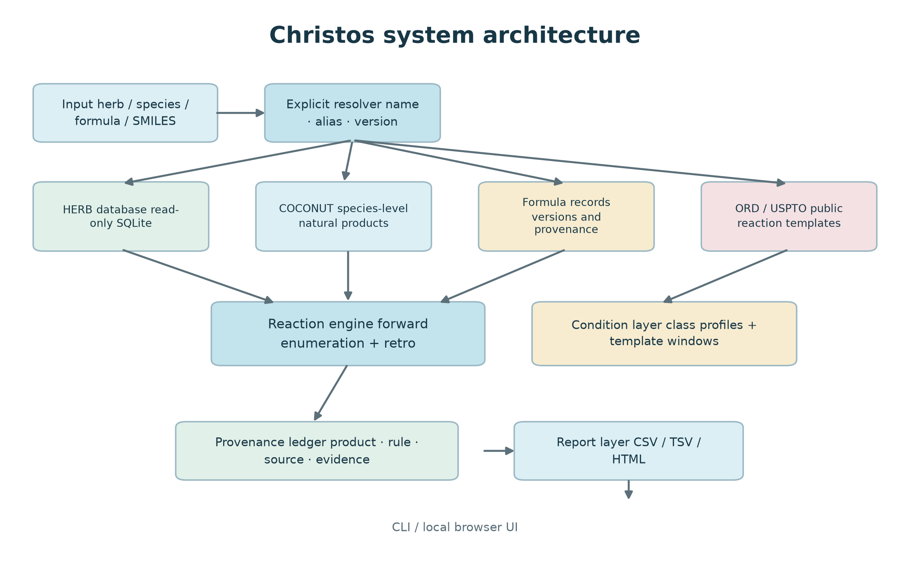
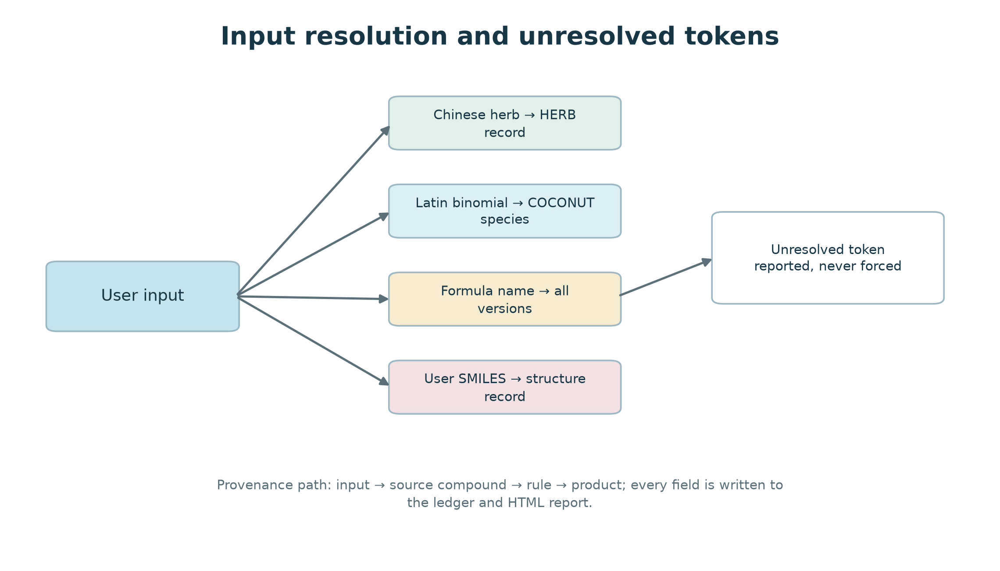
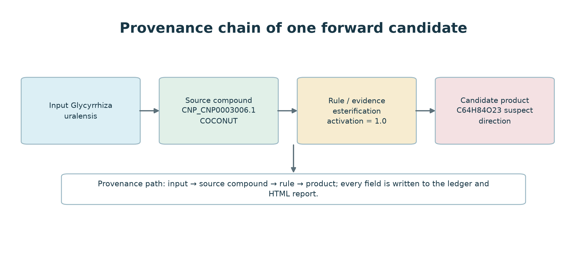
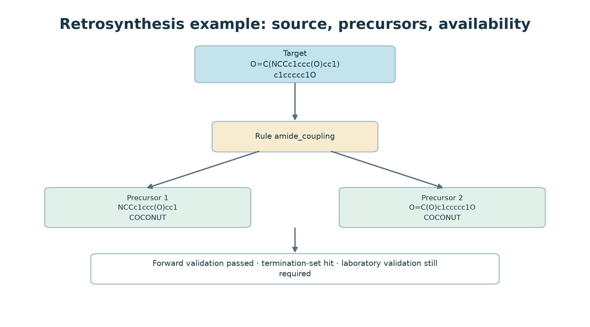
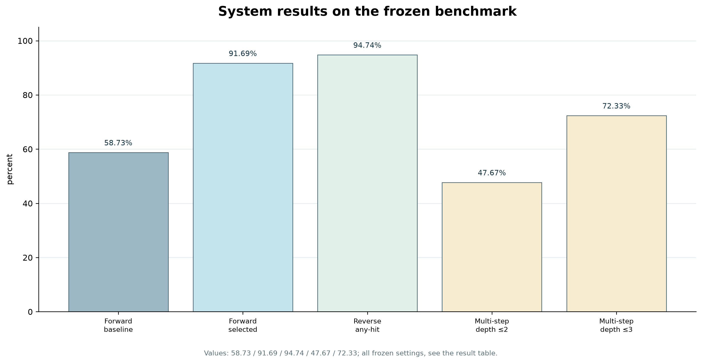

# Christos: a provenance-aware, read-only reaction prediction engine with explicit input resolution for herbal and natural-product data

**Article type:** Software/Research Article  
**Authors:** Dong Xinchang  
**Affiliations:** Beijing University of Chinese Medicine, School of Chinese Materia Medica, Beijing, China  
**Corresponding author:** Dong Xinchang (vegfish@qq.com)

---

## Abstract

**Motivation.** Reaction prediction tools are now applied to natural products and traditional Chinese medicine (TCM), but most report a product without saying which record produced it, which template fired, or what evidence supported the match. For TCM the problem is sharper. A herb name, a plant species, a processed medicinal form, and a formula version each point to a different set of starting compounds, and a system that treats them as one identifier will return a confident answer to a question the user did not ask.

**Results.** We present a method for auditing provenance-aware reaction-prediction systems and apply it to build one, Christos, which runs entirely on the local machine. It reads heterogeneous chemical data without modifying it, enumerates forward reactions from reaction templates, searches retrosynthesis from the same templates, attaches a condition marker and a field-complete provenance record to each candidate. Field completeness does not imply that condition evidence exists. Every run is written as a reproducible report. Inputs can be a herb name, a Latin species, a COCONUT species, a formula name, or a set of SMILES. When several formulas share a name, all versions are kept and the selected one is reported. The underlying databases are opened read-only. Every run produces a CSV/TSV ledger and a single-file HTML report, available from the command line and from a local browser interface.

On a leak-controlled USPTO-50k benchmark, the selected forward configuration reaches 82.32% single-step recall on 50,016 reactions (41,173 hits; Wilson 95% CI 81.98–82.65%), against 55.43% for the baseline configuration. That figure comes at a per-pair cap of 32 with 21.2 candidates per reaction on average, so it is a lower bound on uncapped recall; weighting every reaction class equally gives 75.22%. No external system was run on this benchmark, and the paper makes no claim of state-of-the-art performance. Reverse-direction template search reaches 94.74% any-hit coverage on a 5,002-target subset with the 79,184-template library, and 79.81% on the full 50,016 targets with the 3,065-template leak-controlled library; these two figures are not directly comparable because both the target set and the library change. Multi-step planning finds a route for 47.67% of targets at depth ≤ 2 and 72.33% at depth ≤ 3 on 300 ORD targets; unlike the reverse figures, these have not been target-level filtered. The TCM data layer indexes 31,646 herb compound records (25,486 distinct SMILES), 269,105 COCONUT compounds, 12,071 formula records, and 1,526 pharmacopoeia formula entries. All 3,228 production templates in the provenance chain map back to ORD reaction identifiers. A 500-template condition audit found at least one product match for 493 templates and at least one measured condition class for 491. A field-level audit of a 573-entry herbal run found all nine provenance field groups present in every entry, but substantive condition rationale in only 1.2% of them. Five conversions documented in the TCM literature, covering glycoside and ester hydrolysis, were all reachable in the first round.

Prediction performance is measured on USPTO-50k and ORD only. The herbal component is evaluated as an input-resolution and provenance layer, not as a reaction-prediction benchmark: no TCM reaction ground truth is available, and the 573-entry Glycyrrhiza ledger has not been checked against experiment or literature.

**Availability.** Christos runs on Python 3.12 with RDKit, rdchiral, SmartReact and SQLite. DuckDB appears only in the offline analysis scripts that produced the benchmark tables, not in the runtime. The public distribution separates a read-only research application from a precomputed demonstration package. The demo disables arbitrary-target retrosynthesis and free-form reagent input. Code, data cards, protocol, and reference verification snapshots accompany the manuscript.

**Keywords:** reaction prediction; retrosynthesis; natural products; traditional Chinese medicine; provenance; reproducibility; reaction templates

---

## Introduction

Template-based reaction prediction works when neither experimental nor quantum-chemical data are available for the transformation at hand. RDKit provides a widely used cheminformatics toolkit (RDKit, 2024). RDChiral extracts and applies reaction templates while preserving stereochemistry (Coley et al., 2019). Systems such as AiZynthFinder and Retro* combine template libraries with search and ranking (Genheden et al., 2020; Chen et al., 2020). Benchmark resources such as USPTO-50k (Schneider et al., 2016) and PaRoutes (Genheden & Bjerrum, 2022) make methods comparable, and the Open Reaction Database (ORD) supplies reaction records with experimental context (Kearnes et al., 2021).

These tools are usually evaluated as prediction engines. A separate engineering question is whether a system can preserve the history of a result: the input record, the template that fired, the source database, the conditions measured, and whether the result is a measured precedent or an untested extension of a rule. The question gets concrete once one program has to serve molecular chemistry, natural-product chemistry, and TCM.

Two studies set the scale for that question. Maziarz et al. (2025) re-evaluated retrosynthesis algorithms inside a common framework and found that reported performance shifts with the evaluation setup. Torren-Peraire et al. (2024) found that the choice of single-step model dominates downstream planning quality. A single-step recall figure therefore means little without the configuration and library behind it, which is why the sections that follow report both.

TCM adds its own resolution problems. A Chinese herb name can denote a pharmacopoeia entry, a processed medicinal form, a regional alias, or a plant species. A formula name can cover several historical versions with different compositions. A compound can come from a herb-specific table or from a species-level collection such as COCONUT (Sorokina et al., 2021). Treating these identifiers as interchangeable produces chemically precise-looking output from an ambiguous input.

The system described here was built by auditing each layer of the TCM data pipeline before trusting the layer above it. That audit produced four findings, and each one changed the design: a curated rule library of 64 entries of which the loader used six, a condition gate that admitted reduction reactions under an air atmosphere, a provenance record that was complete in structure but carried substantive condition evidence in 1.2% of entries, and an identifier column that mixed botanical names with pharmacopoeial drug names. Section 5 reports each of these with its measurement.

Christos was therefore built around four requirements:

1. **Resolve inputs explicitly.** Each input type is a separate resolution path. Every run reports which path it took and which tokens it could not resolve.
2. **Keep data read-only.** SQLite databases are opened through read-only connections (`mode=ro`). Formula JSON files are read into memory and no code path writes them back. A run writes reports and ledgers; it never modifies the source data.
3. **Attach provenance to every candidate.** Each product path records the source compound, template, rule name, condition marker, round, and any uncertainty flag. The marker records what the condition layer found, including the case where it found nothing. Uncertain candidates stay in the ledger with a flag.
4. **Make the public boundary explicit.** The public demonstration layer is narrower than the research engine. It disables arbitrary-target retrosynthesis and free-form reagent input, and it ships without a database.

We report the system, its data model, the reaction and condition layers, and the benchmark. Nothing here establishes clinical efficacy or supplies a synthesis protocol. Template prediction and TCM source data each carry limitations, listed in the final section.

## Materials and Methods

### System overview

Christos is organized as a set of composable layers rather than a single monolithic model:

| Layer | Function | Main implementation |
|---|---|---|
| Input resolution | Chinese herb, Latin species, COCONUT species, formula, or SMILES | `sources/herb.py`, `sources/coconut.py`, `sources/formula.py` |
| Reaction enumeration | Forward template application and cascade expansion | `core/smartreact_engine.py`, SmartReact (MolecularAI, version 2.0.1) |
| Retrosynthesis | Template inversion and bounded route search | `tools/retro_search.py` |
| Condition layer | Reaction-class profiles and per-template condition windows | `conditions/`, `data/mined_top_template_conditions*.json` |
| Provenance and reporting | Ledger, index, HTML report, source tags | `core/query_base.py`, `tools/make_report.py` |
| Interfaces | CLI and local browser UI | `integration/tcmai_bridge/` |

The chemical engine is separate from the source-data adapters, so the same engine runs on herb records, species records, or a user-supplied molecule set. The output still shows which kind of input it came from.

*Figure 1. Overview of Christos. Inputs are resolved before any chemistry is run; source adapters remain read-only; the reaction engine writes candidates to a provenance ledger, which is rendered as CSV/TSV and a single-file HTML report.*

### Data sources and read-only policy

The current local deployment uses the following resources:

| Resource | Role | Scale | Handling |
|---|---|---:|---|
| Herb database (`tcm.db`) | Herb names, compounds, aliases, evidence | 31,646 compound records (25,486 distinct SMILES) | read-only SQLite |
| COCONUT snapshot | Species-level natural products | 269,105 valid molecules | read-only SQLite |
| Formula records | Multi-herb prescriptions and versions | 12,071 records | read-only JSON |
| Pharmacopoeia overlay | 2025 formula entries and source URLs | 1,526 entries | internal overlay, not redistributed |
| USPTO-50k | Leak-controlled benchmark | 50,016 reactions | public benchmark |
| ORD-derived templates | Reaction template source and provenance | 3,228 production templates | derived data, attributed |

The public build does not redistribute upstream raw databases. ORD-derived templates are treated as CC BY-SA 4.0, USPTO-50k is CC0 (figshare 5104873), the COCONUT curated dataset is CC0 with MIT infrastructure code, and the SmartReact template package is Apache-2.0. Local herb and formula resources stay under the owner's authorization and are not in the public archive.

Every SQLite connection uses `mode=ro`. If a WAL-backed database cannot be opened read-only because the shared-memory file is missing, the adapter falls back to `immutable=1`, which reads a snapshot without creating sidecar files. The fallback exists because an ordinary `sqlite3.connect()` creates `-wal` and `-shm` files even when the caller only reads.

The public demo ships a fixed excerpt instead of the databases: 100 common herbs with one Latin species each, 50 formulas, and 150 precomputed examples. Formulas are limited to 4–6 ingredients and filtered before packaging. The demo exposes neither arbitrary SMILES nor routes.

### Input resolution

Inputs come in five kinds: a herb name, a Latin species, a COCONUT species, a formula name, or a set of SMILES. Herb names run through the cascade below, which stops at the first stage that returns anything:

1. exact match on a herb or processed-herb name in the herb database;
2. processed-form gate: a pharmacopoeial processed form that the database does not hold returns an explicit "not in library" instead of being decomposed into its source herb or passed to alias matching;
3. alias lookup against a synonym dictionary and the herb alias column; every candidate is returned and the system does not choose between them;
4. curated synonym table, which resolves to a single canonical name;
5. substring match on Chinese names, capped at 40 hits and ordered by name length;
6. substring match on Latin, English or alias strings;
7. fuzzy match at a similarity ratio of at least 0.85, which returns at most one candidate.

Pinyin was removed as a resolution path after it produced false hits: `gancao` matched 秤杆草 (`chenggancao`).

The resolver returns selected records and unresolved tokens together. Formula names keep the full version list and select a documented source tier by default. Merging same-named versions would produce a composition that no historical or pharmacopoeial record contains.

*Figure 2. Resolution paths for herb names, Latin species, formula names and SMILES. Unmatched tokens are reported verbatim rather than forced into a record.*

### Forward reaction enumeration

The forward engine applies a library of reaction templates to a substrate set. Templates are grouped by reaction name and filtered by reactant category. A run can be bounded by the number of compounds per herb, the number of reaction rounds, the maximum number of substrate pairs, and a per-pair candidate cap.

The selected configuration uses a support-filtered template pool, a per-pair cap of 32, and a substrate-compatibility prefilter. A small cap can hide a correct candidate while the template that would produce it is present, so run metadata records pair coverage and truncation state. A capped run is not treated as a complete enumeration.

*Figure 3. A forward candidate and the fields retained in the provenance ledger: input species, source compound, rule, condition-evidence marker and candidate product.*

### Retrosynthesis

The retrosynthesis module inverts the forward templates and applies them recursively to a target molecule. The search returns disconnections, precursor sets, and route-level annotations. Precursors are checked against the termination set and marked available or unavailable. An unmatched precursor is recorded as absent from that set, not as impossible.

The public build blocks arbitrary-target retrosynthesis by default. The research CLI requires an explicit research-mode environment variable. The block protects feature scope; it is not a claim about safety.

*Figure 4. A one-step retrosynthetic route with two precursors hit in the current termination set and a passing forward validation. This is an annotation, not a laboratory instruction.*

### Condition evidence

Condition evidence is represented at two levels:

- reaction-class profiles for named reactions, with solvent, pH, temperature, catalyst, and atmosphere windows;
- per-template windows mined from ORD records, where a template is matched to a reaction record before its conditions are collected.

In the per-template layer, a top-N set of templates is evaluated against an evenly spaced ORD sample. A record contributes a condition only when the template generates a product matching the recorded product. The current 500-template audit found at least one product match for 493 templates and at least one condition category for 491. These windows annotate; they do not simulate kinetics, yield, or selectivity.

### Provenance and reporting

Every candidate path in a ledger contains the product structure, source compound, source herb or species, reaction rule, round, condition activation marker, direction marker, and evidence string. The report generator converts the ledger into a single-file HTML page with the same information and optional structure drawings.

The system shows a direction flag or condition marker as an annotation and keeps the candidate in the ledger. The label "no evidence" means no matching condition record was found. It does not mean the reaction cannot occur.

### Evaluation design

**Forward prediction.** The engine is run for one round on the recorded reactants of each USPTO-50k entry. A hit means the recorded product appears anywhere in the candidate set; no ranking is used. The evaluation set is the full 50,016 reactions, processed with seed 20261014 and six workers.

The leak-controlled template library is built by mining templates from the full ORD shards and then discarding any ORD record whose product, after atom-map removal and canonicalisation, matches a product in the USPTO-50k evaluation set. Exclusion happens at the product level rather than the reaction level, so a record is dropped whenever its product coincides with a test entry even if the reactants differ. This is the stricter of the two options. Both reverse-direction libraries used in the results are filtered the same way. They differ in size because they were mined from different template sources: 79,184 templates for the 5,002-target subset and 3,065 for the full 50,016 targets.

The filter is not what drives the headline number. Running the identical selected configuration against the unfiltered library gives 82.56%, against 82.32% for the filtered library. The gap is 0.24 percentage points, which bounds how much the result could depend on template-test overlap.

The baseline configuration kept the engine default of 8 products per substrate pair, used no extra template pool, and left the compatibility prefilter off. The selected configuration raised the cap to 32, added a pool capped at 20,000 templates mined with support at least 10, and turned the prefilter on.

The candidate distributions support this reconstruction. The baseline median is 8 and the selected configuration's 90th percentile is 32, each sitting at its own cap. The benchmark scripts take their settings from environment variables and the result files record only the aggregate, so the values above are rebuilt from engine defaults and the changelog rather than read back from a run manifest. The compatibility prefilter stays enabled in the selected pipeline, although the ablation below shows it adds nothing measurable on the test sample. Candidate counts are reported next to recall because a larger cap raises recall partly by producing more candidates, and a recall figure without that context is misleading.

Christos does not rank candidates, so recall at any position is the only metric that matches the output format. Precision at k would require a ranking the system deliberately does not produce. The intended use is that a reader inspects candidates against their provenance, not that the first row is the answer.

**Retrosynthesis coverage.** A target is a hit if at least one disconnection produces a precursor set equal to the recorded reactant set after atom-map removal. The 5,002 and 300 target sets are drawn from ORD rather than USPTO-50k: products with molecular weight at most 500, a single component and no salt form, taken from an offset of 200,000 rows in the ORD parquet and deduplicated. Two configurations are reported. The first uses a 5,002-target subset with the 79,184-template library. The second uses all 50,016 targets with the 3,065-template leak-controlled library. These are different experiments: the target sets differ in size and the template libraries differ in breadth, so the two coverage figures are not comparable with each other.

Multi-step route-found rate is measured on 300 targets with a beam search of width 4 and at most 400 disconnections per expansion. A target counts as route-found when the search returns at least one route, whether or not that route passes the usability check. A route counts as usable when every step passes the step-usability check in retro_search.step_usability; a target counts as usable when at least one of its routes does. Route-found is therefore the looser of the two counts.

**TCM resolution and provenance.** We exercise herb, species, formula, and SMILES inputs through the same interface and record the resolved source, version, unresolved tokens, and output links. The demo examples are generated from the same engine but are packaged as fixed precomputed samples so that no database is redistributed.

### Experiment configuration

| Experiment | Target set | Template library | Product-level filter | Comparable with |
|---|---|---|---|---|
| Forward, baseline | 50,016 USPTO-50k | engine default | yes, on USPTO-50k | forward selected |
| Forward, selected | 50,016 USPTO-50k | ~20,000 support-filtered | yes, on USPTO-50k | forward baseline |
| Reverse, subset | 5,002 ORD | 79,184 | yes, plus target overlap check | nothing else |
| Reverse, full | 50,016 USPTO-50k | 3,065 | yes | nothing else |
| Multi-step | 300 ORD | selected | no target overlap check | nothing else |
| Condition audit | 500 templates | production | not applicable | nothing else |
| Herb resolution | 75 fixed inputs | not applicable | not applicable | nothing else |

The forward experiments share a target set and differ only in configuration, so their comparison is meaningful. The two reverse experiments differ in both target set and library and are reported side by side only for completeness. The multi-step run inherits the selected library but has not been checked for target-level overlap.
## Results

### Implemented data scale

The current local deployment covers:

- 31,646 herb compound records, of which 25,486 carry a distinct SMILES;
- 269,105 COCONUT compounds;
- 12,071 formula records;
- 1,526 pharmacopoeia formula entries;
- 3,228 production templates with ORD reaction identifiers;
- 100 herbs and 50 formulas in the public demonstration catalog.

The herb table has not been globally deduplicated. A compound that belongs to several herbs appears once per herb, so 31,646 records correspond to 25,486 distinct SMILES, a 19.5% duplication rate. InChIKey coverage is 30,964 records with 29,013 distinct keys. The two figures are computed over different record sets: every record carries a SMILES, but only 30,964 carry an InChIKey, so the distinct-key count is not directly comparable with the distinct-SMILES count. These numbers describe the data layer as built. A missing compound or formula means the current source did not contain it.

### Forward prediction

On the leak-controlled USPTO-50k benchmark, the baseline configuration reaches 55.43% single-step recall over 50,016 reactions (Wilson 95% CI 54.99–55.87%). It returns 8.8 candidates per reaction on average (median 8, 90th percentile 15), and 1.01% of reactions return nothing at all. The selected configuration reaches **82.32%** (41,173/50,016, Wilson 95% CI **81.98–82.65%**) while returning 21.2 candidates per reaction. One full run took 2,820 seconds on six workers.

The extra candidates are part of the explanation, so recall and candidate count have to be read together. Moving from the baseline to the selected configuration raises both.

Truncation is substantial in both runs. At the baseline cap of 8 the median candidate count is exactly 8, so at least half of the reactions hit the cap. At the selected cap of 32 the 90th percentile is exactly 32, so at least a tenth do. A recall figure measured on a capped run is therefore a lower bound on the uncapped value, and the true figure is unknown from these runs.

Ablation on a fixed 500-reaction stratified sample isolates the components:

| Configuration | Recall | Mean candidates |
|---|---:|---:|
| Engine default | 41.60% | 8.4 |
| + per-pair cap 32 | 64.60% | 10.1 |
| + 20k support-filtered template pool | 75.80% | 19.4 |
| cap 64 instead of 32 | 75.80% | 19.6 |
| + substrate-compatibility prefilter | 75.80% | 19.4 |

Raising the cap from 32 to 64 leaves recall unchanged and moves the mean candidate count by 0.2 on this sample, and the compatibility prefilter adds nothing measurable to the cap-plus-pool baseline. The gain tracks the cap increase and the larger template pool. The template library itself is not uniformly correct, and run metadata records every setting so the numbers can be reproduced and compared.

The sample and the full set answer different weighting questions, and the gap between them is expected rather than contradictory. The 500-reaction sample gives every reaction class an equal quota. The full benchmark is dominated by classes 1 and 2, which make up 45% of all reactions and score highest. Equal weighting therefore moves the baseline from 55.43% on the full set to 43.96%, and the selected configuration from 82.32% to 75.22%. The sample figures of 41.60% and 75.80% sit next to those equal-weight values. Their Wilson intervals are 37.36–45.97% and 71.86–79.35%, so both equal-weight values fall inside the intervals. The remaining gaps are consistent with sampling noise at n = 500; the intervals do not support a claim of systematic bias. The ablation compares configurations under one weighting; the headline numbers use the other.

### Where the gain comes from

Recall is uneven across reaction classes. The default configuration is weakest on classes 4 to 7 and strongest on classes 1 and 2. The selected configuration moves the weak classes furthest.

| Class | n | Baseline | Selected |
|---|---:|---:|---:|
| 1 | 15,151 | 70.9% | 86.9% |
| 2 | 11,896 | 84.2% | 92.6% |
| 3 | 5,662 | 65.5% | 76.0% |
| 4 | 909 | 16.3% | 52.5% |
| 5 | 672 | 19.6% | 64.7% |
| 6 | 8,237 | 16.9% | 73.2% |
| 7 | 4,614 | 9.5% | 79.2% |
| 8 | 811 | 64.9% | 81.8% |
| 9 | 1,834 | 25.7% | 68.4% |
| 10 | 230 | 66.1% | 77.0% |

Classes are the ten reaction-type labels shipped with USPTO-50k. Class 7 rises by 69.7 percentage points, class 6 by 56.3 and class 5 by 45.1, while class 2 gains 8.4 and class 1 gains 16.0. The pattern points to the default library failing to represent a large share of the weak classes, with the larger pool supplying templates for them. It does not establish that those templates are chemically correct.

### Retrosynthesis and multi-step planning

The exclusion runs before template counting: each ORD record is tested against the USPTO-50k product set, and a matching record never reaches the counter. Templates are built only from records that pass the test; none are removed afterwards.

The 5,002 reverse targets were checked against the template-mining source. 252 of them (5.04%) have a product that also appears in that source. Their any-hit rate is 94.84% (239/252); the remaining 4,750, which have no overlap, reach 94.74% (4,500/4,750). Removing the overlapping targets leaves the coverage unchanged to two decimal places.

The reverse search reports two coverage figures that should be read separately. On the 5,002-target subset with the 79,184-template library, any-hit coverage is **94.74%** (4,739/5,002, Wilson 95% CI 94.09–95.33%). On the full 50,016 targets with the 3,065-template leak-controlled library it is **79.81%**. The gap reflects both a smaller template library and a different, larger target set; the two cannot be separated with the data reported here.

The 300 multi-step targets did not receive the same overlap check. Their route-found figures are reported as measured and should be read as not target-level filtered.

With beam width 4 and the selected template library, the route-found rate on the fixed 300-target set is **47.67%** at depth ≤ 2 (143/300, Wilson 95% CI 42.08–53.31%) and **72.33%** at depth ≤ 3 (217/300, CI 67.01–77.09%). At depth ≤ 3, 207 targets have at least one usable route, a usable-target rate of 207/300 = 69.0% and a usable-given-route-found rate of 207/217 = 95.4%. At depth ≤ 2 the usable count was not recorded separately.

Each precursor carries its route-level source and availability status. A "usable" annotation is not an instruction to perform the synthesis.

*Figure 5. Frozen benchmark measurements. The panel collects results from different tasks and the bars do not share a scale: forward single-step recall (baseline 55.43%, selected 82.32%), reverse any-hit coverage (94.74%), multi-step route-found rate at depth ≤ 2 and ≤ 3 (47.67%, 72.33%), and the share of the 500 audited templates with at least one product match (493/500). The audit bar reports product matching only. The separate count of audited templates with at least one condition class is 491 and is not drawn.*

### Condition and provenance coverage

Three template counts appear in this paper and they measure different things. The 3,228 production templates are the runtime library that ships with the engine. The roughly 20,000-template pool is the larger support-filtered set used by the selected benchmark configuration and is not the default runtime library. The 9,177 records are ORD reaction entries referenced by the provenance table, not templates. The 500-template condition audit samples from the production library.

All 3,228 production templates link to ORD reaction identifiers, and the reaction-level back-reference covers 9,177/9,177 records in the current provenance table. The 500-template condition audit produced 493 templates with at least one matching product and 491 with at least one condition category. The two figures use different criteria: 493 counts templates that matched a product at least once, 491 counts templates that additionally yielded at least one condition class. Two templates matched a product without yielding a condition class. The audit ships as a data product and leaves the default runtime library unchanged.

### Known conversions

Five conversions documented in the TCM literature were used as a qualitative reachability check. Each substrate was run alone under the decoction condition profile for up to three rounds, and the ledger was searched for the documented product.

| Conversion | Rule | Round | Candidates | Time |
|---|---|---:|---:|---:|
| Glycyrrhizic acid to glycyrrhetinic acid | hydrolysis_glycoside_001 | 1 | 5,510 | 56 s |
| Ginsenoside Rb1 to Rg3 | hydrolysis_glycoside_001 | 1 | 11,658 | 193 s |
| Aconitine to benzoylaconine | hydrolysis_ester_001 | 1 | 642 | 6 s |
| Benzoylaconine to aconine | hydrolysis_ester_001 | 1 | 814 | 7 s |
| Rutin to quercetin | hydrolysis_glycoside_001 | 1 | 5,685 | 96 s |

All five products appear in the first round, each produced by the chemically expected rule: glycoside hydrolysis for the glycosides, ester hydrolysis for the two diterpenoid alkaloids. The pipeline can therefore reach documented decoction chemistry. It does not follow that it surfaces the right product, because the system does not rank at all.

The two aconitine steps are documented in the Aconitum processing literature (PubMed 27761113 and 18306748). References for the remaining three conversions are still to be added; they come from the same decoction-chemistry literature but have not yet been matched to specific papers in this draft.

The candidate counts are the practical limitation. To find the documented product a researcher has to inspect between 642 and 11,658 entries. A filter layer — mass balance, condition window, or literature priors — is the obvious next step and lies outside this paper.
### Herb resolution audit

The cascade was run against 75 inputs: twenty exact Chinese names, ten aliases, ten processed forms, twenty-five binomials taken from the herb table and ten strings that should not resolve.

| Input group | n | Resolved | Unresolved | Ambiguous |
|---|---:|---:|---:|---:|
| Exact Chinese name | 20 | 20 | 0 | 1 |
| Alias | 10 | 9 | 1 | 1 |
| Processed form | 10 | 3 | 7 | 0 |
| Latin binomial (table-sourced) | 25 | 25 | 0 | 0 |
| Non-herb string | 10 | 1 | 9 | 1 |

Ambiguous counts entries that returned more than one candidate; it is a subset of resolved, not a separate outcome. In the non-herb row the single resolved entry is a false return, not a correct resolution.

Exact Chinese names resolved in all 20 cases. Aliases resolved in 9 of 10: 寸冬 returned nothing. Processed forms resolved in three of ten. The other seven, including 炒白术 and 姜半夏, are not in the library and return the processed-form gate's explicit not-in-library result instead of being decomposed.

The Latin path splits two ways. Twenty-five binomials taken directly from the herb table resolved back to their own herb in all 25 cases; those entries store botanical binomials. The common Chinese herbs store the pharmacopoeial drug name instead. 甘草 holds Radix et Rhizoma Glycyrrhizae, not Glycyrrhiza uralensis. A user who types the botanical binomial for a common herb therefore fails or lands on a different entry: Glycyrrhiza uralensis resolved to 甘草节 (Gancaojie, a node of the licorice root) rather than to 甘草 (Gancao, the root). The current code does not correct this, and the stored field would have to be split into a drug name and a botanical name to fix it.

Two further results from the same audit. 生地黄 resolved to 鲜地黄 and 干地黄 rather than to a single herb, because the table has no entry under that name. 寸冬, a name for 麦冬, returned nothing.

Of the ten strings that should not resolve, nine returned nothing. The single character 甘 (gan) returned 40 candidates, the substring cap, because it matches many herb names. That one is a false return, not a resolution.

The 25 table-sourced binomials are the easy case. A user typing the botanical name of a common herb is represented by a single case here, Glycyrrhiza uralensis, and it failed. The current build does not support botanical-name lookup for common Chinese herbs.

The audit script is in the repository (tools/audit_herb_resolution.py) and the case list can be extended.

### TCM case study

A Glycyrrhiza run over 12 constituents produced 573 candidate products and 573 provenance paths in the current build. Each path carries its source compound, reaction rule, round, direction marker and condition marker. The example illustrates the reporting model; it is not a pharmacological conclusion.

A field-level audit of the same ledger separates structural completeness from substantive content. All nine field groups are present in 100% of the 573 entries. Condition rationale is substantive in 7 entries (1.2%, Wilson 95% CI 0.59–2.50%); the other 566 carry the string "no ORD condition data, admitted", which means the condition layer found no matching record and let the candidate through unannotated. Every field is filled. What sits behind the condition field usually is not.

The audit is a script in the repository (`tools/audit_provenance_completeness.py`) that reruns on any ledger, so the provenance claim can be checked instead of taken on trust.

Formula resolution keeps all same-named versions and reports the selected source tier along with unresolved tokens. When a run touches several versions of one formula, the output lists the selected version and the alternatives.

### Public demonstration and safety boundary

The public demo has 100 common herbs with one Latin species each, 50 formulas, and 150 precomputed entries. Its page offers no arbitrary SMILES field, no route search, no free-form reagent input, and no purchasable-block or vendor link. The application reads the source database without writing to it and writes only its own report and runtime directories.

A program that enumerates reaction products needs such a boundary. The research interface stays available for controlled experiments; the public interface presents a narrower set of features.

### Two-stage filtering

The 3,210 candidates from the Sijunzi run were reduced in two steps. First, only rules from the TCM rulebook were kept, which removed the general organic-synthesis templates mined from ORD; 3,210 fell to 1,114. Second, each product's InChIKey was checked against the 31,646 compounds in the herb database. Six products were already known herbal constituents and 1,108 were not.

The six known products arise from four ester-hydrolysis and two glycoside-hydrolysis events. The overall compression is 99.8%. A reader is left with six compounds that have a literature identity, rather than 3,210 structures to inspect by hand.

The filter is not a ranking and carries no confidence score. It applies two explicit criteria — rule provenance and membership in the compound table — and a product either passes both or does not. The 1,108 products outside the table remain available under a separate flag; they are candidates for novel constituents, not errors.
### Runtime calibration

Two budgets govern a run: the per-herb component limit and the per-pair cap on substrate pairs. Both were measured on Glycyrrhiza rather than chosen by feel.

| Component limit | Substrates | Pairs | Products | Time |
|---|---:|---:|---:|---:|
| 24 | 24 | 276 | 3,666 | 18.5 s |
| 64 | 64 | 2,016 | 33,579 | 166 s |
| 128 | 128 | 8,128 | 97,670 | 429 s |
| 342 (all) | 342 | 58,311 | 359,141 (upper bound) | 33 min |

At 24 compounds a run covers every characteristic compound of Glycyrrhiza under the specificity ordering. Going to 128 adds products but no new characteristic entries. The full set needs slicing: run as 30 slices of 2,000 pairs each, it completes in 33 minutes and yields 359,141 products where each slice is deduplicated internally and duplicates across slices are not removed, so the figure is an upper bound.

| Pair budget | Effective pairs | Products | Time |
|---|---:|---:|---:|
| 500 | 500 | 9,914 | 50 s |
| 1,000 | 1,000 | 17,826 | 77 s |
| 2,000 | 2,000 | 27,076 | 109 s |
| 4,000 | 4,000 | 54,103 | 259 s |
| 8,000 | 8,000 | 120,487 | 573 s |

Products and time both grow with the pair count. The pair budget trades waiting time for coverage and is not a quality threshold.
### What did not help

Four optimizations were attempted against the 33-minute full run. None changed the result.

Caching single-substrate template results across batches changed nothing. The 72 seconds spent on 1,000 pairs is dominated by 11,000 calls to RDKit's `RunReactants`, about 6.5 ms each; the single-substrate path is a small share.

Enumerating pair indices directly, rather than materialising the full 58,311-tuple list before slicing, also changed nothing.

Streaming products to disk in 200-pair batches lowered peak memory from 1.8 GB to a flat profile, but ran 60% slower than 2,000-pair slices because per-batch setup dominates at that granularity.

Four-process parallelism works in principle: slices are independent, and the first four completed with product counts identical to the serial run. It fails on memory. Each worker holds about 1.7 GB of product objects, so four workers exhaust a 16 GB machine and two are killed without an error trace. The bottleneck is the per-product object footprint, not the template library: loading all 82,000 templates costs about 37 MB.

Breaking the ceiling would require changing what a product object carries, deferring provenance lookups until the row is written. That is an engine-level change and is left open.
## Discussion

Christos keeps the evidence for a prediction next to the prediction itself.

Input resolution is explicit. In TCM data a herb name, a processed form, a Latin binomial, and a formula version are different identifiers. The system records the path taken and the tokens it could not resolve, so a reader can tell whether a result came from the intended source.

Provenance travels with each candidate. A template identifier, a reaction record reference, a source compound, and a condition marker let someone audit the result after the run. With heterogeneous source data, that is more useful than a ranked list on its own.

The public interface is narrower than the research engine. Searching arbitrary targets or exposing purchasable building blocks carries a different risk profile from displaying a fixed catalogue, so public availability is a product decision with explicit feature gates.

The gates are not a security boundary. The research path is enabled by an environment variable, and the source is public, so anyone willing to edit the code can re-enable it. What the gates prevent is accidental use: a person opening the public build does not find a field for a target molecule or a free-form reagent. They do not make the underlying search unavailable to someone who reads the repository. This distinction matters for how the system should be regulated and described, and the paper does not claim more than it.

On the frozen USPTO-50k protocol the selected configuration is materially stronger than the baseline. Neither result establishes chemical practicality, biological activity, or clinical utility. The engine still depends on its template library and input data, and the condition layer annotates evidence rather than simulating outcomes.

### Applications

Four uses follow directly from what the system now does.

Decoction product prediction. Given a herb combination, the pipeline returns the products that can form only after the herbs are combined and heated. On the Sijunzi combination this yields six literature-identifiable constituents from 3,210 raw candidates after filtering.

Processing-detoxification mechanism. The two-step hydrolysis of aconitine to benzoylaconine and then to aconine is reproduced in the first round. This is the central chemistry of Aconitum processing.

Quality-marker screening. Products that appear after decoction but are absent from the raw herbs are candidate markers for distinguishing decocted material from powdered herb.

Compatibility chemistry. A product whose two precursors come from different herbs is direct evidence that the combination, and not either herb alone, produced it.

### Outlook

Closing the annotation gap needs infrastructure: either predicted target profiles for natural-product scaffolds, or structure-to-MeSH and structure-to-RxNorm crosswalks so that a novel product can reach the existing toxicity and adverse-event tables. Neither crosswalk exists, and building one is data engineering.

Three further extensions are immediate. The TCM rulebook holds 64 rules; a systematic literature mining effort could take it to several hundred, which is the single largest lever on coverage. The filter currently uses rule provenance and compound identity; mass balance, condition windows and literature priors would tighten it further. And every prediction in this paper is unverified against experiment, which is the step that would turn a reachability check into an accuracy claim.
## Limitations

1. **Template dependence.** The forward and reverse results are bounded by the template library and by candidate truncation. A missing template can hide a correct path.
2. **No laboratory validation in this study.** Condition profiles come from reaction records and literature; they do not substitute for experimental validation.
3. **TCM source heterogeneity.** Herb names, processed forms, species assignments, formula versions, and source tiers can be ambiguous. The system reports unresolved tokens instead of forcing a match.
4. **Condition evidence is incomplete.** Many templates have no usable condition record. A missing condition marker means the current condition data does not contain one, not that the reaction is impossible.
5. **No universal safety guarantee.** The public build blocks high-risk interfaces, but no software filter replaces legal review, institutional controls, or responsible use.
6. **Data and licence boundaries.** Some local resources are owner-maintained and are not redistributed. The public demo uses only a small, sanitized excerpt.
7. **Provenance is traceable, not independently validated.** The template-to-ORD mapping shows where each template came from. Because the templates were mined from ORD in the first place, the back-reference confirms the chain rather than testing it against an outside source.
8. **The TCM layer cannot be recomputed from the public release.** The herb, formula and pharmacopoeia tables sit under third-party terms and are not distributed. The demo carries a fixed excerpt, so the TCM-scale figures reported here cannot be reproduced from the public package alone.
9. **Reaching a product is not surfacing it.** All five documented conversions were found, but each run returned between 642 and 11,658 candidates and the system does not rank them.
10. **Downstream risk annotation stops at known compounds.** A predicted product that is not already in a compound table has no identifier to join against toxicity or disease records. The TDC-derived ADMET cache (Huang et al., 2022) joins on InChIKey and covers 2.6% of a decoction run; CTD (Davis et al., 2026) joins on chemical names and covers effectively none, because novel structures have no name to match. On the same pair of formulas the ADMET cache separates a mild combination from an Aconitum one cleanly — 0 of 84 annotated products above the 90th percentile of acute toxicity versus 65 of 169 — but only for the minority of products that prior curation recognised.
11. **The Latin-name path depends on an overloaded field.** The herb table stores the pharmacopoeial drug name for common herbs, so botanical binomials typed by a user do not match. Seven of ten processed forms and one of ten aliases also failed to resolve in the audit.

## Conclusions

Christos exists to make reaction prediction auditable, and the audit found more than the design anticipated.

The pipeline reaches documented decoction chemistry. Five literature conversions covering glycoside and ester hydrolysis all appear in the first round, and two-stage filtering reduces a 3,210-candidate decoction run to six literature-identifiable constituents.

It also exposed four defects that a system-level claim would have concealed: 58 of 64 curated rules were never loaded, reduction rules passed an air-only condition gate, provenance fields were complete while substantive condition evidence was present in 1.2% of entries, and the Latin-name column held drug names rather than botanical names.

The benchmark numbers — 82.32% forward recall, and reverse coverage of 94.74% and 79.81% under two different configurations — describe the engine, not the herbal layer. The herbal layer is evaluated as input resolution and provenance, and its limitations are listed beside its results.

## Data and code availability

Code, protocol, result tables, figure sources, and runnable scripts are at https://github.com/VegFisx/Christos, archived at https://doi.org/10.5281/zenodo.23499423. Downstream annotation used the TDC ADMET Group (Huang et al., 2022), Tox21/ToxCast endpoints (Richard et al., 2016, 2021), CTD (Davis et al., 2026), and OnSIDES v3.1.1 (Tanaka et al., 2025); OnSIDES was retained for downstream evaluation and is not used for the headline results. The pharmacopoeia overlay was derived from the 2025 Chinese Pharmacopoeia through the third-party `Independent-KBs` structured source. That repository declares no repository-level license, so the overlay remains internal-only. Upstream raw data are not redistributed. The public demonstration package is a fixed precomputed sample and contains no production databases.

## References

All DOIs were resolved through Crossref on 2026-10-19 and 2026-10-29; software and dataset landing pages were checked against the official project, EPA, GitHub release, and repository commit pages. The API snapshots are stored in `reports/paper/reference_verification_20261019/` and `reports/paper/reference_verification_20261029/`.

1. Chen, B., Li, C., Dai, H., & Song, L. (2020). Retro*: Learning retrosynthetic planning with neural guided A* search. *Proceedings of the 37th International Conference on Machine Learning*, PMLR 119, 1608–1616. https://proceedings.mlr.press/v119/chen20c.html

2. Coley, C. W., Green, W. H., & Jensen, K. F. (2019). RDChiral: An RDKit wrapper for handling stereochemistry in retrosynthetic template extraction and application. *Journal of Chemical Information and Modeling*, 59(6), 2529–2537. https://doi.org/10.1021/acs.jcim.9b00286

3. Genheden, S., & Bjerrum, E. J. (2022). PaRoutes: Towards a framework for benchmarking retrosynthesis route predictions. *Digital Discovery*, 1(4), 527–539. https://doi.org/10.1039/D2DD00015F

4. Genheden, S., Thakkar, A., Chadimová, V., Reymond, J.-L., Engkvist, O., & Bjerrum, E. J. (2020). AiZynthFinder: A fast, robust and flexible open-source software for retrosynthetic planning. *Journal of Cheminformatics*, 12, 70. https://doi.org/10.1186/s13321-020-00472-1

5. Kearnes, S. M., Maser, M. R., Wleklinski, M., Kast, A., Doyle, A. G., Dreher, S. D., Hawkins, J. M., Jensen, K. F., & Coley, C. W. (2021). The Open Reaction Database. *Journal of the American Chemical Society*, 143(45), 18820–18826. https://doi.org/10.1021/jacs.1c09820

6. Maziarz, K., Tripp, A., Liu, G., Stanley, M., Xie, S., Gaiński, P., Seidl, P., & Segler, M. (2025). Re-evaluating retrosynthesis algorithms with Syntheseus. *Faraday Discussions*, 256, 568–586. https://doi.org/10.1039/D4FD00093E

7. RDKit: Open-source cheminformatics. (2024). https://www.rdkit.org

8. Schneider, N., Stiefl, N., & Landrum, G. A. (2016). What's What: The (nearly) definitive guide to reaction role assignment. *Journal of Chemical Information and Modeling*, 56(12), 2336–2346. https://doi.org/10.1021/acs.jcim.6b00564

9. Sorokina, M., Merseburger, P., Rajan, K., Yirik, M. A., & Steinbeck, C. (2021). COCONUT online: Collection of Open Natural Products database. *Journal of Cheminformatics*, 13, 2. https://doi.org/10.1186/s13321-020-00478-9

10. Torren-Peraire, P., Hassen, A. K., Genheden, S., Verhoeven, J., Clevert, D.-A., Preuss, M., & Tetko, I. V. (2024). Models Matter: The impact of single-step retrosynthesis on synthesis planning. *Digital Discovery*, 3(3), 558–572. https://doi.org/10.1039/D3DD00252G

11. MolecularAI. SmartReact (version 2.0.1) [Computer software]. https://github.com/MolecularAI/smartreact

12. Huang, K., Fu, T., Gao, W., Zhao, Y., Roohani, Y., Leskovec, J., Coley, C. W., Xiao, C., Sun, J., & Zitnik, M. (2022). Artificial intelligence foundation for therapeutic science. *Nature Chemical Biology*, 18(10), 1033–1036. https://doi.org/10.1038/s41589-022-01131-2

13. Richard, A. M., Huang, R., Waidyanatha, S., et al. (2021). The Tox21 10K compound library: Collaborative chemistry advancing toxicology. *Chemical Research in Toxicology*, 34(2), 189–216. https://doi.org/10.1021/acs.chemrestox.0c00264

14. Richard, A. M., Judson, R. S., Houck, K. A., et al. (2016). ToxCast chemical landscape: Paving the road to 21st century toxicology. *Chemical Research in Toxicology*, 29(8), 1225–1251. https://doi.org/10.1021/acs.chemrestox.6b00135

15. Davis, A. P., Wiegers, T. C., Sciaky, D., Barkalow, F., Wyatt, B., Wiegers, J., McMorran, R., Abrar, S., & Mattingly, C. J. (2026). Comparative Toxicogenomics Database: update 2027. *Nucleic Acids Research*, gkag1041. https://doi.org/10.1093/nar/gkag1041

16. Tanaka, Y., Chen, H. Y., Belloni, P., et al. (2025). OnSIDES database: Extracting adverse drug events from drug labels using natural language processing models. *Med*, 6(7), 100642. https://doi.org/10.1016/j.medj.2025.100642

17. Chinese Pharmacopoeia Commission. (2025). *Pharmacopoeia of the People's Republic of China* (2025 edition). Beijing: China Medical Science Press.

18. cliviali. (2026). *Independent-KBs: structured Chinese pharmacopoeia 2025 knowledge base* [Data set], commit 63cfd6a. https://github.com/cliviali/Independent-KBs (no repository-level license declared; internal use only).
