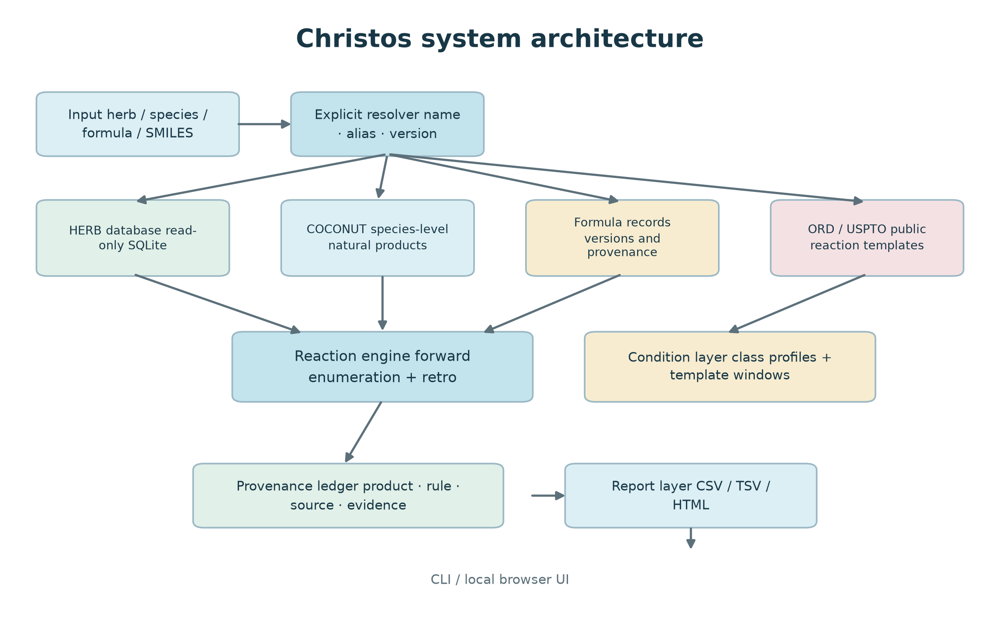
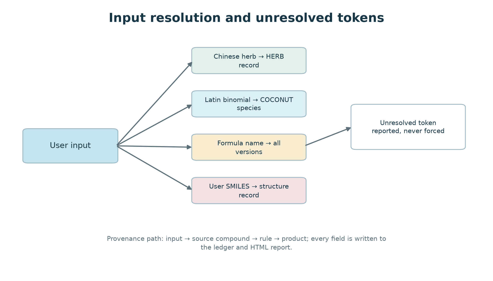
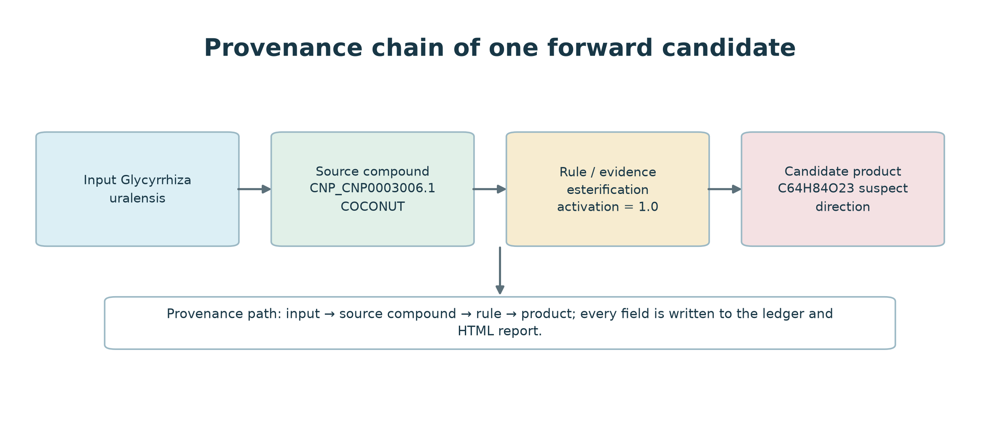
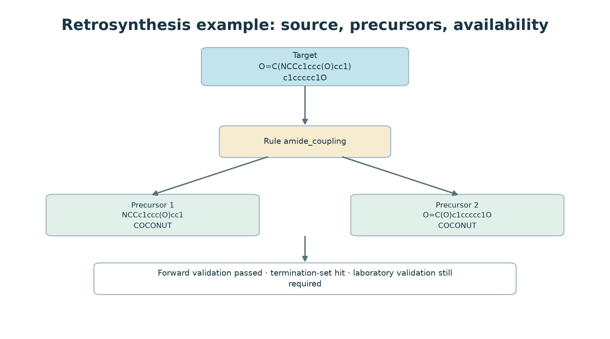
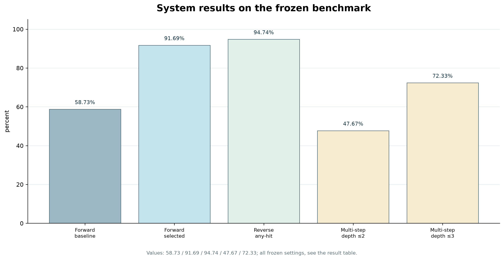

# Christos：一个具备来源感知输入解析与出处追踪的本地反应预测系统

文章类型：软件研究论文  
作者：Dong Xinchang  
单位：北京中医药大学中药学院，北京，中国  
通讯作者：[待填写]

---

## 摘要

背景：反应模板能给出候选产物，但生成结果所依据的原始记录、触发模板和条件证据经常没有随产物一起显示。放到中医药（TCM）数据里，这个问题会放大：同一个中文药名可能指向药典条目、炮制品、地区别名或植物物种，方名也可能对应组成不同的历史版本。

方法：Christos 是一个本地运行的反应预测系统，支持正向枚举、逆合成和逐条结果追踪。程序分别处理五类输入，数据库以只读方式打开，输出中保留模板、源成分、反应轮次、条件标记和不确定性标记。我们在 USPTO-50k 上评价正向召回，以 ORD 目标评价逆向覆盖，并测试多步路线恢复及中医药输入解析和出处字段。

结果：50,016 条 USPTO-50k 反应中，选定配置取得 91.69% 的单步候选集合召回（45,862 条命中；Wilson 95% CI 91.45% 至 91.93%），基线为 58.73%；在官方 5,001 条测试切分上，候选集合召回为 91.71%，top-1 为 43.28%。在 USPTO-MIT（479,035 条）上按确定性规则抽取 39,176 条，候选集合召回 71.18%，top-1 32.81%。逆向搜索在 5,002 个目标、79,184 条模板的组合下取得 94.74% 的 any-hit 覆盖率；在全部 50,016 个目标和 3,065 条泄漏受控模板下为 79.81%。300 个目标中，深度不超过 2 和 3 时的路线发现率分别为 47.67% 和 72.33%。本地数据层包含 31,646 个化合物、110,686 条药材-成分关联、269,105 个 COCONUT 化合物、6,743 条方剂记录和 1,526 条药典方剂条目。正向运行时模板库为 9,770 条精选模板加 41,619 条从 ORD 反应记录中挖掘的模板。与八篇论文的回溯性计算核对在五条选定水解案例中都复现了文献产物的连接层结构，五条都使用了预期水解规则和断裂键类型，并把引擎路径与文献路线对照；以 PubChem 立体结构为参照时，三例复现了精确立体异构体；乌头碱两例各有一个手性中心在一侧未指派，只能确认连接层一致。

结论：Christos 把输入记录、反应路径和候选产物放在同一条可检查的记录链上，“证据不足”也会被保留下来。基准数字反映反应引擎在指定测试设置下的表现，不能直接外推到化学可行性、生物活性或临床疗效。

关键词：反应预测；逆合成；天然产物；中医药；出处追踪；可复现性；反应模板

---

## 引言

实验数据或量化计算数据不足时，模板法常被用来先列出可能产物。RDKit 负责分子对象和基础化学操作（RDKit, 2024）；RDChiral 处理带立体化学的模板抽取和应用（Coley et al., 2019）；AiZynthFinder、Retro* 则把模板库接到搜索和排序过程上（Genheden et al., 2020; Chen et al., 2020）。USPTO-50k、PaRoutes 和 ORD 分别提供了常用测试集、路线基准和带实验背景的反应记录（Schneider et al., 2016; Genheden & Bjerrum, 2022; Kearnes et al., 2021）。

同一个模型换一套目标集或模板库，报告出来的召回率就可能不同。Maziarz et al.（2025）在统一框架中复评逆合成算法时观察到了这种差异；Torren-Peraire et al.（2024）则显示，单步模型的选择会传导向多步规划结果。读到召回率时，目标集、模板库、候选上限和过滤规则都需要一并核对。

天然产物场景还要求程序说明结果从何而来。底物来自哪条输入记录、哪个模板被调用、化合物由哪个本地来源提供、条件证据是实测记录还是一般规则，上述信息不能只靠最终产物回答。同一个界面既接收分子，也接收药材、物种和方剂；标识符层级一旦混用，就容易出现表面精确、实际错配的结果。

中医药数据里，这样的错配很常见。中文药名可能指药典条目、炮制品、地区别名或植物物种，方名也可能带着不同的历史组成。化合物既可能来自药材专库，也可能来自 COCONUT 一类物种级天然产物库（Sorokina et al., 2021）。

Christos 的实现从输入解析开始。每类输入有自己的查找路径；无法解析的词元原样返回；出现多个候选时，程序不会替用户挑一个“看起来最像”的。SQLite 只以只读方式连接。产物记录保留源成分、规则、轮次、条件标记和不确定性标记。公开演示使用固定目录，任意目标逆合成、自由试剂、可购砌块和供应商链接都不开放。

本文用公开反应基准检查引擎性能，再单独检查中医药输入解析和出处字段。两部分的评价对象不同。前者看候选能否覆盖已知产物，后者看系统有没有选对来源、并如实保留已知与未知。所有候选仍是待实验检验的化学假设。

## 材料与方法

### 系统组成

代码按职责分成六块，表 1 列出了各块的实际入口：

| 组件 | 功能 | 主要实现 |
|---|---|---|
| 输入解析 | 中药名、拉丁物种、COCONUT 物种、方剂或 SMILES | `sources/herb.py`、`sources/coconut.py`、`sources/formula.py` |
| 反应枚举 | 正向模板应用与级联扩展 | `core/smartreact_engine.py`、SmartReact（MolecularAI，2.0.1） |
| 逆合成 | 模板反转与有界路线搜索 | `tools/retro_search.py` |
| 条件层 | 反应类别档案与逐模板条件窗口 | `conditions/`、`data/mined_top_template_conditions*.json` |
| 出处与报告 | 台账、索引、HTML 报告和来源标签 | `core/query_base.py`、`tools/make_report.py` |
| 界面 | 命令行与本地浏览器界面 | `integration/tcmai_bridge/` |

来源适配器和反应引擎没有绑死。药材、物种、方剂或用户分子进入同一套反应代码后，输入侧的出处仍会随产物保留。运行环境为 Python 3.12，使用 RDKit、rdChiral、SmartReact 和 SQLite；DuckDB 只出现在离线基准脚本中。

*图 1. Christos 的输入与输出路径。化学模块开始运行前先解析输入；来源适配器不写入数据库；候选产物连同出处字段写入台账，再生成 CSV/TSV 和单文件 HTML。*

### 数据源与只读策略

本地版本实际加载了以下几类资源：

| 资源 | 用途 | 规模 | 处理方式 |
|---|---|---:|---|
| 药材数据库（`tcm.db`） | 药名、成分、别名与证据 | 31,646 条成分记录（25,486 个不同 SMILES） | 只读 SQLite |
| COCONUT 快照 | 物种级天然产物 | 269,105 个有效分子 | 只读 SQLite |
| 方剂记录 | 多味方剂与版本 | 6,743 条 | 只读 JSON |
| 药典 overlay | 2025 年版方剂条目与来源 URL | 1,526 条 | 内部使用，不再分发 |
| USPTO-50k | 泄漏受控基准 | 50,016 条反应 | 公开基准 |
| 正向模板 | 精选模板包 + 从 ORD 挖掘的模板 | 9,770 条精选 + 41,619 条挖掘 | 派生数据，署名 |
| 逆合成模板 | 聚类后的逆向模板 | 3,228 条（编译后 3,025） | 派生数据，署名 |

上游原始数据库不随本项目重新分发。ORD 派生模板按 CC BY-SA 4.0 处理；USPTO-50k 为 CC0（figshare 5104873）；COCONUT curated dataset 为 CC0，基础设施代码为 MIT；SmartReact 模板包为 Apache-2.0。本地药材和方剂资源还需库主授权，不会进入公开归档。

SQLite 连接统一加 `mode=ro`。如果 WAL 数据库因共享内存文件缺失而打不开只读连接，适配器会改用 `immutable=1` 读快照，边车文件不会新建。这个分支来自一次实际踩坑：普通 `sqlite3.connect()` 即使只打算读取，也可能顺手生成 `-wal` 和 `-shm`。

公开演示收录 100 味常用药材，每味对应一个拉丁物种，另含 50 个方剂和 150 条预计算示例。方剂控制在 4 至 6 味，并先经过安全过滤再打包。页面没有任意 SMILES 入口，也不接受路线查询。

### 输入解析

Christos 接收药材名、拉丁物种、COCONUT 物种、方名或一组 SMILES。药材名按以下顺序解析，直到某一层返回结果：

1. 在药材数据库中精确匹配药材名或炮制品名；
2. 炮制品闸：若药典收载的炮制品不在库中，返回“库中无此条目”，不拆回基原，也不转入别名匹配；
3. 在别名词典和药材别名列中查询，返回全部候选，不在候选之间自动选择；
4. 在人工整理的同义词表中查询，得到单一规范名；
5. 匹配中文名子串，最多返回 40 个候选，并按名称长度排序；
6. 匹配拉丁名、英文名或别名字符串；
7. 以不低于 0.85 的相似度做模糊匹配，最多返回一个候选。

拼音路径已经移除，因为查询 `gancao` 时曾匹配到秤杆草（`chenggancao`）。

解析结果里既有选中的记录，也有没有解开的词元。方剂会保留同名版本列表，再按来源层级选出一个版本。不同版本若被强行拼成一张处方，得到的组成不符合任何历史或药典条目。

*图 2. 药材名、拉丁物种、方名和 SMILES 的解析路径。未匹配词元按原样返回，不强行归入某条记录。*

### 正向反应枚举

正向枚举对底物集合逐个应用模板。模板先按反应名称归组，再按反应物类别过滤。运行参数包括每味药的成分数、反应轮数、底物对上限，以及每个底物对保留多少候选。

选定配置采用支持度过滤的模板池，每个底物对最多保留 32 个产物，并启用底物兼容性预筛。候选上限可能在模板已经命中的情况下仍把正确产物截掉。运行记录因此会一并保存底物对覆盖率和截断状态；发生截断时，结果按不完整枚举处理。

*图 3. 一条正向候选及其在出处台账中保留的字段：输入物种、源成分、规则、条件证据标记和候选产物。*

### 逆合成

逆合成使用正向模板的反向应用，从目标分子逐层找出切断、前体和整条路线的标注。前体查终止集合后标成可用或不可用。查不到只说明本地终止集合里没有它，不能据此判断现实中买不到或做不出。

公开版本不开放任意目标逆合成。研究命令需要通过单独的环境变量启用这项功能。它只改变公开界面的功能范围，并不能当作安全屏障。

*图 4. 一条单步逆合成路线，两个前体命中当前终止集合，正向验证也通过。这是标注，不是实验室操作指令。*

### 条件证据

条件证据有两个来源：

- 命名反应类别的条件档案，包括溶剂、pH、温度、催化剂和气氛窗口；
- 从 ORD 记录中挖掘的逐模板窗口，只有模板重现了记录中的产物，才收集该记录的条件。

逐模板层从均匀抽取的 ORD 样本开始。模板必须先在记录中重现产物，之后才采用这条记录的条件。500 条受审模板里，493 条至少有一次产物匹配，491 条由此得到至少一个条件类别。条件窗口只用于标注，不计算动力学、收率或选择性。

### 出处与报告

台账路径逐条保存产物结构、源成分、药材或物种来源、反应规则、轮次、条件标记、方向标记和证据文字。报告生成器读取上述字段，输出单文件 HTML，并可按需绘制结构。

方向和条件标记只改变显示内容，不删候选。“无证据”表示当前记录中没有找到匹配条件，不表示反应必然不会发生。

### 文献一致性验证

我们在运行当前版本前固定了五个案例：甘草酸到甘草次酸、人参皂苷 Rb1 到 Rg3、乌头碱两步酯水解，以及芦丁到槲皮素。文献通过 PubMed 检索；主运行的底物、产物和中间体均来自本地只读成分表。每个案例再用 PubChem 的立体参考结构重跑一次，分别比较连接层和完整立体结构。

每个底物单独使用煎煮条件运行一轮，开启 `strict_redox_gate=True`，每个底物对最多保留 64 个产物。产物命中要求规范化结构与文献产物一致。随后核对命中规则、规则模板中断裂的映射键、底物与产物的分子式差，以及文献中间体是否出现。对本地库中存在的中间体再单独运行一轮，检查它能否继续生成目标产物。这是一次计算实验：系统在煎煮条件下运行，把产物与路径同文献对照。系统在自身条件下复现了文献产物；它不复制文献的物理条件、产率或选择性。

### 评价设计

#### 正向预测

每条 USPTO-50k 记录只跑一轮，把记录中的反应物作为输入。目标产物只要出现在候选集合任意位置就算命中，最后不排序。评价覆盖全部 50,016 条反应，随机种子为 20261014，使用 6 个工作进程。

泄漏受控模板库先由全部 ORD 分片挖出，再做产物级去重。标准化并删除原子映射号后，产物只要与任一 USPTO-50k 测试产物相同，对应 ORD 记录就不进入模板计数；反应物是否相同不影响这一判断。两组逆向模板库也按同样规则处理。来源不同，最终规模不同：5,002 个目标的实验使用 79,184 条模板，全部 50,016 个目标的实验使用 3,065 条。

同一选定配置在过滤库和未过滤库上分别得到 91.69% 和 91.97%，相差 0.28 个百分点。就这组比较而言，模板与测试集重合只能解释很小一部分结果。

基线保留引擎默认设置，每个底物对最多 8 个产物，不加额外模板池，也不启用兼容性预筛。选定配置把上限提高到 32，再加入约 20,000 条、支持度至少为 10 的模板，并打开预筛。

基线候选中位数为 8，选定配置的第 90 百分位为 32，都已碰到各自上限。基准脚本从环境变量读取参数，结果文件只保存汇总；运行参数只能从引擎默认值和变更记录还原，原运行清单没有留下完整配置。消融显示兼容性预筛没有带来可测增益，但选定流程仍保留它。

系统本身不做候选排序。评价完整候选集合的召回率，和实际输出形式一致；Precision at k 依赖一个并不存在的排序。用户最后看到的是带出处的候选集合，第一行没有特殊地位。

#### 逆向覆盖率

逆向命中要求至少一个切断在去除原子映射号后，得到与记录完全一致的反应物集合。5,002 个目标和 300 个目标均取自 ORD，限制为分子量不超过 500、单组分、无盐形式，从 parquet 约第 200,000 行开始抽取并去重。一组使用 5,002 个目标和 79,184 条模板；另一组使用全部 50,016 个目标和 3,065 条泄漏受控模板。目标集、模板库都变了，只能分别报告覆盖率。

多步测试使用束宽 4，每次扩展最多保留 400 个切断。搜索只要返回路线，就算“找到路线”，这条路线未必通过可用性检查。每一步都通过 `retro_search.step_usability` 才算可用路线；目标只要有一条可用路线，就算可用目标。“找到路线”比“找到可用路线”宽松。

#### 中医药解析与出处

药材、物种、方剂和 SMILES 都从同一接口进入。每轮记录解析来源、版本、未解析词元和输出链接。演示示例由同一引擎生成，打包时固化为预计算结果，公开包中没有生产数据库。

### 实验配置

| 实验 | 目标集 | 模板库 | 产物级过滤 | 可比较对象 |
|---|---|---|---|---|
| 正向基线 | 50,016 条 USPTO-50k | 引擎默认 | 是，按 USPTO-50k | 正向选定配置 |
| 正向选定 | 50,016 条 USPTO-50k | 约 20,000 条支持度过滤模板 | 是，按 USPTO-50k | 正向基线 |
| 逆向子集 | 5,002 个 ORD 目标 | 79,184 条 | 是，并检查目标重合 | 无 |
| 逆向全量 | 50,016 个 USPTO-50k 目标 | 3,065 条 | 是 | 无 |
| 多步 | 300 个 ORD 目标 | 选定模板库 | 未做目标重合检查 | 无 |
| 条件审计 | 500 条模板 | 生产库 | 不适用 | 无 |
| 药材解析 | 75 个固定输入 | 不适用 | 不适用 | 无 |

正向两组共用目标集，差别只在配置，可以直接比较。逆向实验连目标集和模板库一起换了，只能并列展示。多步实验沿用选定模板库，没有再做目标级重合检查。

## 结果

### 已实现的数据规模

本地版本从药材库索引了 31,646 个化合物与 110,686 条药材-成分关联，另有 269,105 个 COCONUT 化合物、6,743 条方剂记录和 1,526 条药典方剂条目。正向运行时模板库为 9,770 条精选模板加 41,619 条从 ORD 反应记录中挖掘的模板；挖掘库中默认配置加载 14,140 条双底物与 1,045 条单底物模板。逆向搜索另用一套聚类库，3,228 条（编译后 3,025）。公开演示另含 100 味药材和 50 个方剂。

药材表保存的是药材与成分的关联，没有先做全局去重。31,646 条记录去重后剩 25,486 个 SMILES，按记录计的重复率为 19.5%。其中 30,964 条带 InChIKey，共 29,013 个不同键。还有 682 条没有 InChIKey，所以不同键数不能拿来和不同 SMILES 数直接对照。某个成分或方剂不在统计中，只说明本次本地快照没有它。

### 正向预测

泄漏受控的 USPTO-50k 实验共有 50,016 条反应。基线单步召回率为 58.73%（Wilson 95% CI 58.30% 至 59.16%），每条反应平均返回 10.4 个候选，中位数 9，第 90 百分位 16；另有 0.05% 的反应一个候选也没有。选定配置的召回率为 91.69%（45,862/50,016；Wilson 95% CI 91.45% 至 91.93%），平均候选数为 21.3。三进程完成一次完整运行用了 1,596 秒。

58.73% 是 2026-10-30 冻结下来的测量值。在当前代码上按同一配置（每个底物对最多 8 个产物、不装额外模板池、预筛关闭）重跑，得到 55.53%，候选分布完全一致（均值 10.3、中位 9、第 90 百分位 16、空集 0.05%）。差别不是均匀的：类别 4、5、6、7、8、9 两次运行一致到 ±0.2 个百分点，差异集中在类别 1、2、3、10（当前代码 54.8、75.9、56.8、0.0，冻结值 60.5、79.7、59.0、66.5）。这四类都依赖双组分的 mined 模板，而双组分模板在产物上限为 8 时会被截断。类别 10 最清楚：NBS 苄位溴化模板仍在库里（支持度 2,313）、也仍能编译，但在当前的发射序里大多落在第 9 到第 15 位，上限为 8 就把它们截掉了；2026-10-30 那次它们落在上限之内。所以这个差是候选顺序与上限的交互，不是模板缺失；它也无法用二分查找定位：冻结那次早于第一个提交，我们能重建的最早快照在上限为 8 时也只有 40%（立体关 36.7%），上限放到 32 则是 83–87%。下表的逐类数值取冻结那次，与 58.73% 和 91.69% 两个头条数字同源；我们保留冻结值以与其余冻结测量保持一致，并把当前代码的值一并给出，而不是悄悄用一个替换另一个。

两组配置都是候选越多、召回越高，两个数字不能拆开看。基线上限为 8，中位数接近 8；选定配置上限为 32，第 90 百分位已经超过 32。截断是实际发生的，表中召回率只覆盖上限以内的结果。

在固定抽取的 500 条分层反应样本上进行的消融如下：

| 配置 | 召回率 | 平均候选数 |
|---|---:|---:|
| 引擎默认 | 46.60% | 10.3 |
| 每对上限 32 | 58.20% | 14.8 |
| 加入 20,000 条支持度过滤模板 | 84.80% | 19.6 |
| 上限从 32 改为 64 | 85.00% | 19.7 |
| 加入底物兼容性预筛 | 84.80% | 19.6 |

把上限从 32 提到 64，召回率高了 0.2 个百分点，平均候选数只动了 0.1。兼容性预筛在这一样本上也没有可测作用。增益主要来自更高的每个底物对上限和更大的模板池；所得数字不能证明新增模板在化学上成立。

500 条样本和全量基准的权重不同。样本给每个反应类别相同配额；全量数据里类别 1 和 2 约占 45%，而且本来召回最高。改成等权后，基线从 58.73% 降到 45.65%，选定配置从 91.69% 降到 85.90%。样本给出的两项估计是 46.60% 和 84.80%，Wilson 区间分别为 42.27% 至 50.98%、81.39% 至 87.68%，都包含对应的等权值。剩余差值仍在 n = 500 的抽样波动范围内。上表的头条结果按全量权重报告，消融表按分层样本报告。

### 外部测试切分

另外两个切分给正向结果划出边界，模板一条未改。在 RetroComposer 发布的官方 USPTO-50k 测试切分上，5,001 条反应剔除 8 条三反应物记录后为 4,993 条可评数据。同一配置的候选集合召回为 91.71%（4,579 条），top-1 43.28%、top-5 67.75%、top-10 78.85%、MRR 0.5496，平均 21.8 个候选（354 秒，零报错）。同一份代码在 50,016 条全量上的候选集合召回是 92.01%，所以两个分母之间 0.30 个百分点的差并不是头条数字的来源。

更难的切分是 USPTO-MIT，体量约为十倍。撰写时无法访问官方切分文件，因此采用确定性抽样：取种子与反应串拼接后 MD5 的前 8 个十六进制位映射到 0 至 9999，保留小于 836 的行，得到 479,035 条中的 39,176 条（8.36%）。候选集合召回 71.18%（top-1 32.81%、top-5 51.89%、top-10 61.68%、MRR 0.4187、平均 20.1 个候选）。四个分片的召回差异在 0.6 个百分点以内，top-1 在 0.8 以内。

我们的模板示例与这两个测试集的严格同反应重合都是零（50,016 条中 0 条，479,035 条中 0 条），所以从 91.71% 降到 71.18% 反映的是反应空间更宽，而不是记住了测试集。

这些数字与已发表的 Transformer 基线不可直接比较。Molecular Transformer、其增广版本、Chemformer 与 Graph2SMILES 在 USPTO-MIT 的 40,000 条官方测试集上报的 top-1 在 90.3% 至 92.8% 之间，且使用官方切分与单一产物；我们的数字是不同切分、不同抽样下约 20 个候选的候选集合召回。列出它们是为了给结果划边界，不是声称更优。

### 增益来源

各反应类别的召回并不齐。基线配置在类别 1、2、10 上最高，在类别 4、5、9 上最低；换成选定配置后，弱类别的提升最明显。

| 类别 | n | 基线 | 选定配置 |
|---|---:|---:|---:|
| 1 | 15,151 | 60.5% | 93.0% |
| 2 | 11,896 | 79.7% | 95.8% |
| 3 | 5,662 | 59.0% | 81.3% |
| 4 | 909 | 10.3% | 56.7% |
| 5 | 672 | 5.7% | 83.6% |
| 6 | 8,237 | 42.8% | 96.5% |
| 7 | 4,614 | 60.1% | 92.0% |
| 8 | 811 | 49.9% | 97.3% |
| 9 | 1,834 | 22.0% | 83.7% |
| 10 | 230 | 66.5% | 79.1% |

类别 5 提高了 78.0 个百分点，类别 9 提高 61.7，类别 6 提高 53.8，类别 8 提高 47.3。类别 2 提高 16.1，类别 10 提高 12.6。大模板池似乎补上了弱类别的覆盖缺口，但这次比较没有检查新增模板的化学反应是否正确。

### 逆合成与多步规划

排除先于模板计数完成。每条 ORD 记录先查 USPTO-50k 产物集合，匹配的记录直接不进入计数。模板建好之后没有再删模板。

5,002 个逆向目标与模板挖掘来源的重合情况也查过。252 个目标（5.04%）在来源中出现过，其 any-hit 命中率为 94.84%（239/252）。其余 4,750 个目标为 94.74%（4,500/4,750）。去掉重合目标以后，覆盖率到小数点后两位都没有变化。

两组逆向实验的数值要分开看。5,002 个目标配合 79,184 条模板时，any-hit 覆盖率为 94.74%（4,739/5,002；Wilson 95% CI 94.09% 至 95.33%）。全部 50,016 个目标配合 3,065 条泄漏受控模板时，覆盖率为 79.81%。两组实验连目标集和模板库一起换了，现有结果无法分清各自贡献。

300 个多步目标没有做同样的重合检查，路线发现率也未做目标级过滤。

选定模板库下，束宽为 4 的搜索在深度不超过 2 时找到 47.67% 的路线（143/300；Wilson 95% CI 42.08% 至 53.31%），深度不超过 3 时为 72.33%（217/300；95% CI 67.01% 至 77.09%）。深度 3 以内有 207 个目标至少存在一条可用路线，占全部目标的 69.0%，占已找到路线目标的 95.4%。深度 2 以内的可用路线数没有单独保存。

每个前体都带着路线级来源和可用状态。“可用”在此仅指记录的步骤通过了本地检查，并不等于实验中可以做通。

*图 5. 冻结基准上的测量结果。各柱来自不同任务、量纲并不统一：正向单步召回（基线 58.73%、选定配置 91.69%）、逆向 any-hit 覆盖率（94.74%）、深度 ≤ 2 与 ≤ 3 的多步路线找到率（47.67%、72.33%）。条件模板核对（500 个审计模板中 493 个至少匹配一个产物、491 个还匹配到条件类别）只写在正文里，因为它是产物匹配比例，不是召回率。*

### 条件与出处覆盖

文中出现了几个不同的计数，不能混着读。正向运行时库是 9,770 条精选模板加 41,619 条挖掘模板，其中默认配置加载 14,140 条双底物与 1,045 条单底物；约 20,000 条只属于选定基准配置，不是默认库；**3,228 条是逆向搜索的聚类库，正向路径从不加载**；条件审计则从挖掘库抽了 500 条模板。

每条挖掘模板都记录了它来自哪条 ORD 反应记录，产出这个库的挖掘流程随代码一起提供。条件审计中，500 条抽样里 493 条至少匹配一个产物，491 条还能给出至少一个条件类别；两条模板匹配了产物，却没有得到条件类别。审计结果是单独的数据产物，没有改写运行时库；它跑在较早一版的挖掘库上，尚未在现版重跑。

### 文献一致性结果

五个文献产物都在计算运行的第一轮被复现，命中路径均使用预设中预期的水解规则。下表候选数来自当前版本，与较早的界面运行不同。

| 转化 | 文献 | 引擎规则 | 候选数 | 二维连接层 | PubChem 立体 |
|---|---|---|---:|---|---|
| 甘草酸到甘草次酸 | Fan et al., 2016 | `hydrolysis_glycoside_001` | 63 | 命中 | 精确 |
| 人参皂苷 Rb1 到 Rg3 | Fu et al., 2017; Ryu et al., 2017; Piao et al., 2020 | `hydrolysis_glycoside_001` | 102 | 命中 | 精确 |
| 乌头碱到苯甲酰乌头原碱 | Li et al., 2016; Huang et al., 2007 | `hydrolysis_ester_001` | 24 | 命中 | 仅连接层 |
| 苯甲酰乌头原碱到乌头原碱 | Li et al., 2016; Huang et al., 2007 | `hydrolysis_ester_001` | 27 | 命中 | 仅连接层 |
| 芦丁到槲皮素 | Kim & Lim, 2017; Yang et al., 2019 | `hydrolysis_glycoside_001` | 61 | 命中 | 精确 |

引擎路径记录为规则、断裂的映射键、轮次，以及产物减底物的分子式差；下表把它与各论文报告的路线对照。

| 转化 | 引擎路径 | 文献路径 | 判定 |
|---|---|---|---|
| 甘草酸到甘草次酸 | `hydrolysis_glycoside_001`；C–O 键，第 1 轮；C−12 H−16 O−12 | 连续与并行水解生成甘草次酸和 3-O-单葡萄糖醛酸苷（Fan et al., 2016） | 反应族一致；中间体不在本地库，先后顺序未定 |
| 人参皂苷 Rb1 到 Rg3 | `hydrolysis_glycoside_001`；C–O 键，第 1 轮；C−12 H−20 O−10 | 酶转化走 Rb1 → Rd → Rg3；热加工也生成 Rg3（Fu et al., 2017; Ryu et al., 2017; Piao et al., 2020） | 第二次运行复现 Rd → Rg3；Rb1 也能直达 Rg3 |
| 乌头碱到苯甲酰乌头原碱 | `hydrolysis_ester_001`；酯 O–C 键，第 1 轮；C−2 H−2 O−1 | 脱去 C8 乙酰酯（Li et al., 2016; Huang et al., 2007） | 与乙酰基脱落一致；C8 未用原子映射固定 |
| 苯甲酰乌头原碱到乌头原碱 | `hydrolysis_ester_001`；酯 O–C 键，第 1 轮；C−7 H−4 O−1 | 脱去 C14 苯甲酸酯（Li et al., 2016; Huang et al., 2007） | 与苯甲酰基脱落一致；C14 未用原子映射固定 |
| 芦丁到槲皮素 | `hydrolysis_glycoside_001`；C–O 键，第 1 轮；C−12 H−20 O−9 | 切断芦丁糖苷键；异槲皮素也被报道（Kim & Lim, 2017; Yang et al., 2019） | 异槲皮素可续到槲皮素；直接切断也一致 |

系统在 5/5 案例中复现了文献产物的连接层结构；5/5 使用预期反应族和映射键类型；以 PubChem 立体结构为参照时，3/5 复现了精确立体异构体。乌头碱两例各有一个手性中心在一侧未指派，只能算连接层一致。

逐步路径的证据也不整齐。Rb1 → Rd → Rg3 和芦丁 → 异槲皮素 → 槲皮素都能通过两次独立运行复现；乌头碱的两步可作为两个连续案例复现。甘草酸文献同时报告单葡萄糖醛酸中间体和甘草次酸，并指出存在连续和并行水解，但该中间体不在本地库，具体先后顺序无法测试。

这些计算实验统一使用水、100°C、60 分钟、pH 6.5、空气。所引论文使用亚临界水、蒸制、酶转化、酸水解或长时间水解；文献产物和反应族得到复现，物理条件、报告产率和条件选择性没有复现。

### 药材解析审计

解析级联一共跑了 75 个输入，包括 20 个精确中文名、10 个别名、10 个炮制品、25 个取自药材表的双名学名，以及 10 个本不应被解析的字符串。

| 输入组 | n | 已解析 | 未解析 | 有歧义 |
|---|---:|---:|---:|---:|
| 精确中文名 | 20 | 20 | 0 | 1 |
| 别名 | 10 | 9 | 1 | 1 |
| 炮制品 | 10 | 3 | 7 | 0 |
| 表内拉丁双名 | 25 | 25 | 0 | 0 |
| 非药材字符串 | 10 | 1 | 9 | 1 |

“有歧义”表示结果不止一个，它仍属于已解析输入。10 条非药材字符串里有 1 条被解析，实际是误返回。

20 个精确中文名全部成功。别名命中 9/10，只有寸冬为空。炮制品命中 3/10；其余 7 个，包括炒白术和姜半夏，都返回“库中无此条目”，没有被拆成基原。这个行为符合炮制品闸的设定。

拉丁名路径的问题更具体。25 条表内双名都能回到自身，条目本来就存植物名。常用中药记录存的却是药典药材名，例如甘草记录是 Radix et Rhizoma Glycyrrhizae，不是 Glycyrrhiza uralensis。用户输入 Glycyrrhiza uralensis 时，结果落到甘草节，而不是甘草根。要让这条路可靠，当前字段必须拆成“药材名”和“植物学名”两列。

同一次审计里，生地黄被分配给鲜地黄和干地黄，因为表里没有生地黄本身；寸冬作为麦冬别名仍然为空。

10 个不应解析的字符串中，9 个正常返回空。唯一的例外是单字“甘”，它返回 40 个候选并触及子串上限。这个结果属于误命中，不能算解析成功。

表内双名成功并不等于支持常用中药的植物名查找。Glycyrrhiza uralensis 是这项用户路径唯一的测试，而且落到了错误药用部位。现有版本还不能可靠处理这类查询。

审计脚本保存在 `tools/audit_herb_resolution.py`，用例清单还可以继续加。

### 中医药案例

以 12 个成分为输入跑甘草，得到 573 个候选产物和 573 条出处路径。每条路径都带源成分、反应规则、轮次、方向标记和条件标记。这次运行只用来看报告机制，不能据此讨论药效。

字段级审计要回答的是“字段填了没有”和“字段里有没有内容”这两个不同问题。573 条记录里，9 个字段组都填满，表面覆盖率为 100%。但真正带条件依据的只有 7 条，占 1.2%（Wilson 95% CI 0.59% 至 2.50%）。其余 566 条写着“无 ORD 条件数据，放行”，说明条件层没有找到匹配记录，候选被保留下来，却没有条件说明。字段齐全与证据稀疏并存。

`tools/audit_provenance_completeness.py` 可以对任意台账重跑。方剂解析保留所有同名版本，并列出选中的来源层级和未解析词元；一次运行碰到多个版本时，选中项和备选项都会出现在输出中。

### 公开演示与功能边界

公开演示带 100 味常用药材，每味绑定一个拉丁物种，另有 50 个方剂和 150 条预计算记录。页面没有任意 SMILES 入口、路线搜索、自由试剂、可购砌块或供应商链接。源数据库只读，程序写入范围限制在自己的报告和运行目录。需要受控实验时，仍可使用研究界面。

### 两级过滤

四君子汤的 3,210 个候选先按规则来源缩减。只保留中医药规则，去掉从 ORD 挖出的通用有机合成模板，剩下 1,114 个。接下来把每个产物的 InChIKey 与 31,646 条药材成分比对，6 个属于已知成分，1,108 个不属于。

6 个已知产物中，4 个来自酯水解，2 个来自糖苷水解。两轮过滤合计去掉 99.8% 的候选，需要人工查看的结构从 3,210 个降到 6 个。这个数字只表示上述结构已有文献身份。

过滤条件只有两个：规则来自中医药规则库，以及成分是否出现在药材表中。程序不计算置信分。表外的 1,108 个产物单独标记后继续保留，它们可能是新成分，也可能是错误产物。

### 运行时间校准

甘草实验还测了两种预算：每味药取多少成分，以及一次处理多少底物对。

| 成分上限 | 底物数 | 底物对 | 产物数 | 时间 |
|---|---:|---:|---:|---:|
| 24 | 24 | 276 | 3,666 | 18.5 秒 |
| 64 | 64 | 2,016 | 33,579 | 166 秒 |
| 128 | 128 | 8,128 | 97,670 | 429 秒 |
| 342（全部） | 342 | 58,311 | 359,141（上界） | 33 分钟 |

按特异性排序时，24 个成分已经覆盖全部特征性成分。把上限加到 128 会产生更多产物，却没有新增特征性条目。全量数据必须切片执行；分成 30 片、每片 2,000 对后，总时间 33 分钟，输出 359,141 行。去重只在片内完成，跨片重复仍在，所以这是上界。

| 底物对预算 | 实际底物对 | 产物数 | 时间 |
|---|---:|---:|---:|
| 500 | 500 | 9,914 | 50 秒 |
| 1,000 | 1,000 | 17,826 | 77 秒 |
| 2,000 | 2,000 | 27,076 | 109 秒 |
| 4,000 | 4,000 | 54,103 | 259 秒 |
| 8,000 | 8,000 | 120,487 | 573 秒 |

底物对增加时，产物和耗时一起增长。这个预算只决定等待多久、覆盖多少，不是化学质量门槛。

### 没有产生改善的尝试

全量运行耗时约 33 分钟。我们围绕它试了四项改动，输出都没有变化。

单底物结果跨批次缓存没有作用。1,000 个底物对用了 72 秒，主要耗在 11,000 次 RDKit `RunReactants` 调用上，每次约 6.5 毫秒。单底物部分不是主要开销。

底物对索引改为按需生成，不再先构造全部 58,311 个元组，结果也没有变化。

每 200 个底物对向磁盘写一次产物，峰值内存从 1.8 GB 降到平缓水平，但整体比 2,000 对切片慢 60%。批次太小时，初始化成本把收益吃掉了。

四进程并行在逻辑上没问题，切片彼此独立，前四片产物数与串行一致。实际运行卡在内存：每个工作进程约占 1.7 GB 的产物对象，四个进程把 16 GB 机器耗尽，其中两个没有留下错误信息就被终止。加载全部 82,000 条模板只需要约 37 MB，显然不是模板库占内存。

想继续降内存，只能改产物对象字段，或者把出处查询推迟到写行时。这次没有改到引擎对象层。

## 讨论

这项工作的直接结果，是每条预测产物都能回到具体的输入记录、模板、源成分和条件标记。中医药场景尤其需要这一步。药名、炮制品、拉丁名和方剂版本经常看起来指向同一对象，实际却对应不同材料。解析路径至少能让读者看到系统最后用了哪一条。

出处链并不能替反应化学作担保。模板指向哪条 ORD 记录，只说明模板从哪里来；条件窗口说明某类记录里出现过什么，也不等于动力学、收率和选择性已经算清楚。模板库换了，或者本地数据快照更新了，结果仍可能变化。

公开版和研究版做的事情不同。公开版只展示固定目录，任意目标逆合成、自由试剂、可购砌块和供应商链接都没有入口；研究路径由环境变量恢复。这能减少误操作，但代码是可见的，控制不了愿意修改代码的人。

冻结的 USPTO-50k 实验中，选定配置比基线高。两边都有截断，选定配置的候选数和命中数也一起增加。这组数字支持配置在本文测试条件内有效，不能延伸到化学可行性、生物活性或临床疗效。

### 应用

Christos 可以列出必须在数味药共同加热后才会出现的结构。四君子汤示例中，过滤把 3,210 个候选压到 6 个已知成分。若两个前体分别来自不同药材，这条产物记录就为组合反应提供了线索，但最终仍要做实验。

乌头碱在第一轮水解成苯甲酰乌头原碱，再水解成乌头原碱，和附子炮制中的关键步骤一致。煎煮后出现、原药材中没有的产物，可以拿来做质量标志物筛选。上述应用只是研究起点，还不是经过验证的标志物或炮制终点。

### 展望

新产物怎样接上毒性或不良反应数据，目前还没有现成通道。可以预测天然产物骨架的靶点谱，也可以建立结构到 MeSH、结构到 RxNorm 的映射；系统现在两样都没有，工作量也超出反应引擎本身。

中医药规则库有 64 条规则，按文献系统整理后可以扩展到数百条。质量守恒、条件窗口和文献先验有望继续减少人工检查。最缺的仍然是实验：这里只判断软件和证据来源内能不能走到某条转化，没有回答具体实验条件下会不会发生。

## 局限

结果首先受模板库和候选上限约束。模板缺失会直接断掉一条可能正确的路径；上限太低时，正确产物可能排在本轮生成范围之外。程序会记录截断和底物对覆盖情况，但现有运行仍算不出未截断时的完整召回率。五项文献案例中有四项的本地结构缺少立体信息，只能比较到连接层。

本研究没有做实验室验证。条件档案来自反应记录和文献，不等于收率、选择性、溶剂效应或降解实验。下游风险标注也只对已有记录的化合物有用。ADMET 缓存按 InChIKey 匹配，只覆盖一次煎煮运行产物的 2.6%；CTD 用化学名匹配，同一批新结构几乎全部落空。两个示例方剂中，ADMET 缓存给温和组合的 84 个已标注产物记录了 0 个急性毒性高分，给含附子方剂的 169 个产物记录了 65 个高分。这个差异只覆盖已经被外部数据收录的少数结构。

中药标识符的问题还没有解决。药材名、炮制品、物种、方剂版本和来源层级都可能带来歧义。程序会报告未解析词元，不会替用户编一条看起来合理的记录。审计中，10 个炮制品有 7 个未解析，10 个别名有 1 个未解析；拉丁名字段还把植物名和药典药材名混在一起。另一方面，中医药表受库主或第三方条款约束，公开包只带固定摘录，无法单独复现中医药规模统计。

条件证据依旧稀疏。很多模板没有可用条件类别。没有标记只说明数据里没有匹配项，不能据此判定反应不会发生。五个文献产物都在第一轮被复现，但当前每次运行仍返回 24 至 102 个候选，系统不提供排序。

公开界面降低了敏感功能被随手打开的概率，不能替代法律审查、机构管理或安全评估。数据再分发仍受数据卡中的来源许可和所有权条款限制。

## 结论

Christos 的目标是让反应预测结果更容易核对。五条文献转化都在第一轮被复现，且都使用预期水解规则；其中三例可确认完整立体结构，乌头碱两例只能确认到连接层。四君子汤经过两级过滤，从 3,210 个候选留下 6 个已知成分。

审计还暴露了几处实现问题。64 条人工整理规则中有 58 条从未加载；还原规则通过了只允许空气的条件闸；带实质条件证据的出处条目只有 1.2%；拉丁名字段存药名而未存植物名。我们据此修改了代码，也将审计结果保留在论文中。

91.69% 的正向召回率，以及 94.74% 和 79.81% 的逆向覆盖率，只对应本文的反应引擎测试。药材输入和出处另做评价。Christos 留下的是一套可以复查的结果生成记录；预测产物能否在某个具体流程中生成，还要靠实验判断。

## 数据与代码可用性

代码、协议、结果表、图件源文件和可运行脚本位于 https://github.com/VegFisx/Christos，归档于 https://doi.org/10.5281/zenodo.23499423。文献验证输出为 `reports/paper/literature_validation_20261030.json`、`reports/paper/literature_validation_20261030.csv`、`reports/paper/literature_validation_pubmed_20261030.xml` 和 `reports/paper/pubchem_literature_validation_20261030.json`。基准结果表带有 `stereo_on_full50k`、`stereo_on_unfiltered_full50k`、`legacy_on_full50k` 和 `legacy_off_full50k` 标记；所有正向运行都在产物规范化时保留立体化学。本文头条数字对应归档快照 `694d2de`，运行时置 `CHEMCREACT_STEREO_CANON=1`。当前默认代码在此基础上多了一处改动（重写后的温度判据），召回为 92.01%（50,016 条中命中 46,020 条，Wilson 95% CI 91.77% 至 92.24%），结果表为 `stereo_on_default_20261104`；同一份代码关闭立体化学后为 82.77%。把同一次重跑应用到降档的基线配置，得到 55.53%（结果表 `baseline58_20261107`），对应冻结值 58.73%。下游标注使用 TDC ADMET Group（Huang et al., 2022）、Tox21/ToxCast 端点（Richard et al., 2016, 2021）、CTD（Davis et al., 2026）和 OnSIDES v3.1.1（Tanaka et al., 2025）。OnSIDES 用于下游评价准备，不参与本文头条结果。药典 overlay 从《中国药典》2025 年版经第三方结构化仓库 `Independent-KBs` 派生；该仓库未声明仓库级许可证，overlay 仅限内部使用。上游原始数据不再分发。公开演示包是固定预计算样本，不包含生产数据库。

## 参考文献

下列期刊和会议引用已分别于 2026-10-19 和 2026-10-29 核对。DOI 记录通过 Crossref 解析；软件、数据集和会议条目通过各自官方项目页、EPA 页面、GitHub release 和固定提交页面核对。API 快照存于 `reports/paper/reference_verification_20261019/` 和 `reports/paper/reference_verification_20261029/`。

1. Chen, B., Li, C., Dai, H., & Song, L. (2020). Retro*: Learning retrosynthetic planning with neural guided A* search. *Proceedings of the 37th International Conference on Machine Learning*, PMLR 119, 1608–1616. https://proceedings.mlr.press/v119/chen20c.html

2. Coley, C. W., Green, W. H., & Jensen, K. F. (2019). RDChiral: An RDKit wrapper for handling stereochemistry in retrosynthetic template extraction and application. *Journal of Chemical Information and Modeling*, 59(6), 2529–2537. https://doi.org/10.1021/acs.jcim.9b00286

3. Genheden, S., & Bjerrum, E. J. (2022). PaRoutes: Towards a framework for benchmarking retrosynthesis route predictions. *Digital Discovery*, 1(4), 527–539. https://doi.org/10.1039/D2DD00015F

4. Genheden, S., Thakkar, A., Chadimová, V., Reymond, J.-L., Engkvist, O., & Bjerrum, E. J. (2020). AiZynthFinder: A fast, robust and flexible open-source software for retrosynthetic planning. *Journal of Cheminformatics*, 12, 70. https://doi.org/10.1186/s13321-020-00472-1

5. Kearnes, S. M., Maser, M. R., Wleklinski, M., Kast, A., Doyle, A. G., Dreher, S. D., Hawkins, J. M., Jensen, K. F., & Coley, C. W. (2021). The Open Reaction Database. *Journal of the American Chemical Society*, 143(45), 18820–18826. https://doi.org/10.1021/jacs.1c09820

6. Maziarz, K., Tripp, A., Liu, G., Stanley, M., Xie, S., Gaiński, P., Seidl, P., & Segler, M. (2025). Re-evaluating retrosynthesis algorithms with Syntheseus. *Faraday Discussions*, 256, 568–586. https://doi.org/10.1039/D4FD00093E

7. RDKit: Open-source cheminformatics. (2024). https://www.rdkit.org

8. Schneider, N., Stiefl, N., & Landrum, G. A. (2016). What's What: The (nearly) definitive guide to reaction role assignment. *Journal of Chemical Information and Modeling*, 56(12), 2336–2346. https://doi.org/10.1021/acs.jcim.6b00564

9. Sorokina, M., Merseburger, P., Rajan, K., Yirik, M. A., & Steinbeck, C. (2021). COCONUT online: Collection of Open Natural Products database. *Journal of Cheminformatics*, 13, 2. https://doi.org/10.1186/s13321-020-00478-9

10. Torren-Peraire, P., Hassen, A. K., Genheden, S., Verhoeven, J., Clevert, D.-A., Preuss, M., & Tetko, I. V. (2024). Models Matter: The impact of single-step retrosynthesis on synthesis planning. *Digital Discovery*, 3(3), 558–572. https://doi.org/10.1039/D3DD00252G

11. MolecularAI. SmartReact (version 2.0.1) [Computer software]. https://github.com/MolecularAI/smartreact

12. Huang, K., Fu, T., Gao, W., Zhao, Y., Roohani, Y., Leskovec, J., Coley, C. W., Xiao, C., Sun, J., & Zitnik, M. (2022). Artificial intelligence foundation for therapeutic science. *Nature Chemical Biology*, 18(10), 1033–1036. https://doi.org/10.1038/s41589-022-01131-2

13. Richard, A. M., Huang, R., Waidyanatha, S., et al. (2021). The Tox21 10K compound library: Collaborative chemistry advancing toxicology. *Chemical Research in Toxicology*, 34(2), 189–216. https://doi.org/10.1021/acs.chemrestox.0c00264

14. Richard, A. M., Judson, R. S., Houck, K. A., et al. (2016). ToxCast chemical landscape: Paving the road to 21st century toxicology. *Chemical Research in Toxicology*, 29(8), 1225–1251. https://doi.org/10.1021/acs.chemrestox.6b00135

15. Davis, A. P., Wiegers, T. C., Sciaky, D., Barkalow, F., Wyatt, B., Wiegers, J., McMorran, R., Abrar, S., & Mattingly, C. J. (2026). Comparative Toxicogenomics Database: update 2027. *Nucleic Acids Research*, gkag1041. https://doi.org/10.1093/nar/gkag1041

16. Tanaka, Y., Chen, H. Y., Belloni, P., et al. (2025). OnSIDES database: Extracting adverse drug events from drug labels using natural language processing models. *Med*, 6(7), 100642. https://doi.org/10.1016/j.medj.2025.100642

17. 国家药典委员会. (2025). 《中华人民共和国药典（2025 年版）》. 北京：中国医药科技出版社.

18. cliviali. (2026). *Independent-KBs：中国药典 2025 结构化知识库* [数据集]，提交 `63cfd6a`. https://github.com/cliviali/Independent-KBs （未声明仓库级许可证，仅限内部使用）.

19. Fan, R., Li, N., Xu, H., Xiang, J., Wang, L., & Gao, Y. (2016). The mechanism of hydrothermal hydrolysis for glycyrrhizic acid into glycyrrhetinic acid and glycyrrhetinic acid 3-O-mono-β-D-glucuronide in subcritical water. *Food Chemistry*, 190, 912–921. https://doi.org/10.1016/j.foodchem.2015.06.039

20. Fu, Y., Yin, Z.-H., & Yin, C.-Y. (2017). Biotransformation of ginsenoside Rb1 to ginsenoside Rg3 by endophytic bacterium Burkholderia sp. GE 17-7 isolated from Panax ginseng. *Journal of Applied Microbiology*, 122(6), 1579–1585. https://doi.org/10.1111/jam.13435

21. Ryu, J., Lee, H. W., Yoon, J., Seo, B., Kwon, D. E., Shin, U.-M., Choi, K.-J., & Lee, Y.-W. (2017). Effect of hydrothermal processing on ginseng extract. *Journal of Ginseng Research*, 41(4), 572–577. https://doi.org/10.1016/j.jgr.2016.12.002

22. Li, T.-F., Gong, N., & Wang, Y.-X. (2016). Ester hydrolysis differentially reduces aconitine-induced anti-hypersensitivity and acute neurotoxicity: Involvement of spinal microglial dynorphin expression and implications for Aconitum processing. *Frontiers in Pharmacology*, 7, 367. https://doi.org/10.3389/fphar.2016.00367

23. Huang, Q.-A., Zhang, Y.-M., He, Y., Lu, J., & Lin, R.-C. (2007). Studies on hydrolysis of aconitine. *Zhongguo Zhong Yao Za Zhi*, 32(20), 2143–2145. PMID: 18306748.

24. Kim, D.-S., & Lim, S.-B. (2017). Optimization of subcritical water hydrolysis of rutin into isoquercetin and quercetin. *Preventive Nutrition and Food Science*, 22(2), 131–137. https://doi.org/10.3746/pnf.2017.22.2.131

25. Yang, J., Lee, H., Sung, J., Kim, Y., Jeong, H. S., & Lee, J. (2019). Conversion of rutin to quercetin by acid treatment in relation to biological activities. *Preventive Nutrition and Food Science*, 24(3), 313–320. https://doi.org/10.3746/pnf.2019.24.3.313

26. Piao, X. M., Huo, Y., Kang, J. P., Mathiyalagan, R., Zhang, H., Yang, D. U., Kim, M., Yang, D. C., Kang, S. C., & Wang, Y. P. (2020). Diversity of ginsenoside profiles produced by various processing technologies. *Molecules*, 25(19), 4390. https://doi.org/10.3390/molecules25194390
