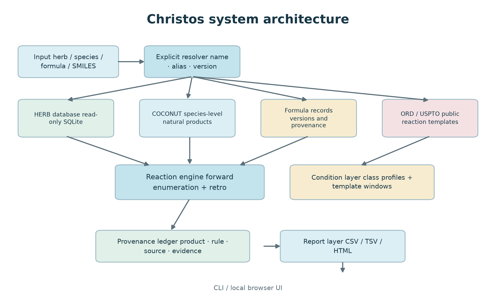
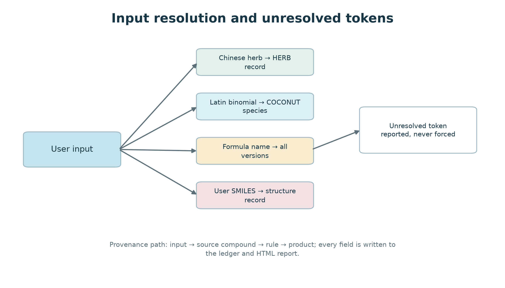
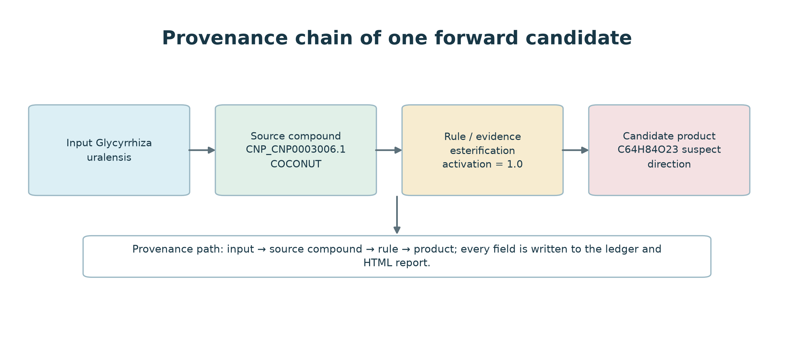
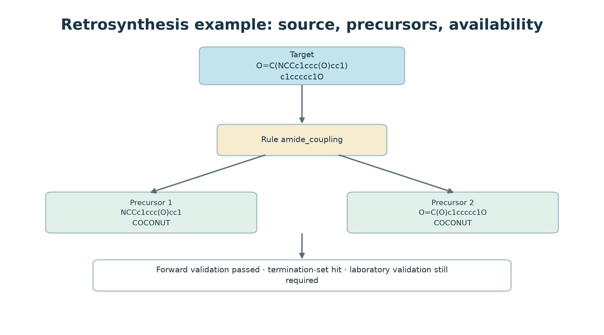
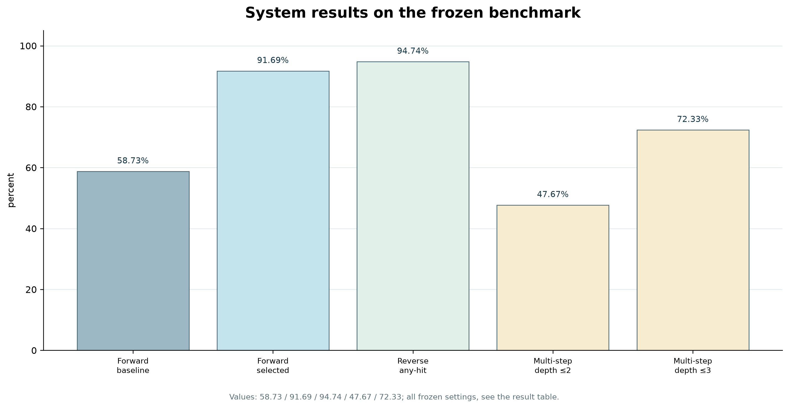

# Christos: a local reaction prediction system with source-aware input resolution and provenance

Article type: Software article  
Authors: Dong Xinchang  
Affiliations: Beijing University of Chinese Medicine, School of Chinese Materia Medica, Beijing, China  
Corresponding author: [To be completed]

---

## Abstract

Background: Reaction templates can produce candidate structures, but the source record, template, and condition evidence behind a result often stay out of view. The problem grows in traditional Chinese medicine (TCM), where one herb name may refer to a pharmacopoeia entry, a processed form, a regional alias, or a plant species, and a formula name may cover several versions with different compositions.

Methods: Christos is a local reaction prediction system for forward enumeration, retrosynthesis, and result-level provenance. It handles five input types, opens databases read-only, and keeps the template, source compound, reaction round, condition marker, and uncertainty flag with each candidate. We tested forward recall on USPTO-50k, reverse coverage on ORD targets, multi-step route recovery, and TCM input resolution and provenance fields.

Results: Across 50,016 USPTO-50k reactions, the selected configuration reached 91.69% single-step candidate-set recall (45,862 hits; Wilson 95% CI 91.45% to 91.93%), against 58.73% for the baseline; top-1 accuracy was 43.28% on the official 5,001-reaction test split, where candidate-set recall was 91.71%. On a 39,176-reaction deterministic sample of USPTO-MIT (479,035 reactions), candidate-set recall was 71.18% and top-1 accuracy 32.81%. Reverse search reached 94.74% any-hit coverage on 5,002 targets with 79,184 templates and 79.81% on all 50,016 targets with 3,065 leak-controlled templates. At depths ≤2 and ≤3, route recovery on 300 targets was 47.67% and 72.33%. The local TCM layer contained 31,646 compounds, 110,686 herb–compound links, 269,105 COCONUT compounds, 6,743 formula records, and 1,526 pharmacopoeia formula entries. The forward runtime library held 9,770 curated templates and 41,619 templates mined from ORD reaction records. A retrospective computational check against eight papers reproduced the published products in all five selected hydrolysis cases at connectivity level, with the expected rule family and cleaved bond, and compared the engine path with each reported route. With PubChem isomeric references, the exact stereoisomer was reproduced in three; the two aconitine products each differed at one centre that is unassigned on one side, so those two remain connectivity-level.

Conclusions: Christos keeps the input record, reaction path, and candidate product in one inspectable chain and preserves the state in which evidence is missing. The benchmark figures describe the reaction engine under the stated settings. They do not establish chemical practicality, biological activity, or clinical utility.

Keywords: reaction prediction; retrosynthesis; natural products; traditional Chinese medicine; provenance; reproducibility; reaction templates

---

## Introduction

When experimental or quantum-chemical data are unavailable, template methods can provide an initial list of products. RDKit handles molecular objects and basic chemical operations (RDKit, 2024); RDChiral extracts and applies stereochemistry-aware templates (Coley et al., 2019); AiZynthFinder and Retro* connect template libraries to search and ranking (Genheden et al., 2020; Chen et al., 2020). USPTO-50k, PaRoutes, and ORD provide a common test set, a route benchmark, and reactions with experimental context, respectively (Schneider et al., 2016; Genheden & Bjerrum, 2022; Kearnes et al., 2021).

A model can report a different recall rate after changing the target set or template library. Maziarz et al. (2025) observed this when algorithms were compared within a common framework, and Torren-Peraire et al. (2024) showed that the choice of single-step model propagates into multi-step planning. A recall figure therefore needs its target set, template library, candidate limit, and filtering rules checked alongside it.

Natural-product applications also require the program to explain where a result came from. Which input record supplied the substrate, which template was called, which local source supplied the compound, and whether the condition evidence came from a measured record or a general rule cannot be answered from the final product alone. A single interface that accepts molecules, herbs, species, and formulas makes mistakes at these identifier boundaries more likely to go unnoticed.

Such mismatches are common in TCM data. A Chinese herb name may denote a pharmacopoeia entry, a processed form, a regional alias, or a plant species; a formula name may belong to historical versions with different compositions. A compound may come from a herb-specific table or from a species-level natural-product collection such as COCONUT (Sorokina et al., 2021).

Christos starts with input resolution. Each input type has its own lookup path, unresolved tokens are returned unchanged, and the program does not select one plausible candidate when several are possible. SQLite sources are opened read-only. Product records retain the source compound, rule, round, condition marker, and uncertainty flag. The public demonstration uses a fixed catalogue and does not expose arbitrary-target retrosynthesis, free-form reagents, purchasable building blocks, or vendor links.

We used public reaction benchmarks to evaluate the engine and separate audits to inspect TCM input resolution and provenance. The two evaluations answer different questions. The first asks whether candidates cover known products; the second asks whether the system selected the intended source and kept known and unknown information distinct. Every candidate remains a chemical hypothesis awaiting experimental work.

## Materials and Methods

### System overview

The code separates input handling, reaction generation, evidence annotation, and reporting into six units. Table 1 gives their implementation entry points.

| Layer | Function | Main implementation |
|---|---|---|
| Input resolution | Chinese herb, Latin species, COCONUT species, formula, or SMILES | `sources/herb.py`, `sources/coconut.py`, `sources/formula.py` |
| Reaction enumeration | Forward template application and cascade expansion | `core/smartreact_engine.py`, SmartReact (MolecularAI, version 2.0.1) |
| Retrosynthesis | Template inversion and bounded route search | `tools/retro_search.py` |
| Condition layer | Reaction-class profiles and per-template condition windows | `conditions/`, `data/mined_top_template_conditions*.json` |
| Provenance and reporting | Ledger, index, HTML report, source tags | `core/query_base.py`, `tools/make_report.py` |
| Interfaces | CLI and local browser UI | `integration/tcmai_bridge/` |

The source adapters are not bound to the reaction engine. Herb records, species records, formulas, or user-supplied molecules enter the same reaction code, and the input-side provenance remains attached to the products.

The runtime uses Python 3.12, RDKit, rdChiral, SmartReact, and SQLite. DuckDB appears only in offline scripts that generate benchmark tables.

*Figure 1. Input and output paths in Christos. Inputs are resolved before the chemistry modules run. Source adapters do not write to the databases. Candidate products and provenance fields enter the ledger, which produces CSV/TSV files and a single-file HTML report.*

### Data sources and read-only policy

The local build loads the following resources:

| Resource | Role | Scale | Handling |
|---|---|---:|---|
| Herb database (`tcm.db`) | Herb names, compounds, aliases, evidence | 31,646 compound records (25,486 distinct SMILES) | read-only SQLite |
| COCONUT snapshot | Species-level natural products | 269,105 valid molecules | read-only SQLite |
| Formula records | Multi-herb prescriptions and versions | 6,743 records | read-only JSON |
| Pharmacopoeia overlay | 2025 formula entries and source URLs | 1,526 entries | internal overlay, not redistributed |
| USPTO-50k | Leak-controlled benchmark | 50,016 reactions | public benchmark |
| Forward templates | Curated package plus templates mined from ORD | 9,770 curated + 41,619 mined | derived data, attributed |
| Retrosynthesis templates | Clustered reverse templates | 3,228 clustered (3,025 compiled) | derived data, attributed |

Upstream raw databases are not redistributed with this work. ORD-derived templates are treated as CC BY-SA 4.0, USPTO-50k is CC0 (figshare 5104873), the COCONUT curated dataset is CC0 with MIT infrastructure code, and the SmartReact template package is Apache-2.0. Local herb and formula resources remain subject to the owner's authorization and do not enter the public archive.

SQLite connections use `mode=ro`. If a WAL database cannot be opened read-only because its shared-memory file is absent, the adapter falls back to `immutable=1` and reads a snapshot without creating sidecar files. We added this branch after finding that an ordinary `sqlite3.connect()` can create `-wal` and `-shm` files during work that was meant to be read-only.

The public demonstration contains 100 common herbs with one Latin species each, 50 formulas, and 150 precomputed examples. Formulas are limited to four to six ingredients and passed a safety filter before packaging. The page has no arbitrary-SMILES entry and accepts no route queries.

### Input resolution

Christos accepts herb names, Latin species, COCONUT species, formula names, or sets of SMILES. Herb names pass through the following cascade until a stage returns a result:

1. exact match on a herb or processed-herb name in the herb database;
2. processed-form gate: a pharmacopoeial processed form absent from the database returns "not in library" and is not decomposed into its source herb or passed to alias matching;
3. alias lookup against a synonym dictionary and the herb alias column, returning every candidate without choosing among them;
4. lookup in a curated synonym table that resolves to one canonical name;
5. substring match on Chinese names, capped at 40 hits and ordered by name length;
6. substring match on Latin, English, or alias strings;
7. fuzzy match with a similarity ratio of at least 0.85, returning at most one candidate.

Pinyin resolution was removed after it matched 秤杆草 (`chenggancao`) to the query `gancao`.

The resolver returns both selected records and unresolved tokens. For a formula, it retains all versions with the same name and selects one by documented source tier. Combining versions by hand would create a composition that does not match any historical or pharmacopoeial entry.

*Figure 2. Resolution paths for herb names, Latin species, formula names and SMILES. Unmatched tokens are reported verbatim rather than forced into a record.*

### Forward reaction enumeration

Forward enumeration applies templates to a substrate set. Templates are grouped by reaction name and then filtered by reactant category. Run parameters include compounds per herb, reaction rounds, the substrate-pair limit, and the number of candidates kept for each pair.

The selected configuration uses a support-filtered template pool, keeps at most 32 products per substrate pair, and enables a substrate-compatibility prefilter. A pair limit can remove the correct product even after its template has fired. Each run therefore records pair coverage and truncation state, and a capped run is marked as an incomplete enumeration.

*Figure 3. A forward candidate and the fields retained in the provenance ledger: input species, source compound, rule, condition-evidence marker and candidate product.*

### Retrosynthesis

Retrosynthesis applies the templates in reverse and expands a target molecule layer by layer. The output includes disconnections, precursor sets, and annotations for each route. Precursors are checked against the termination set and marked available or unavailable. A miss means only that the local set lacks the precursor; it says nothing definite about whether the compound can be bought or prepared.

The public build does not expose arbitrary-target retrosynthesis. The research command requires a separate environment variable. This changes the public feature set and does not act as a security barrier.

*Figure 4. A one-step retrosynthetic route with two precursors hit in the current termination set and a passing forward validation. This is an annotation, not a laboratory instruction.*

### Condition evidence

Condition evidence has two sources:

- profiles for named reaction classes, containing solvent, pH, temperature, catalyst, and atmosphere windows;
- per-template windows mined from ORD records, where a template must reproduce a recorded product before its conditions are collected.

The per-template layer starts from an evenly spaced ORD sample. A record contributes its conditions only after the template reproduces the recorded product. Of 500 audited templates, 493 matched at least one product, and 491 produced at least one condition class. The windows annotate candidates; they do not calculate kinetics, yield, or selectivity.

### Provenance and reporting

Each ledger path stores the product structure, source compound, herb or species source, reaction rule, round, condition marker, direction marker, and evidence text. The report generator reads these fields and writes a single-file HTML page, with structure drawings where requested.

Direction and condition markers change what is displayed; they do not delete candidates. "No evidence" means the current records contain no matching condition. It does not mean that the reaction cannot occur.

### Literature consistency validation

We assembled five cases before running the current build: glycyrrhizic acid to glycyrrhetinic acid, ginsenoside Rb1 to Rg3, the two aconitine ester-hydrolysis steps, and rutin to quercetin. Candidate papers were located through PubMed; all primary-run structures came from the local read-only compound table. Each case was then re-run from the PubChem isomeric reference structure and compared at connectivity and at full isomeric identity.

Each substrate ran alone under the decoction profile for one round, with `strict_redox_gate=True` and a cap of 64 products. A product match required the canonical structure of the reported product. We then checked the matched rule, its mapped broken bond, the formula difference between substrate and product, and the presence of any literature intermediate. For intermediates present in the local table, a second run tested whether the intermediate could reach the final product. This is a computational experiment: the system is run under the decoction profile, and its products and paths are compared with the published ones. The system reproduces the published products under its own conditions; it does not reproduce the physical conditions, yields, or selectivity of the cited studies.

### Evaluation design

#### Forward prediction

We ran one round on the recorded reactants of each USPTO-50k entry. Product structures were canonicalised with stereochemistry retained, so a hit required the same stereoisomer as the recorded product, and no ranking was applied. The evaluation covered all 50,016 reactions, using seed 20261014 and three workers.

The leak-controlled template library was mined from all ORD shards and then filtered at product level. After normalisation and removal of atom maps, an ORD record was excluded when its product matched any USPTO-50k test product. The reactants did not have to match. Both reverse libraries followed the same rule. Their final sizes differ because they came from different template sources: 79,184 templates for the 5,002-target experiment and 3,065 for the full 50,016-target experiment.

Under the selected configuration, the filtered and unfiltered libraries produced 91.69% and 91.97%, a difference of 0.28 percentage points. In this comparison, template-test overlap could explain only a small part of the result.

The baseline retained the engine default of eight products per substrate pair, used no extra template pool, and left the compatibility prefilter off. The selected configuration raised the limit to 32, added about 20,000 templates with support of at least 10, and enabled the prefilter.

The baseline median candidate count was 8, and the selected configuration's 90th percentile was 32. Both reached their respective limits. Benchmark settings came from environment variables, while the result files stored only aggregates. We therefore reconstructed the configuration from engine defaults and the changelog, not from a complete run manifest. The ablation showed no measurable gain from the compatibility prefilter, but the selected pipeline still uses it.

The system does not rank candidates. Complete-set recall matches the form of the output; precision at k depends on a ranking that Christos does not produce. Users see a candidate set with provenance, and the first row has no special status.

#### Retrosynthesis coverage

A reverse target counted as a hit when at least one disconnection, after removal of atom maps, gave exactly the recorded reactant set. We drew the 5,002-target and 300-target sets from ORD, restricted to products with molecular weight at most 500, one component, and no salt form, starting near row 200,000 of the parquet file and removing duplicates. One experiment used 5,002 targets and 79,184 templates; the other used all 50,016 targets and 3,065 leak-controlled templates. Because both target set and template library changed, only separate coverage values can be reported.

Multi-step testing used beam width 4 and kept at most 400 disconnections per expansion. A target counted as route-found when the search returned any route, whether or not that route passed the usability check. A route was usable when every step passed `retro_search.step_usability`; a target was usable when it had at least one usable route. Route-found is the looser endpoint.

#### TCM resolution and provenance

Herb, species, formula, and SMILES inputs entered through the same interface. Each run recorded the source, version, unresolved tokens, and output links. Demonstration examples came from the same engine and were frozen as precomputed results, so the public package contains no production database.

### Experiment configuration

| Experiment | Target set | Template library | Product-level filter | Comparable with |
|---|---|---|---|---|
| Forward, baseline | 50,016 USPTO-50k | engine default | yes, on USPTO-50k | forward selected |
| Forward, selected | 50,016 USPTO-50k | ~20,000 support-filtered | yes, on USPTO-50k | forward baseline |
| Reverse, subset | 5,002 ORD | 79,184 | yes, plus target overlap check | nothing else |
| Reverse, full | 50,016 USPTO-50k | 3,065 | yes | nothing else |
| Multi-step | 300 ORD | selected | no target overlap check | nothing else |
| Condition audit | 500 templates | production | not applicable | nothing else |
| Herb resolution | 75 fixed inputs | not applicable | not applicable | nothing else |

The two forward experiments share a target set and differ only in configuration, so they can be compared directly. The reverse experiments changed both the target set and the template library and are shown side by side without a direct comparison. The multi-step run reused the selected library and did not receive a target-level overlap check.
## Results

### Implemented data scale

The local build indexed 31,646 compounds and 110,686 herb–compound links from the herb database, 269,105 COCONUT compounds, 6,743 formula records, and 1,526 pharmacopoeia formula entries. Its forward runtime library held 9,770 curated templates and 41,619 templates mined from ORD reaction records; of the mined set, the default configuration loads 14,140 multi-substrate and 1,045 single-substrate templates. The retrosynthesis search uses a separate clustered library of 3,228 templates (3,025 after compilation). The public demonstration separately contained 100 herbs and 50 formulas.

The herb table stores herb-compound associations and has not been globally deduplicated. The 31,646 records collapsed to 25,486 distinct SMILES, a record-level duplication rate of 19.5%. An InChIKey was present for 30,964 records, with 29,013 distinct keys. Because 682 records lacked an InChIKey, the distinct-key count cannot be compared directly with the distinct-SMILES count. A compound or formula outside these counts was absent from this local snapshot.

### Forward prediction

The leak-controlled USPTO-50k experiment contained 50,016 reactions. The baseline reached 58.73% single-step recall (Wilson 95% CI 58.30% to 59.16%) and returned a mean of 10.4 candidates per reaction (median 9, 90th percentile 16). A further 0.05% of reactions returned no candidate. The selected configuration reached 91.69% (45,862/50,016; Wilson 95% CI 91.45% to 91.93%), with a mean of 21.3 candidates. One complete run took 1,596 seconds on three workers.

The baseline figure of 58.73% is a frozen measurement from 2026-10-30. Re-running the same configuration (eight products per substrate pair, no extra template pool, prefilter off) on the current code base returns 55.53%, with the same candidate distribution (mean 10.3, median 9, 90th percentile 16, empty set 0.05%). The difference is not spread evenly. Classes 4, 5, 6, 7, 8, and 9 agree to within 0.2 percentage points across the two runs; the gap concentrates in classes 1, 2, 3, and 10 (current code 54.8, 75.9, 56.8, 0.0 against frozen 60.5, 79.7, 59.0, 66.5). Those four depend on two-component mined templates that a cap of eight can truncate. Class 10 is the clearest case: the NBS benzylic-bromination templates are still in the library (support 2,313) and still compile, but on current emission order they land at positions 9 to 15 for most entries, so a cap of eight drops them, whereas the 2026-10-30 run placed them inside the cap. The gap is therefore an interaction between candidate ordering and the cap, not a missing transformation. It cannot be bisected: the frozen run predates the first commit, and the earliest snapshot we can rebuild already reproduces only 40% of class 10 at a cap of eight (36.7% with stereochemistry off), while a cap of 32 gives 83-87%. The per-class table below uses the frozen run, the same run that produced the 58.73% and 91.69% headlines. We report the frozen value for consistency with the other frozen measurements and give the current-code value here rather than silently replacing one with the other.

Both configurations gained recall as candidate counts grew, so the two measures need to be read together. The baseline cap of 8 sat near the median, and the selected cap of 32 fell below the 90th percentile. Truncation affected both runs, and the reported recall covers only what appeared within the cap.

Ablation on a fixed 500-reaction stratified sample isolates the components:

| Configuration | Recall | Mean candidates |
|---|---:|---:|
| Engine default | 46.60% | 10.3 |
| + per-pair cap 32 | 58.20% | 14.8 |
| + 20k support-filtered template pool | 84.80% | 19.6 |
| cap 64 instead of 32 | 85.00% | 19.7 |
| + substrate-compatibility prefilter | 84.80% | 19.6 |

Raising the cap from 32 to 64 changed recall by 0.2 percentage points and the mean candidate count by 0.1. The compatibility prefilter again produced no measurable effect on this sample. Most of the gain came from the larger per-pair cap and the expanded template pool. These numbers do not show that the added templates are chemically correct.

The 500-reaction sample and the full benchmark weight reaction classes differently. The sample gives each class an equal quota. The full set is dominated by classes 1 and 2, which account for 45% of reactions and had the highest recall. Equal weighting reduced the baseline from 58.73% to 45.65% and the selected configuration from 91.69% to 85.90%. The sample estimates were 46.60% and 84.80%, with Wilson intervals of 42.27% to 50.98% and 81.39% to 87.68%. Each equal-weight value fell inside its corresponding interval. The remaining difference is compatible with sampling variation at n = 500. Headline results use full-set weighting; the ablation uses the stratified sample.

### External test splits

Two further splits bound the forward result without changing any template. On the official USPTO-50k test split distributed with the RetroComposer release, 5,001 reactions reduced to 4,993 evaluable rows after dropping eight three-reactant entries. With the selected configuration, candidate-set recall was 91.71% (4,579 rows), top-1 43.28%, top-5 67.75%, top-10 78.85%, and MRR 0.5496, with 21.8 candidates on average (354 s, no errors). Candidate-set recall on the 50,016-reaction set is 92.01% for the same code, so the 0.30-point difference between denominators does not carry the headline.

The harder split is USPTO-MIT, which is roughly ten times larger. No official split file was reachable while this was written, so we sampled deterministically: the first eight hex digits of the MD5 of the seed plus the reaction string were mapped onto 0-9999 and rows below 836 kept, giving 39,176 of 479,035 reactions (8.36%). Candidate-set recall was 71.18% (top-1 32.81%, top-5 51.89%, top-10 61.68%, MRR 0.4187, 20.1 candidates). The four shards agreed to within 0.6 points on recall and 0.8 on top-1.

Strict same-reaction overlap between our template examples and either test set is zero (0 of 50,016 and 0 of 479,035), so the drop from 91.71% to 71.18% reflects a wider reaction space rather than memorisation.

These numbers are not directly comparable with published transformer baselines. Molecular Transformer, its augmented variant, Chemformer and Graph2SMILES report top-1 accuracies of 90.3% to 92.8% on the 40,000-reaction test set of USPTO-MIT, using official splits and single products; our figures are candidate-set recall over roughly 20 candidates on a different sample of a different split. We report them to bound the result, not to claim superiority.

### Where the gain comes from

Recall varied by reaction class. The baseline configuration was strongest on classes 1, 2, and 10 and weakest on classes 4, 5, and 9. The selected configuration produced its largest gains on the weak classes.

| Class | n | Baseline | Selected |
|---|---:|---:|---:|
| 1 | 15,151 | 60.5% | 93.0% |
| 2 | 11,896 | 79.7% | 95.8% |
| 3 | 5,662 | 59.0% | 81.3% |
| 4 | 909 | 10.3% | 56.7% |
| 5 | 672 | 5.7% | 83.6% |
| 6 | 8,237 | 42.8% | 96.5% |
| 7 | 4,614 | 60.1% | 92.0% |
| 8 | 811 | 49.9% | 97.3% |
| 9 | 1,834 | 22.0% | 83.7% |
| 10 | 230 | 66.5% | 79.1% |

Class 5 rose by 78.0 percentage points, class 9 by 61.7, class 6 by 53.8, and class 8 by 47.3. Class 2 rose by 16.1 points and class 10 by 12.6. The larger template pool appears to have filled some coverage gaps in the weak classes. This comparison did not test whether the added templates produce chemically valid reactions.

### Retrosynthesis and multi-step planning

Exclusion preceded template counting. Each ORD record was checked against the USPTO-50k product set, and a matching record never entered the count. No template was removed after construction.

We also checked overlap between the 5,002 reverse targets and the template-mining source. The source contained products from 252 targets (5.04%), which had an any-hit rate of 94.84% (239/252). The remaining 4,750 targets had a rate of 94.74% (4,500/4,750). Removing the overlapping targets left coverage unchanged to two decimal places.

The two reverse experiments need to be read separately. With 5,002 targets and 79,184 templates, any-hit coverage was 94.74% (4,739/5,002; Wilson 95% CI 94.09% to 95.33%). With all 50,016 targets and the 3,065-template leak-controlled library, coverage was 79.81%. Both the target set and the template library changed, so the present data cannot separate their effects.

The 300 multi-step targets did not receive the same overlap check, and their route-found rates are reported without target-level filtering.

With the selected template library and beam width 4, route recovery was 47.67% at depth ≤2 (143/300; Wilson 95% CI 42.08% to 53.31%) and 72.33% at depth ≤3 (217/300; 95% CI 67.01% to 77.09%). At depth ≤3, 207 targets had at least one usable route, equal to 69.0% of all targets and 95.4% of targets with a route. The usable-route count at depth ≤2 was not stored separately.

Each precursor carries a route-level source and availability status. "Usable" here means only that the recorded steps passed the local checks. It does not mean that a synthesis will work in practice.

*Figure 5. Frozen benchmark measurements. The panel collects results from different tasks and the bars do not share a scale: forward single-step recall (baseline 58.73%, selected 91.69%), reverse any-hit coverage (94.74%), multi-step route-found rate at depth ≤ 2 and ≤ 3 (47.67%, 72.33%). The condition-template audit (493 of 500 audited templates matched at least one product, and 491 also matched a condition class) is reported in the text only, because it is a product-match share rather than a recall.*

### Condition and provenance coverage

The template counts in this paper describe different objects. The forward runtime library holds 9,770 curated templates plus a mined library of 41,619; the default configuration loads 14,140 multi-substrate and 1,045 single-substrate templates from that mined set. The roughly 20,000-template pool belongs only to the selected benchmark configuration, not to the default library. The 3,228 figure is the clustered retrosynthesis library, which the forward path never loads. The condition audit sampled 500 templates from the mined library.

Each mined template records the ORD reaction record it was derived from, and the mining pipeline that produced the library ships with the code. In the audit, 493 of the 500 sampled templates matched at least one product and 491 also yielded at least one condition class; two templates matched a product but produced no condition class. The audit was written as a separate data product and did not change the runtime library. It was run on an earlier build of the mined library and has not been re-run on the current one.

### Literature consistency results

All five published products were reproduced in the first round of the computational run. Each hit used the hydrolysis rule named in the validation design. The candidate counts below refer to the current build and differ from an earlier interface run.

| Conversion | Literature | Engine rule | Candidates | 2D connectivity | PubChem exact |
|---|---|---|---:|---|---|
| Glycyrrhizic acid to glycyrrhetinic acid | Fan et al., 2016 | `hydrolysis_glycoside_001` | 63 | hit | exact |
| Ginsenoside Rb1 to Rg3 | Fu et al., 2017; Ryu et al., 2017; Piao et al., 2020 | `hydrolysis_glycoside_001` | 102 | hit | exact |
| Aconitine to benzoylaconine | Li et al., 2016; Huang et al., 2007 | `hydrolysis_ester_001` | 24 | hit | connectivity only |
| Benzoylaconine to aconine | Li et al., 2016; Huang et al., 2007 | `hydrolysis_ester_001` | 27 | hit | connectivity only |
| Rutin to quercetin | Kim & Lim, 2017; Yang et al., 2019 | `hydrolysis_glycoside_001` | 61 | hit | exact |

The engine path is recorded as the rule, the mapped bond broken, the round, and the product-minus-substrate formula difference. The next table compares it with the route described in each paper.

| Conversion | Engine path | Reported route | Verdict |
|---|---|---|---|
| Glycyrrhizic acid to glycyrrhetinic acid | `hydrolysis_glycoside_001`; C–O bond, round 1; C−12 H−16 O−12 | Consecutive and parallel hydrolysis to glycyrrhetinic acid and the 3-O-mono-glucuronide (Fan et al., 2016) | Family agrees; the mono-glucuronide is absent locally, so the order is unresolved |
| Ginsenoside Rb1 to Rg3 | `hydrolysis_glycoside_001`; C–O bond, round 1; C−12 H−20 O−10 | Rb1 → Rd → Rg3 by enzymatic conversion; thermal processing also forms Rg3 (Fu et al., 2017; Ryu et al., 2017; Piao et al., 2020) | Rd → Rg3 reproduced in a second run; Rb1 also reaches Rg3 directly |
| Aconitine to benzoylaconine | `hydrolysis_ester_001`; ester O–C bond, round 1; C−2 H−2 O−1 | C8 acetylester removed (Li et al., 2016; Huang et al., 2007) | Agrees with acetyl loss; C8 is not fixed by atom map |
| Benzoylaconine to aconine | `hydrolysis_ester_001`; ester O–C bond, round 1; C−7 H−4 O−1 | C14 benzoylester removed (Li et al., 2016; Huang et al., 2007) | Agrees with benzoyl loss; C14 is not fixed by atom map |
| Rutin to quercetin | `hydrolysis_glycoside_001`; C–O bond, round 1; C−12 H−20 O−9 | Rutinoside cleavage; isoquercetin also reported (Kim & Lim, 2017; Yang et al., 2019) | Isoquercitrin reaches quercetin; direct cleavage matches |

The system reproduced the published product at connectivity level in 5/5 cases. The expected reaction family and mapped bond type matched in 5/5. With PubChem isomeric references, the exact stereoisomer was reproduced in 3/5; the two aconitine products each differ from their reference at one stereocentre that is unassigned on one side, so those two remain connectivity-level.

The sequence evidence is also uneven. The Rb1 → Rd → Rg3 and rutin → isoquercitrin → quercetin sequences were reproduced in two separate runs. The two aconitine steps were reproduced as two consecutive cases. The glycyrrhizic-acid paper reports both a mono-glucuronide and glycyrrhetinic acid under consecutive and parallel hydrolysis, but the mono-glucuronide is not in the local table. Its precise ordering could not be tested.

These computational runs used 100°C for 60 minutes in water at pH 6.5 under air. The cited studies used subcritical water, steaming, enzymatic conversion, acid hydrolysis, or extended water hydrolysis. The published products and reaction families were reproduced; the physical conditions, reported yields, and condition-dependent selectivity were not.
### Herb resolution audit

We tested the cascade on 75 inputs: twenty exact Chinese names, ten aliases, ten processed forms, twenty-five binomials taken from the herb table, and ten strings that should not resolve.

| Input group | n | Resolved | Unresolved | Ambiguous |
|---|---:|---:|---:|---:|
| Exact Chinese name | 20 | 20 | 0 | 1 |
| Alias | 10 | 9 | 1 | 1 |
| Processed form | 10 | 3 | 7 | 0 |
| Latin binomial (table-sourced) | 25 | 25 | 0 | 0 |
| Non-herb string | 10 | 1 | 9 | 1 |

An ambiguous result returned more than one candidate and is still counted as resolved. One non-herb string was marked resolved; this was a false return.

All 20 exact Chinese names resolved. Nine of ten aliases resolved, with 寸冬 returning nothing. Three of ten processed forms resolved. The other seven, including 炒白术 and 姜半夏, returned the explicit "not in library" result and were not decomposed into their source herbs.

The Latin-name path depended on how each record was stored. All 25 table-sourced binomials resolved back to their own herb because those records store botanical names. Common Chinese herbs store a pharmacopoeial drug name instead. The record for 甘草 contains Radix et Rhizoma Glycyrrhizae, not Glycyrrhiza uralensis. A query for Glycyrrhiza uralensis resolved to 甘草节 (Gancaojie, a node of the licorice root), not 甘草 (Gancao, the root). Correcting this path requires separate drug-name and botanical-name fields.

Two other outcomes came from the same audit. 生地黄 resolved to 鲜地黄 and 干地黄 because the table has no entry for 生地黄 itself. 寸冬, an alias for 麦冬, returned nothing.

Nine of the ten non-herb strings returned nothing. The single character 甘 (gan) returned 40 candidates, reaching the substring cap because many herb names contain it. This was a false match.

Success on the table-sourced binomials does not mean that botanical lookup works for common Chinese herbs. Glycyrrhiza uralensis was the only test of that path, and it returned the wrong medicinal part. The current build cannot reliably resolve botanical names for common Chinese herbs.

The audit script is `tools/audit_herb_resolution.py`, and the case list can be extended.

### TCM case study

A Glycyrrhiza run over 12 constituents produced 573 candidate products and 573 provenance paths. Each path included the source compound, reaction rule, round, direction marker, and condition marker. We used this run to inspect the reporting model, not to support a pharmacological claim.

The field-level audit asked two different questions: whether a field was populated, and whether it contained substantive evidence. All nine field groups were populated in 100% of the 573 entries. Only seven entries (1.2%; Wilson 95% CI 0.59% to 2.50%) contained condition rationale. The other 566 carried "no ORD condition data, admitted", which meant the condition layer found no matching record and kept the candidate without a condition annotation. Complete fields and sparse evidence occurred together.

`tools/audit_provenance_completeness.py` can rerun the audit on any ledger. Formula resolution retains all same-named versions and reports the selected source tier and unresolved tokens. When a run encounters several versions, the output lists the selected version and the alternatives.

### Public demonstration and safety boundary

The public demonstration contains 100 common herbs with one Latin species each, 50 formulas, and 150 precomputed entries. The page has no arbitrary-SMILES field, route search, free-form reagent input, purchasable-block list, or vendor link. Source databases are read-only, and the application writes only its reports and runtime files. The research interface remains available for controlled use.

### Two-stage filtering

The 3,210 Sijunzi candidates were reduced first by rule provenance. Keeping only the TCM rulebook removed general organic-synthesis templates mined from ORD and left 1,114 candidates. We then matched each product's InChIKey against the 31,646 herb compounds. Six products were known constituents and 1,108 were not.

Four of the six known products arose from ester hydrolysis and two from glycoside hydrolysis. The two filters removed 99.8% of the candidates, leaving six structures with literature identities for manual review.

The filter uses two binary checks: whether the rule comes from the TCM rulebook and whether the compound appears in the herb table. It assigns no confidence score. The 1,108 products outside the table remain available under a separate flag; they may be new constituents or incorrect products.
### Runtime calibration

The Glycyrrhiza tests also measured two run budgets: compounds selected per herb and substrate pairs processed per run.

| Component limit | Substrates | Pairs | Products | Time |
|---|---:|---:|---:|---:|
| 24 | 24 | 276 | 3,666 | 18.5 s |
| 64 | 64 | 2,016 | 33,579 | 166 s |
| 128 | 128 | 8,128 | 97,670 | 429 s |
| 342 (all) | 342 | 58,311 | 359,141 (upper bound) | 33 min |

Under the specificity ordering, 24 compounds already included every characteristic Glycyrrhiza compound. Raising the limit to 128 produced more products but no additional characteristic entries. The complete set required slicing. The 30 slices of 2,000 pairs completed in 33 minutes and produced 359,141 rows. Duplicates were removed within slices but not across them, so the total is an upper bound.

| Pair budget | Effective pairs | Products | Time |
|---|---:|---:|---:|
| 500 | 500 | 9,914 | 50 s |
| 1,000 | 1,000 | 17,826 | 77 s |
| 2,000 | 2,000 | 27,076 | 109 s |
| 4,000 | 4,000 | 54,103 | 259 s |
| 8,000 | 8,000 | 120,487 | 573 s |

Products and runtime increased with the pair count. The pair budget controls waiting time and coverage; it is not a chemical quality threshold.
### What did not help

The full run took about 33 minutes. We tested four changes around it, and none changed the output.

Cross-batch caching of single-substrate results had no effect. The 72 seconds spent on 1,000 pairs was dominated by 11,000 calls to RDKit `RunReactants`, at about 6.5 ms each. The single-substrate path was not the main cost.

Generating pair indices on demand instead of building all 58,311 tuples first also produced no change.

Writing products to disk every 200 pairs lowered peak memory from 1.8 GB to a flat profile, but ran 60% slower than 2,000-pair slices. At that granularity, setup cost consumed the gain.

Four-process parallelism worked in logic: the slices were independent, and the first four produced product counts identical to the serial run. Memory stopped the run. Each worker held about 1.7 GB of product objects, four workers exhausted a 16 GB machine, and two were killed without an error trace. Loading all 82,000 templates required only about 37 MB, so the template library was not the source of the pressure.

Further memory reduction would require changing the fields stored in product objects or deferring provenance lookup until a row is written. We did not make that engine-level change.
## Discussion

The direct result is traceability. Each predicted product can be followed back to a specific input record, template, source compound, and condition marker. TCM work needs that step because herb names, processed forms, Latin names, and formula versions often look as though they refer to the same material while describing different things. The resolution path at least shows which record entered the run.

The provenance chain does not guarantee the chemistry. A template-to-ORD link says where a template came from; a condition window says what appeared in a class of records. Neither establishes kinetics, yield, or selectivity. Results can also change when the template library or local data snapshot changes.

The public and research builds do different jobs. The public build shows a fixed catalogue and provides no entry point for arbitrary-target retrosynthesis, free-form reagents, purchasable building blocks, or vendor links. An environment variable restores the research path. This reduces accidental use, but the source is visible, so it cannot stop someone who edits the code.

In the frozen USPTO-50k experiment, the selected configuration scored above the baseline. Both runs were truncated, and the selected run produced more candidates along with more hits. These numbers support the configuration within the stated benchmark. They do not extend to chemical practicality, biological activity, or clinical utility.

### Applications

Christos can list structures that appear only after several herbs have been heated together. In the Sijunzi example, filtering reduced 3,210 candidates to six known constituents. When the two precursors of a product come from different herbs, the record provides a specific lead for a combination-dependent reaction; the product still needs experimental confirmation.

The first-round hydrolysis of aconitine to benzoylaconine and then to aconine matches a key step in Aconitum processing. Products that appear after decoction but are absent from the raw herbs could be screened as candidate quality markers. These are starting points for research, not validated markers or processing endpoints.

### Outlook

There is still no ready path from a new product to toxicity or adverse-event data. One option is to predict target profiles for natural-product scaffolds; another is to build structure-to-MeSH and structure-to-RxNorm mappings. The current system has neither, and both require work beyond the reaction engine.

The TCM rulebook has 64 rules, and systematic literature work could expand it into the hundreds. Mass balance, condition windows, and literature priors might reduce manual review further. The largest remaining gap is experimental work: this study asks whether a transformation can be reached within the software and its evidence sources, not whether it occurs under a particular laboratory procedure.
## Limitations

The results are bounded first by the template library and candidate limits. A missing template removes a potentially correct path, and a low candidate cap can omit a product that a higher cap would expose. Each run records truncation and pair coverage, but the present runs cannot estimate full uncapped recall. Four of the five literature cases could be compared only at connectivity level because their local structures lack stereo assignments.

We did not perform laboratory validation. Condition profiles came from reaction records and literature and cannot replace measurements of yield, selectivity, solvent effects, or degradation. Downstream risk annotation also works only for compounds already present in external tables. The ADMET cache matched 2.6% of one decoction run by InChIKey. CTD uses chemical names and matched essentially none of the same new structures. In the two formula examples, the ADMET cache found 0 acute-toxicity values above the 90th percentile among 84 annotated products for the milder combination and 65 among 169 for the Aconitum-containing formula. That contrast covers only products already represented in the annotation source.

TCM identifiers remain unstable. Herb names, processed forms, species assignments, formula versions, and source tiers can all be ambiguous. Christos reports unresolved tokens instead of supplying a plausible record. In the audit, seven of ten processed forms and one of ten aliases failed to resolve, and the Latin field mixed botanical names with pharmacopoeial drug names. The TCM tables are controlled by the database owner or by third-party terms, so the public package cannot reproduce the TCM-scale counts without those sources.

Condition evidence remains sparse. Many templates have no usable condition class in the current records. A missing marker means that the data contain no match; it does not establish that a reaction is impossible. All five literature products were reproduced in the first round, but each current run returned between 24 and 102 candidates, and the system does not rank them.

The public interface reduces accidental access to sensitive features. It does not replace legal review, institutional controls, or safety assessment. Data redistribution remains subject to the source licenses and ownership terms in the data card.

## Conclusions

Christos was developed to make reaction predictions easier to check. The published products for five documented glycoside and ester-hydrolysis conversions were reproduced in the first round, and two-stage filtering left six known constituents from 3,210 Sijunzi candidates.

The audits also exposed implementation problems. Of 64 curated rules, 58 were not loaded; reduction rules passed an air-only condition gate; only 1.2% of provenance entries contained substantive condition evidence; and the Latin-name field held drug names instead of botanical names. We changed the implementation and retained those findings in the results.

The 91.69% forward recall and the reverse coverage values of 94.74% and 79.81% apply to the reaction engine under the stated configurations. Input resolution and provenance were evaluated separately for the herbal layer. In the literature-consistency check, all five products matched at connectivity level and all used the expected hydrolysis family; three could also be confirmed at full stereochemical identity, and the two aconitine steps remain connectivity-level. Christos provides an inspectable record of how a result was generated. Whether a predicted product forms under a specific procedure still requires experimental work.

## Data and code availability

Code, protocol, result tables, figure sources, and runnable scripts are at https://github.com/VegFisx/Christos, archived at https://doi.org/10.5281/zenodo.23499423. The literature-validation outputs are `reports/paper/literature_validation_20261030.json`, `reports/paper/literature_validation_20261030.csv`, `reports/paper/literature_validation_pubmed_20261030.xml`, and `reports/paper/pubchem_literature_validation_20261030.json`. The benchmark result tables are tagged `stereo_on_full50k`, `stereo_on_unfiltered_full50k`, `legacy_on_full50k` and `legacy_off_full50k`; all forward runs keep stereochemistry in product canonicalisation. The headline figures refer to the archived code snapshot at commit `694d2de` with `CHEMCREACT_STEREO_CANON=1`. The current default tree carries one further change, a revised temperature gate, and reaches 92.01% (46,020 of 50,016; Wilson 95% CI 91.77% to 92.24%), stored as `stereo_on_default_20261104`; the same tree with stereochemistry disabled reaches 82.77%. Applying that same re-run to the degraded baseline configuration gives 55.53% (tag `baseline58_20261107`), against the frozen 58.73%. Downstream annotation used the TDC ADMET Group (Huang et al., 2022), Tox21/ToxCast endpoints (Richard et al., 2016, 2021), CTD (Davis et al., 2026), and OnSIDES v3.1.1 (Tanaka et al., 2025); OnSIDES was retained for downstream evaluation and is not used for the headline results. The pharmacopoeia overlay was derived from the 2025 Chinese Pharmacopoeia through the third-party `Independent-KBs` structured source. That repository declares no repository-level license, so the overlay remains internal-only. Upstream raw data are not redistributed. The public demonstration package is a fixed precomputed sample and contains no production databases.

## References

All DOIs were resolved through Crossref on 2026-10-19 and 2026-10-29; software and dataset landing pages were checked against the official project, EPA, GitHub release, and repository commit pages. The API snapshots are stored in `reports/paper/reference_verification_20261019/` and `reports/paper/reference_verification_20261029/`.

1. Chen, B., Li, C., Dai, H., & Song, L. (2020). Retro*: Learning retrosynthetic planning with neural guided A* search. *Proceedings of the 37th International Conference on Machine Learning*, PMLR 119, 1608–1616. https://proceedings.mlr.press/v119/chen20c.html

2. Coley, C. W., Green, W. H., & Jensen, K. F. (2019). RDChiral: An RDKit wrapper for handling stereochemistry in retrosynthetic template extraction and application. *Journal of Chemical Information and Modeling*, 59(6), 2529–2537. https://doi.org/10.1021/acs.jcim.9b00286

3. Genheden, S., & Bjerrum, E. J. (2022). PaRoutes: Towards a framework for benchmarking retrosynthesis route predictions. *Digital Discovery*, 1(4), 527–539. https://doi.org/10.1039/D2DD00015F

4. Genheden, S., Thakkar, A., Chadimová, V., Reymond, J.-L., Engkvist, O., & Bjerrum, E. J. (2020). AiZynthFinder: A fast, robust and flexible open-source software for retrosynthetic planning. *Journal of Cheminformatics*, 12, 70. https://doi.org/10.1186/s13321-020-00472-1

5. Kearnes, S. M., Maser, M. R., Wleklinski, M., Kast, A., Doyle, A. G., Dreher, S. D., Hawkins, J. M., Jensen, K. F., & Coley, C. W. (2021). The Open Reaction Database. *Journal of the American Chemical Society*, 143(45), 18820–18826. https://doi.org/10.1021/jacs.1c09820

6. Maziarz, K., Tripp, A., Liu, G., Stanley, M., Xie, S., Gaiński, P., Seidl, P., & Segler, M. (2025). Re-evaluating retrosynthesis algorithms with Syntheseus. *Faraday Discussions*, 256, 568–586. https://doi.org/10.1039/D4FD00093E

7. RDKit: Open-source cheminformatics. (2024). https://www.rdkit.org

8. Schneider, N., Stiefl, N., & Landrum, G. A. (2016). What's What: The (nearly) definitive guide to reaction role assignment. *Journal of Chemical Information and Modeling*, 56(12), 2336–2346. https://doi.org/10.1021/acs.jcim.6b00564

9. Sorokina, M., Merseburger, P., Rajan, K., Yirik, M. A., & Steinbeck, C. (2021). COCONUT online: Collection of Open Natural Products database. *Journal of Cheminformatics*, 13, 2. https://doi.org/10.1186/s13321-020-00478-9

10. Torren-Peraire, P., Hassen, A. K., Genheden, S., Verhoeven, J., Clevert, D.-A., Preuss, M., & Tetko, I. V. (2024). Models Matter: The impact of single-step retrosynthesis on synthesis planning. *Digital Discovery*, 3(3), 558–572. https://doi.org/10.1039/D3DD00252G

11. MolecularAI. SmartReact (version 2.0.1) [Computer software]. https://github.com/MolecularAI/smartreact

12. Huang, K., Fu, T., Gao, W., Zhao, Y., Roohani, Y., Leskovec, J., Coley, C. W., Xiao, C., Sun, J., & Zitnik, M. (2022). Artificial intelligence foundation for therapeutic science. *Nature Chemical Biology*, 18(10), 1033–1036. https://doi.org/10.1038/s41589-022-01131-2

13. Richard, A. M., Huang, R., Waidyanatha, S., et al. (2021). The Tox21 10K compound library: Collaborative chemistry advancing toxicology. *Chemical Research in Toxicology*, 34(2), 189–216. https://doi.org/10.1021/acs.chemrestox.0c00264

14. Richard, A. M., Judson, R. S., Houck, K. A., et al. (2016). ToxCast chemical landscape: Paving the road to 21st century toxicology. *Chemical Research in Toxicology*, 29(8), 1225–1251. https://doi.org/10.1021/acs.chemrestox.6b00135

15. Davis, A. P., Wiegers, T. C., Sciaky, D., Barkalow, F., Wyatt, B., Wiegers, J., McMorran, R., Abrar, S., & Mattingly, C. J. (2026). Comparative Toxicogenomics Database: update 2027. *Nucleic Acids Research*, gkag1041. https://doi.org/10.1093/nar/gkag1041

16. Tanaka, Y., Chen, H. Y., Belloni, P., et al. (2025). OnSIDES database: Extracting adverse drug events from drug labels using natural language processing models. *Med*, 6(7), 100642. https://doi.org/10.1016/j.medj.2025.100642

17. Chinese Pharmacopoeia Commission. (2025). *Pharmacopoeia of the People's Republic of China* (2025 edition). Beijing: China Medical Science Press.

18. cliviali. (2026). *Independent-KBs: structured Chinese pharmacopoeia 2025 knowledge base* [Data set], commit 63cfd6a. https://github.com/cliviali/Independent-KBs (no repository-level license declared; internal use only).

19. Fan, R., Li, N., Xu, H., Xiang, J., Wang, L., & Gao, Y. (2016). The mechanism of hydrothermal hydrolysis for glycyrrhizic acid into glycyrrhetinic acid and glycyrrhetinic acid 3-O-mono-β-D-glucuronide in subcritical water. *Food Chemistry*, 190, 912–921. https://doi.org/10.1016/j.foodchem.2015.06.039

20. Fu, Y., Yin, Z.-H., & Yin, C.-Y. (2017). Biotransformation of ginsenoside Rb1 to ginsenoside Rg3 by endophytic bacterium Burkholderia sp. GE 17-7 isolated from Panax ginseng. *Journal of Applied Microbiology*, 122(6), 1579–1585. https://doi.org/10.1111/jam.13435

21. Ryu, J., Lee, H. W., Yoon, J., Seo, B., Kwon, D. E., Shin, U.-M., Choi, K.-J., & Lee, Y.-W. (2017). Effect of hydrothermal processing on ginseng extract. *Journal of Ginseng Research*, 41(4), 572–577. https://doi.org/10.1016/j.jgr.2016.12.002

22. Li, T.-F., Gong, N., & Wang, Y.-X. (2016). Ester hydrolysis differentially reduces aconitine-induced anti-hypersensitivity and acute neurotoxicity: Involvement of spinal microglial dynorphin expression and implications for Aconitum processing. *Frontiers in Pharmacology*, 7, 367. https://doi.org/10.3389/fphar.2016.00367

23. Huang, Q.-A., Zhang, Y.-M., He, Y., Lu, J., & Lin, R.-C. (2007). Studies on hydrolysis of aconitine. *Zhongguo Zhong Yao Za Zhi*, 32(20), 2143–2145. PMID: 18306748.

24. Kim, D.-S., & Lim, S.-B. (2017). Optimization of subcritical water hydrolysis of rutin into isoquercetin and quercetin. *Preventive Nutrition and Food Science*, 22(2), 131–137. https://doi.org/10.3746/pnf.2017.22.2.131

25. Yang, J., Lee, H., Sung, J., Kim, Y., Jeong, H. S., & Lee, J. (2019). Conversion of rutin to quercetin by acid treatment in relation to biological activities. *Preventive Nutrition and Food Science*, 24(3), 313–320. https://doi.org/10.3746/pnf.2019.24.3.313

26. Piao, X. M., Huo, Y., Kang, J. P., Mathiyalagan, R., Zhang, H., Yang, D. U., Kim, M., Yang, D. C., Kang, S. C., & Wang, Y. P. (2020). Diversity of ginsenoside profiles produced by various processing technologies. *Molecules*, 25(19), 4390. https://doi.org/10.3390/molecules25194390
