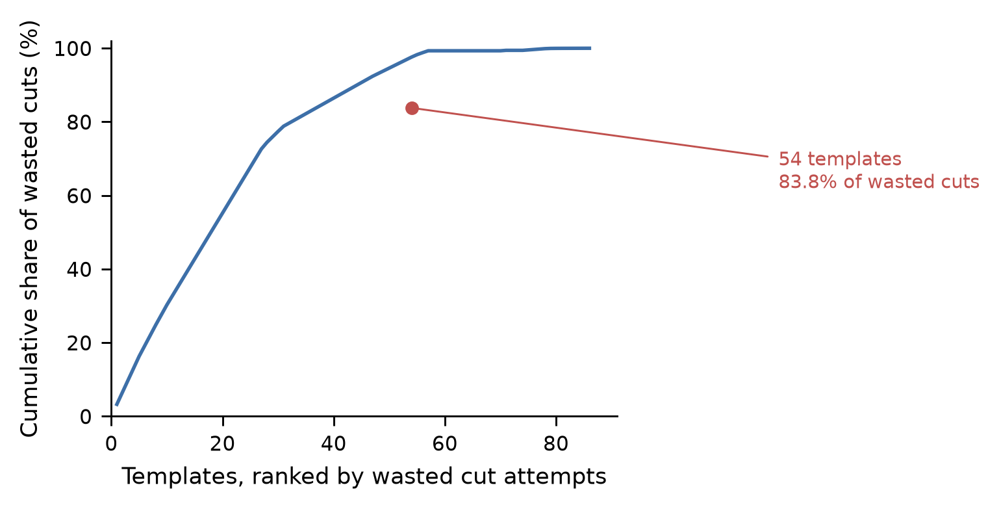
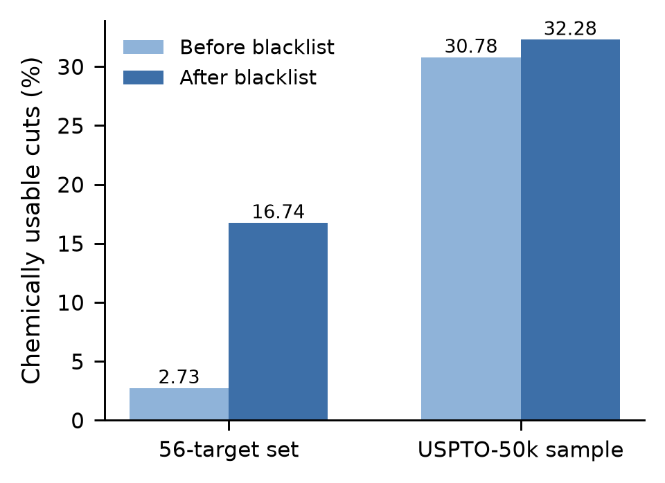
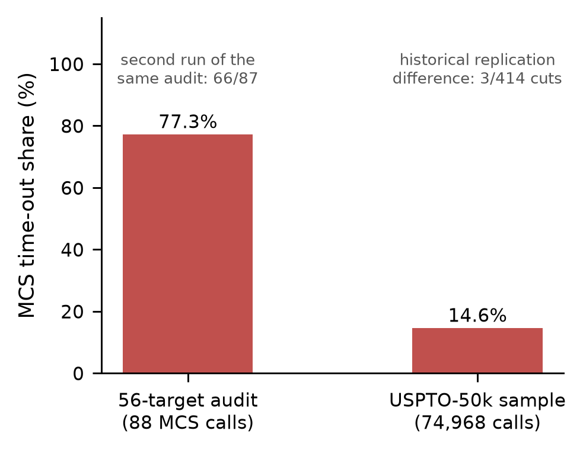
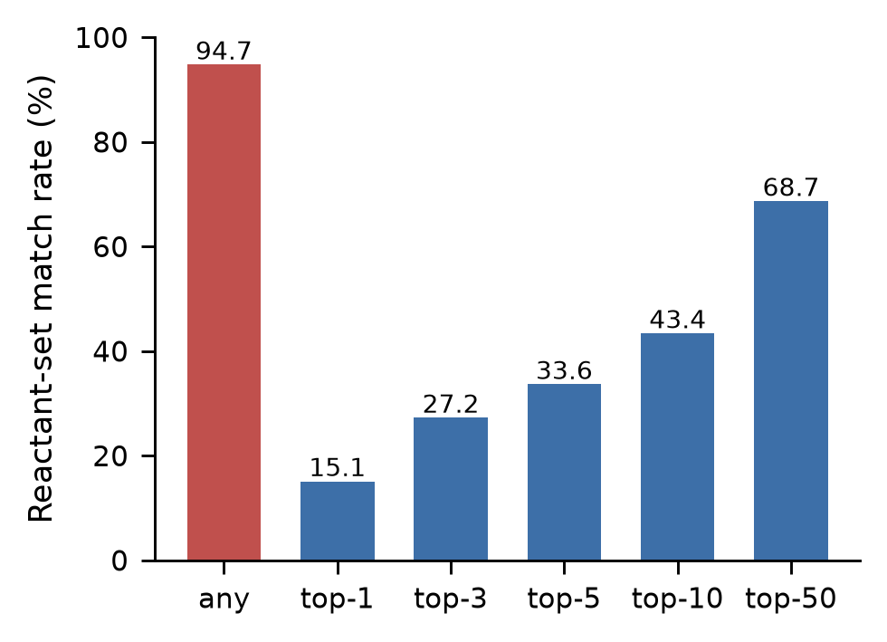
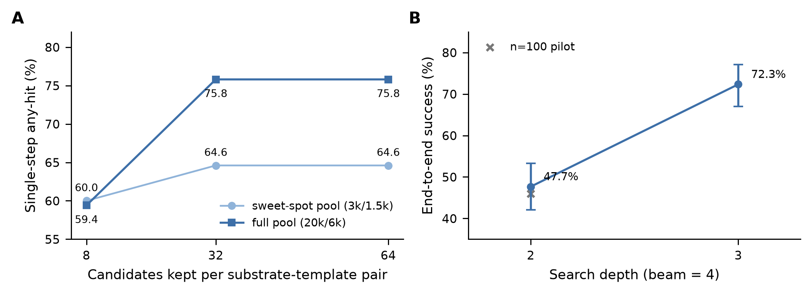
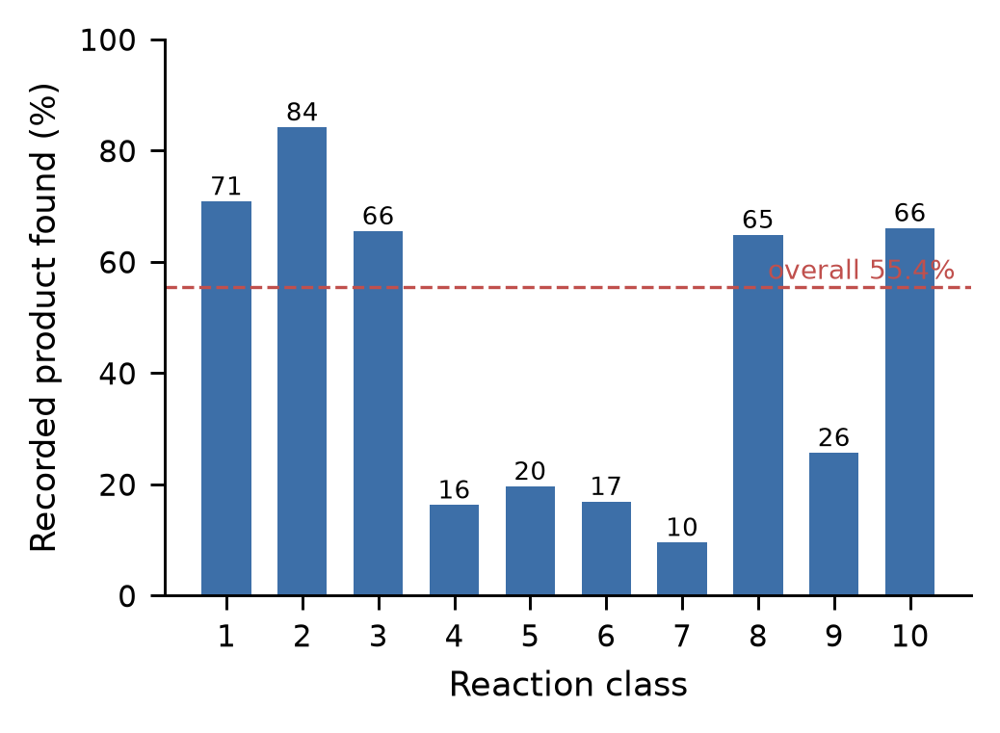
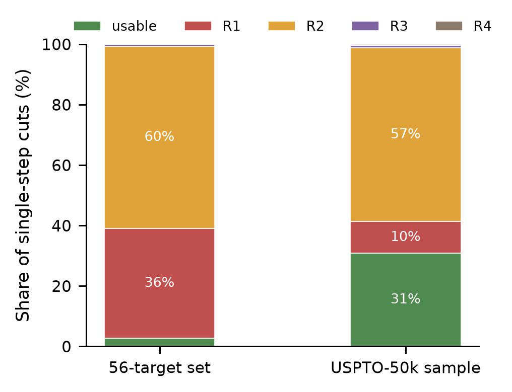

# A library-scale audit of template-based retrosynthesis: a few templates dominate false routes and a time-boxed validity criterion is not reproducible

**Authors:** [to be completed]

**Affiliations:** [to be completed]

**Corresponding author:** [to be completed]

---

## Abstract
Template-based retrosynthesis dominates industrial and open-source synthesis planning, yet published work concentrates on search and ranking. The template library's own quality, and the reproducibility of the criteria used to judge route validity, are rarely audited. We audit a production template library on the public USPTO-50k benchmark and on Open Reaction Database reactions, under a leak-controlled protocol, and release a reproducible audit-and-repair framework.

Five findings emerge. (i) False routes are highly concentrated: 54 of 3,025 templates account for 83.8% of invalid disconnections on a 56-target audit set, and blacklisting raises usability there from 2.72% to 16.74%. (ii) On USPTO-50k, cuts whose precursors are larger than the target (class R2) make up 57.5% of all cuts, top five templates contributing 52.7%; chemically this is the reverse of aromatic C-H functionalisation. (iii) The residue/similarity criterion rests on time-boxed maximum-common-substructure calls: 68 of 88 invocations (77%) time out in our audit set and 14.6% in a 50k sample, so verdicts inherit machine-state dependence. (iv) Blacklisting plus a deterministic repair criterion tightens the false-usable rate from 30.78% to 29.22%. (v) Candidate truncation saturates: raising the per-pair cap from 8 to 32 on a fixed 20k pool lifts single-step recall from 59.40% to 75.80% (McNemar p = 4.1 x 10^-25, zero regressions); on the full benchmark the leak-free gain is 70.43% to 82.32% (Wilson 95% CI 81.98-82.65%).

Reverse-direction coverage reaches 94.74% (leak-free, n = 5,002) and multi-step success 47.67% at depth <= 2 and 72.33% at depth <= 3 (n = 300). We also contribute a provenance-first ordering basis from the Chinese Pharmacopoeia (2025): 386 of 491 in-scope monographs (78.6%) and 3,277 linked rows, each carrying its official entry URL, consumed behind a switch that is off by default. We mark rather than delete, never rank silently, and attach provenance to every item.

**Keywords:** retrosynthesis; reaction templates; reaction filters; reproducibility; benchmarking; data provenance

---

## Introduction

Template-based retrosynthesis compresses a reaction corpus into reaction rules and then searches for disconnections that regenerate a target. It is the mainstream engineering path: RDChiral provides the standard implementation of template extraction and application (Coley, Green & Jensen, 2019), and Retro* (Chen et al., 2020) and AiZynthFinder (Genheden et al., 2020) build search and ranking on top of it, while PaRoutes (Genheden & Bjerrum, 2022) supplies route-level benchmarking.

These systems ship with engineering filters — bond filters, reactant-count filters, frozen-substructure filters, and learned feasibility filters — that exist precisely because templates are known to be misapplied. In the AiZynthFinder code base, all four filter classes are *rejection* filters: a hit raises a rejection exception and the candidate is deleted (filter_strategies.py, master branch, retrieved 2026-10-18; code-level default cutoff for the learned filter is 0.05). The filters are therefore an admission by the community that template quality matters. Yet they are almost never the object of study; they appear as implementation defaults with a short justification.

Three blind spots follow.

First, the *concentration* of toxicity is unknown. Are false routes produced uniformly across a library, or by a handful of templates? If the latter, auditing the library is a far better use of effort than enlarging the corpus.

Second, the *validity criterion* may not be reproducible. The common heuristic — a route is implausible if precursors are similar in size to the target, i.e. a residue route — rests on maximum common substructure (MCS) computations that are time-boxed. When the call times out, the verdict is taken from a partial search, so the same molecule can be judged differently under different machine load. Any reported 'usable rate' inherits this uncertainty.

Third, *candidate truncation* has an unaccounted cost. Search engines cap the number of candidates kept per substrate–template pair. When the cap is tight, adding more templates can lower recall; we isolate this mechanism below and show that it accounts for more than 12 recall points on the full benchmark.

We answer these questions under a public, reproducible, leak-controlled protocol, and we turn the audit into consumable product defaults. Our contributions are:

- **C1 — Library-scale audit and concentration.** Every template is audited against a target distribution, quantifying how few templates cause most invalid attempts.
- **C2 — Criterion reliability as an evaluation-methodology result.** The timeout structure and verdict drift of time-boxed MCS are measured and reported as a negative result.
- **C3 — Truncation saturation and its repair.** We characterise the 'more templates, lower recall' mechanism with a three-point curve and paired tests, lifting single-step recall from 55.43% to 82.32%.
- **C4 — Availability-conditioned verdicts.** Residue routes are marked implausible only when the precursor is unavailable, converting deletion into conditioned annotation.
- **C5 — A 100% provenance chain.** All 3,228 production templates map back to ORD reaction identifiers, turning template quality from a modelling question into a governable data question.
- **C6 — A chemical reading of the dominant family.** 'Reverse editing' reactions explain the R2 family and are actionable for auditing.
- **C7 — Application: a pharmacopoeia-anchored ordering basis.** Input compounds can be ordered by an external standard, with every ordering basis traceable to an official entry (switch off by default).

Our stance throughout is to mark rather than delete, never to score or rank silently, and to attach provenance and an uncertainty marker to every generated item. This is both a response to the reasonable objection that filters are old news and a product-level design constraint.

## Materials and Methods

The full protocol is published with the repository (README-protocol.md); this section restates the frozen definitions so that any reader can reproduce the numbers.

### Data and licences

| Role | Data | Scale | Licence |
|---|---|---|---|
| Template source | ORD `uspto-grants` (parquet) | 1,771,032 reactions; first 60,000 rows used | CC BY-SA 4.0 |
| Extracted records | RDChiral extraction | 56,047 successful extractions | project output |
| Benchmark targets | USPTO-50k (retrosim mirror) | 50,016 reactions, 0 parse failures | CC0 (figshare 5104873); mirror code MIT |
| Termination set, natural products | COCONUT local snapshot | 269,105 valid molecules | upstream curated dataset CC0; code MIT |
| Termination set, TCM constituents | tcm.db (owner-built, read-only) | 31,646 | owner's own data |
| Termination set, building blocks | ORD-derived purchasable blocks | 32,146 full keys | inherits CC BY-SA 4.0 |

We do not redistribute any upstream raw data. Two limitations matter for interpretation: presence in COCONUT is not evidence of real-world purchasability, and the building-block table is a proxy for commercial availability. Both bias the termination test optimistically, which affects absolute usable rates but not the paired comparisons (before/after filtering, before/after truncation) on which our claims rest.

### Benchmark library construction and leakage control

We first verified that our clustering procedure reproduces the production library: re-clustering the unmodified extraction records with min-freq = 3 and per-bucket = 3 yields a template set *identical as a set* to the 3,228 production templates. We then removed every extraction record whose product side, after mapping removal, appears among the 50,016 USPTO-50k products — 3,007 of 56,047 records — and re-clustered, obtaining a 3,065-template benchmark library. By construction no template instance in this library derives from a USPTO-50k reaction, so all evaluations of 50k are instance-unseen.

We quantified the residual leakage explicitly: 4.96% of 50k products (2,480/50,016) occur in the original extraction records, and 1.11% (555/50,016) share a complete reaction signature. Both the leaky and leak-free variants of the main experiment are reported; the headline forward number is the leak-free one.

### Metrics

**Any-hit coverage.** A target is a hit if some disconnection has a precursor set (normalised after mapping removal) strictly equal to the reactant set recorded for that reaction in 50k.

**Top-k (k = 1, 3, 5, 10, 50).** All cuts of a target are ordered by template frequency (descending) and then by SMARTS lexicographic order — a deterministic ordering with no chemical scoring — and the target is a hit at k if the correct cut ranks at most k.

**Per-cut usability.** Targets are stratified by reaction class (≤ 300 per class, seed 20261014). Every cut is judged by the same `step_usability` routine used in production, which assigns one of four verdicts: R1 residue (precursors comparable in size to the target), R2 enlargement (precursors larger than the target), R3 inert (no reactive change), R4 absurd (chemically implausible). Element-coverage ratios and blacklist flags are recorded alongside.

**Blacklist.** `retro_template_blacklist.json` contains 51 never-usable templates, 3 exemptions (templates that 'revived' on a held-out distribution and were therefore not banned), and 3 no-op templates. The list is applied as a switch that is off by default, so headline numbers remain comparable with the literature; when enabled it reduces the loadable library from 3,025 to 2,942 templates.

**Forward single-step recall.** The recorded reactants (one to three) are fed to the engine as substrates for one round; a hit means the recorded product appears anywhere in the candidate set (no ranking). Candidate-set size and per-class recall are reported. Because no catalysts or reagents are supplied, C–C coupling classes are structurally handicapped.

### Reliability experiments

`step_usability` calls a time-boxed MCS routine (2 s) for medium-sized molecules. We measured (a) the timeout share on the 56-target cut set and on a stratified 50k sample, and (b) verdict stability under controlled load: quiet, then eight cores loaded, then quiet again, re-judging 3,320 cuts. Negative results are reported as measured.

### Pharmacopoeia-anchored predicate chain

To make the ordering basis of input compounds externally verifiable, we extracted the Assay (含量测定) and Identification (鉴别) sections of each monograph from the Chinese Pharmacopoeia (2025 edition), repaired OCR-shaped errors, rejected section labels, reconstructed multi-component 'total content' sentences, and linked the resulting rows to our compound database. Every row carries the official entry URL. Ordering is tiered: Tier-0 (Assay, with a quantitative limit) precedes Tier-1 (Identification); within a tier, the official limit value defines the order. No model score is involved. The behaviour sits behind a switch that is off by default, and all headline results above are produced with it off.

### Implementation

RDKit 2026.3.6, RDChiral 1.1.0, Python 3.12.6; re-clustering and provenance lookup use DuckDB 1.5.6 and ord_schema 0.8.3. Coverage over 5,002 targets takes 44.8 min with four workers; usability over 1,000 targets 54.2 min; the forward pass over 50,016 reactions 49.5 min. Library loading costs 0.2 s / 137 MB for the 3,025-template library, 1.1 s / 595 MB for the 16,891 compilable frequent templates, and 5.8 s / 2,785 MB for all 71,638 compilable templates.

## Results

### Audit scale and concentration

Auditing 3,025 templates against the 56-target set yields two complementary pieces of evidence. The first is concentration: **54 templates account for 83.8% of invalid disconnections**, so false routes are not spread uniformly across the library but are dominated by a very small subset. The second is repair: after applying the blacklist (51 banned, 3 exempt, 3 no-op), usability on that set rises from **2.72% to 16.74%**.

The blacklist was then tested out of distribution (Table 1). On a 64-target COCONUT set, 53 templates hit and 50 still produced no usable cut; the three templates that 'revived' were the reason the exemption list exists. On the full USPTO-50k benchmark, 51 templates hit, accounting for 409,422 cuts of which only 0.40% were usable. The direction is consistent across all three distributions, which is what a library-level defect should look like.

**Table 1.** Blacklist behaviour across three target distributions.

| Distribution | Templates hit | Cuts affected | Usable share | Interpretation |
|---|---|---|---|---|
| 56-target audit set | 54 (concentration set) | — | 2.72% → 16.74% | first evidence of concentration and repair |
| COCONUT, 64 targets | 53 | — | 50 targets remain zero-usable | 3 'revived' templates exempted |
| USPTO-50k, full | 51 | 409,422 | 0.40% usable | third out-of-distribution check, same direction |

**Figure 1.** Concentration of invalid disconnections: a small number of templates dominates false routes.

### The R2 family: precursors larger than the target

On USPTO-50k, class R2 cuts account for **57.5% of all cuts** and originate from 491 templates. Their concentration is extreme: the top five templates contribute 52.7%, the top 20 contribute 77.7% and the top 100 contribute 93.8%. Chemically, the family is the reverse of aromatic C–H functionalisation (Ar–H ← Ar–F/Cl/Br/I/O/Me), that is, 'de-halogenation' or 'de-functionalisation' written as a synthetic step.

The first blacklist, built on a support threshold (≥ 5 occurrences), **missed this family entirely**: support counts cannot see an error that is defined by direction. We therefore constructed a distribution-conditioned second list (B8): 29 templates, all R2, zero usable cuts in the 50k sample, together accounting for 45.8% of all cuts and 79.8% of all R2 cuts in that sample. B8 ships off by default (3,025 → 2,942 templates when enabled) so that headline numbers stay comparable with published work.

**Figure 2.** Usable share before and after blacklisting, on the 56-target set and on USPTO-50k.

### Criterion reliability: time-boxed MCS and verdict drift

Table 2 summarises the reliability experiments. In the 56-target audit, 68 of 88 MCS invocations time out (77.3%); a second run of the same audit gave 66 of 87 (75.9%). On the stratified 50k sample, 10,977 of 74,968 calls time out (14.6%). Under controlled load, re-judging 3,320 cuts produced **zero flips**, but this negative result carries little weight: every verdict in that set was R1 and no MCS call was made at all, so the experiment cannot speak to MCS stability. The reproducibility evidence therefore rests on the timeout share and on two independent historical audits of a 414-cut set, which differed on 3 cuts (one template produced 28 cuts in one run and 26 in the other).

We therefore do not claim that the criterion is reproducible. We claim only that no flips were observed in this particular set, and that the reproducibility evidence must rest on the timeout share plus cross-run differences. Two independent audits of the same 414-cut set differed on 3 cuts, and template idx1613 produced 28 cuts in one run and 26 in another.

**Table 2.** Reliability of the time-boxed usability criterion.

| Experiment | Result |
|---|---|
| Timeout share, 56-target audit | 68/88 = 77.3% (second run: 66/87 = 75.9%) |
| Timeout share, 50k stratified sample | 10,977/74,968 = 14.6% |
| Controlled-load re-judgement, quiet/loaded/quiet | 0/3,320 flips; set was R1-only, no MCS calls |
| Cross-run difference, historical independent audits | 3/414 cuts; one template 28 → 26 cuts |
| Composition of the re-judged set | 100% R1 verdicts, 0 MCS calls |

**Figure 5.** MCS time-out share in the 56-target audit and in the 50k sample; annotations give the second audit run and the historical replication difference.

### Data-scale ablation

Expanding the template source from 3.4% of the corpus to 100% (1,654,644 reactions mined, 93.4% of the parquet) grows the library from 3,228 to 81,286 templates (79,184 in the benchmark version). On the same 501 targets, any-hit coverage rises from **78.44% to 93.61%**; on 5,002 targets it is **94.74%** (Wilson 95% CI 94.09–95.33%), with top-1/3/5/10/50 of 15.07/27.21/33.61/43.36/68.65% and 1,766.6 cuts per product.

Usability at this scale is lower in absolute terms: 23.13% for the full v2 library versus 27.31% for the frequent-template (freq ≥ 10) variant, which is also 2.6× cheaper to run (591 s versus 2,687 s over 5,002 targets, and 659 versus 1,766 cuts per product). We stress that the older 29.22% figure is **not** comparable to either: it was measured on a stratified ~2,930-target set, whereas the v2 numbers use 100 targets per class (1,000 total). Such differences are precisely why we argue that every metric must be reported together with its sampling frame.

**Table 3.** Coverage and usability at scale (leak-free library).

| Metric | Value | Wilson 95% CI |
|---|---|---|
| Reverse coverage, n = 5,002 | **94.74%** | 94.09–95.33% |
| Reverse coverage, freq ≥ 10, n = 5,002 | 91.90% | 91.11–92.63% |
| Cuts per product | 1,766.6 | — |
| Usability, full v2 (deterministic default) | 23.13% | 23.06–23.20% |
| Usability, freq ≥ 10 | 27.31% | 27.20–27.42% |

**Figure 3.** Coverage and top-k curves.

### Truncation saturation: more templates can lower recall

Holding the candidate pool fixed at 20k substrates and varying only the per-pair truncation cap produces a saturating curve (Table 4). Raising the cap from 8 to 32 lifts single-step recall on the 500-reaction sample from 59.40% to 75.80% (+16.4 points; McNemar exact test, 0 versus 82 discordant pairs, p = 4.1 × 10⁻²⁵). Raising it further to 64 changes nothing: the curve is saturated at 32.

On the full 50,016-target benchmark the same manipulation yields 70.43% at cap 8 and 82.56% at cap 32 in the leaky variant, and **82.32% in the leak-free variant we report** (Wilson 95% CI 81.98–82.65%). Against the old production default of 55.43%, this is +26.9 points; the paired comparison on the 500-reaction sample (41.60% → 75.40%) has zero regressions (0 versus 169 discordant pairs, p = 2.7 × 10⁻⁵¹). The leaky and leak-free variants differ by 0.24 points (McNemar p = 0.5), direct evidence that the leakage control is honest rather than cosmetic.

**Table 4.** Truncation saturation on a fixed 20k pool, and on the full benchmark.

| Configuration | Single-step recall | Note |
|---|---|---|
| cap 8, 500-reaction sample | 59.40% | baseline |
| cap 32, 500-reaction sample | **75.80%** | +16.4 points, p = 4.1 × 10⁻²⁵ |
| cap 64, 500-reaction sample | 75.80% | saturated at 32 |
| cap 8, full 50,016 | 70.43% | full library |
| cap 32, full 50,016, leaky | 82.56% | 95% CI 82.22–82.89% |
| cap 32, full 50,016, **leak-free (reported)** | **82.32%** | 95% CI 81.98–82.65% |

The mechanism is consistent with the three-point curve (inference, not direct instrumentation): the engine keeps only the first *cap* candidates for each (substrate, template) pair, and for natural-product-like substrates the correct answer often ranks late within that pair. Relaxing the cap from 8 to 32 makes those answers visible; beyond 32 no new answers appear. Part of what previously looked like 'not enough templates' was therefore **truncation-induced false scarcity**.

**Figure 7.** Truncation saturation (cap 8/32/64) and the multi-step curve (depth ≤ 2/3).

### Forward direction: from 55.43% to 82.32%

Table 5 collects the forward results. Candidate-set size grows from a mean of 8.8 (median 8, p90 15, empty set 1.01%) to 21.4 (empty set 0.03%) between the old default and the final configuration. In the baseline configuration, per-class recall varies widely — class 2 reaches 84.2%, class 10 66.1%, class 7 only 9.5% — which is exactly what the protocol predicts, since C–C coupling classes (4/5/6/7) need reagents that the forward evaluation deliberately withholds.

Failure attribution is informative: of 22,292 failures, only 2% (503) produced no candidates at all. Records with a single reactant reach 15.2% recall versus 72.1% for two-reactant records. The bottleneck is missing recipe information and template coverage, not a failure of the engine to see the target.

**Table 5.** Forward single-step recall on USPTO-50k.

| Configuration | Recall | Wilson 95% CI |
|---|---|---|
| Old default (600 + 903 templates) | 55.43% | 54.99–55.87% |
| Full library, cap 8 | 70.43% | 70.03–70.83% |
| Full library, cap 32, leaky | 82.56% | 82.22–82.89% |
| **Full library, cap 32, leak-free (reported)** | **82.32%** | **81.98–82.65%** |

**Figure 6.** Forward recall by reaction class in the baseline configuration (dashed line: overall 55.43%).

### Multi-step end-to-end

With the leak-free library (16,891 templates) and beam width 4, end-to-end success on 300 targets is 143/300 = **47.67%** at depth ≤ 2 (95% CI 42.08–53.31%) and 217/300 = **72.33%** at depth ≤ 3 (95% CI 67.01–77.09%); 207 of the 300 targets admit at least one usable route. A 100-target pilot gave 46.0%, consistent with the larger sample.

### Application: a pharmacopoeia-anchored ordering basis

The predicate chain covers **386 of 491 in-scope monographs (78.6%)** and links **3,277 rows (58.0%)**, every row carrying the official entry URL. A 400-row blind re-check against the source text found 93.5% supported (98.7% after excluding 5.3% known extraction artefacts); an independent re-check with a stricter windowed matcher agreed on all 400 rows with zero disagreements. The unlinked 21% is dominated by mineral and aggregate entries and by total-content sentences that could not be reconstructed, which we regard as an explainable ceiling rather than an open defect.

Two cases illustrate the behaviour. For *Glycyrrhiza* (甘草), running the production configuration over 12 constituents with the ordering switch enabled produces a ledger of **552 distinct candidate products with 552 provenance paths**; the two constituents that the 2025 Pharmacopoeia quantifies for this herb — glycyrrhizic acid (≥ 2.0%) and liquiritin (≥ 0.50%) — head the candidate list, each carrying its limit and source entry. For *Andrographis* (穿心莲), a 'total content' herb, the curation layer recovers a four-component sentence (andrographolide, neoandrographolide, 14-deoxyandrographolide, dehydroandrographolide) into four linkable components.

**Figure 4.** Composition of cut verdicts (R1/R2/R3/R4).

### Provenance chain

All 3,228 production templates map to ORD reaction identifiers (100%), and the reaction-level back-reference agrees for 9,177/9,177 records. 'Why is this template suspicious?' can therefore be answered by pointing at specific reaction records rather than at a statistical anomaly.

## Discussion

### What truncation saturation implies

Truncation separates two levers that are routinely conflated: data scale and search width. In our initial configuration most of the benefit of a larger corpus was consumed by truncation — the full library reached only 70.43% at cap 8 — and widening the cap, with no new data, pushed the same library to 82.32%. The practical implication is blunt: **report the truncation parameter before reporting library size**. Without it, differences in reported recall between systems cannot be attributed.

### Why the R2 family dominates: a chemical reading

R2 writes the installation of a functional group backwards, as its removal. Chemically this is not nonsense: late-stage C–H functionalisation is a real strategy. But as a *disconnection* it silently assumes that the C–H precursor is a cheap, available starting material. When the engine consumes building blocks rather than designed intermediates, such editing steps disguise themselves as synthesis: the model proposes to unmake a group it was never asked to install.

We act on this in three ways. We audit rather than gesture: the family is enumerated across the target distribution and its concentration quantified. We condition the verdict on availability: a reverse-editing step is legitimate exactly when the precursor it starts from is purchasable, and implausible only when it is not. And we make the list distribution-conditioned, because which editing reactions are acceptable depends on the target distribution (natural-product-like versus block-like); the deliverable is a conditioned list plus an audit script, not one global threshold.

### Audit hygiene versus data scale

The main claim compresses to one sentence: on community-standard reaction data, the quality of template-based prediction is limited less by data volume than by corpus-audit hygiene and candidate truncation. This is the opposite of the intuitive 'more data' prescription, and it explains why recall numbers across systems are hard to compare: their truncation, filtering and leakage handling differ, and those parameters are rarely reported.

### Provenance as an ordering basis

The pharmacopoeia chain demonstrates a different kind of ordering: the basis comes from an external standard (the official limit value) rather than from a model score, and every row resolves to an official entry. In the product it is a switch that is off by default, so it does not contaminate the main results; in the method, it converts 'interpretable' from an adjective into an auditable data structure.

### Limitations

**No independent expert annotation.** We could not obtain expert annotators. We substitute objective proxy criteria plus a curated gold check (93.5% supported on 400 rows, 98.7% after excluding known extraction artefacts) and state explicitly that this is a substitute, not an equivalent. A 200-cut annotation kit exists but has not been run.

**Heuristic usability.** R1–R4 verdicts and bounded MCS matching are heuristics; timeouts persist (quantified above), so borderline verdicts can be machine-dependent. Our controlled-load experiment failed to exercise the criterion at all, which is itself a limitation of the reliability evidence.

**ORD-internal evaluation.** Templates are mined from, and evaluated on, community-standard ORD/USPTO-derived data. We control evaluation leakage (75,718 leaked rows removed; leak-free numbers reported), but cross-database evaluation and an automated-retrosynthesis baseline comparison remain future work.

**The pharmacopoeia chain is a downstream layer, not an oracle.** It depends on a third-party structured edition of the standard; 21% of in-scope entries are not linked (mineral, aggregate and tail categories), and total-content sentences required bespoke reconstruction.

**Conditions are annotated, not simulated.** Temperature, solvent and reagent windows carry evidence markers; we do not claim kinetic, yield or selectivity prediction. Structurally feasible is not practically usable, so a blind-annotation protocol would need to separate structural soundness, condition conventionality and reagent availability.

**Scope discipline.** The system is a general reaction engine. Herb-specific scenarios (for example decoction chemistry) are deliberately excluded from this version.

**Provenance of TCM-side data (supplementary).** A fixed-seed audit of AI-retrieved ancient prescriptions (n = 300) found 28.0% matching a public source composition-wise (Wilson 95% CI 23.2–33.3%), 66.3% matching in name only, and 5.7% not found in the queried channels; absence in our channels is not evidence of non-existence. Every record carries a provenance tier (0 = pharmacopoeia … 5 = AI-retrieved) and is never hidden or deleted.

## Conclusions

A template library is not neutral infrastructure. A few templates can dominate false routes, a validity criterion can drift while its timed search races a clock, and candidate truncation can quietly consume the benefit of a larger corpus. We provide a reproducible audit-and-repair framework with three testable findings — concentration, criterion instability and truncation saturation — lifting single-step recall from 55.43% to 82.32%, and we demonstrate a provenance-first ordering basis in which every ordering decision points at an official standard entry. Treating filters and evaluation protocols as objects of study, rather than as implementation detail, is a more reliable way to improve the credibility of this field than adding another ranking model.

---

## Data and code availability

The protocol, result JSON files, figures and scripts accompany the repository (README-protocol.md; reproduction checklist). We do not redistribute ORD, COCONUT or USPTO-50k raw data; we distribute scripts and the templates/lists derived from public data, with upstream attribution and licences: ORD-derived templates are treated as CC BY-SA 4.0; USPTO-50k is CC0 (figshare 5104873) with the retrosim mirror under MIT; the COCONUT curated dataset is CC0 with MIT infrastructure code; the SmartReact template package is Apache-2.0. The 50k evaluation records enter no intermediate artefact, as guaranteed by the removal procedure in Materials and Methods.

## Funding

[to be completed]

## Competing interests

The authors declare no competing interests. [to be confirmed]

## Author contributions

[to be completed — CRediT taxonomy]

## Acknowledgements

[to be completed]

## References

Coley CW, Green WH, Jensen KF. 2019. RDChiral: an RDKit wrapper for handling stereochemistry in retrosynthetic template extraction and application. *Journal of Chemical Information and Modeling* 59(6):2529–2537. DOI: 10.1021/acs.jcim.9b00286.

Chen B, Li C, Dai H, Song L. 2020. Retro*: learning retrosynthetic planning with neural guided A* search. In: *Proceedings of the 37th International Conference on Machine Learning*, PMLR 119:1608–1616.

Genheden S, Thakkar A, Chadimová V, Reymond J-L, Engkvist O, Bjerrum EJ. 2020. AiZynthFinder: a fast, robust and flexible open-source software for retrosynthetic planning. *Journal of Cheminformatics* 12:70. DOI: 10.1186/s13321-020-00472-1.

Genheden S, Bjerrum EJ. 2022. PaRoutes: towards a framework for benchmarking retrosynthesis route predictions. *Digital Discovery* 1(4):527–539. DOI: 10.1039/D2DD00015F.

Kearnes SM, Maser MR, Wleklinski M, Kast A, Doyle AG, Dreher SD, Hawkins JM, Jensen KF, Coley CW. 2021. The Open Reaction Database. *Journal of the American Chemical Society* 143(45):18820–18826. DOI: 10.1021/jacs.1c09820.

Maziarz K, Tripp A, Liu G, Stanley M, Xie S, Gaiński P, Seidl P, Segler M. 2025. Re-evaluating retrosynthesis algorithms with Syntheseus. *Faraday Discussions* 256:568–586. DOI: 10.1039/D4FD00093E.

Schneider N, Stiefl N, Landrum GA. 2016. What's What: the (nearly) definitive guide to reaction role assignment. *Journal of Chemical Information and Modeling* 56(12):2336–2346. DOI: 10.1021/acs.jcim.6b00564.

Sorokina M, Merseburger P, Rajan K, Yirik MA, Steinbeck C. 2021. COCONUT online: collection of open natural products database. *Journal of Cheminformatics* 13:2. DOI: 10.1186/s13321-020-00478-9.

Torren-Peraire P, Hassen AK, Genheden S, Verhoeven J, Clevert D-A, Preuss M, Tetko IV. 2024. Models Matter: the impact of single-step retrosynthesis on synthesis planning. *Digital Discovery* 3(3):558–572. DOI: 10.1039/D3DD00252G.

Chinese Pharmacopoeia Commission. 2025. *Pharmacopoeia of the People's Republic of China* (2025 edition). Beijing: China Medical Science Press.

---

## Supplementary note: version alignment

The results reported here correspond to the frozen v1.0.0 result set (15–18 October 2026). The public code release at the time of writing is v0.9.0-beta, which differs only at the periphery (public builds close arbitrary-target retrosynthesis and free reagent input, and the installer ships no database). The algorithm and benchmarking definitions are identical. Version numbers must be unified before submission.