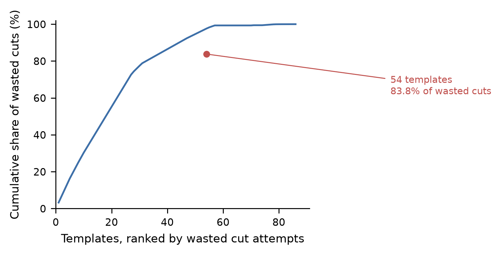
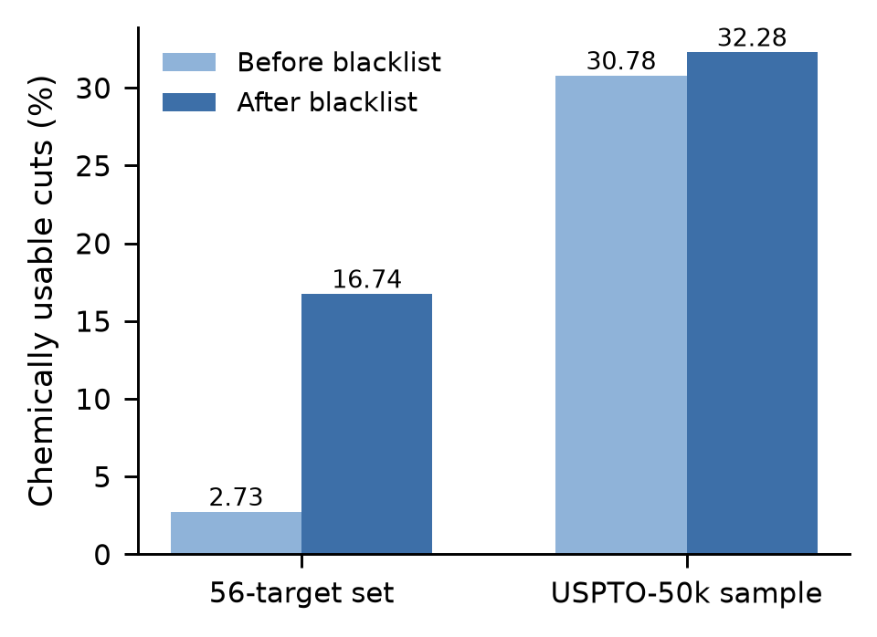
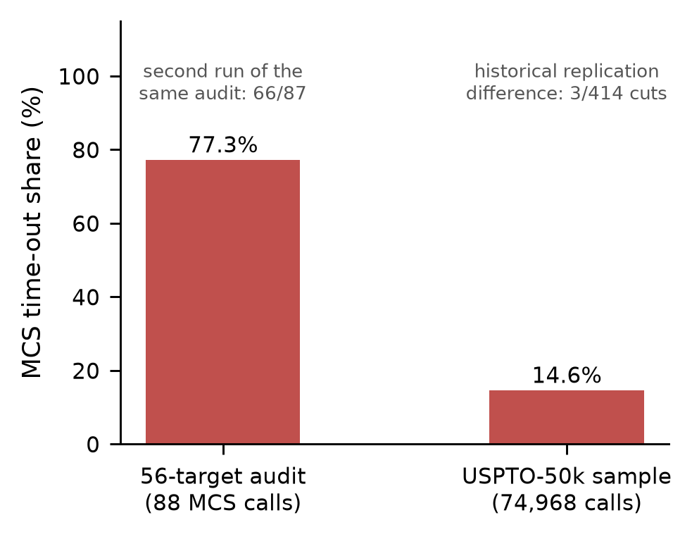
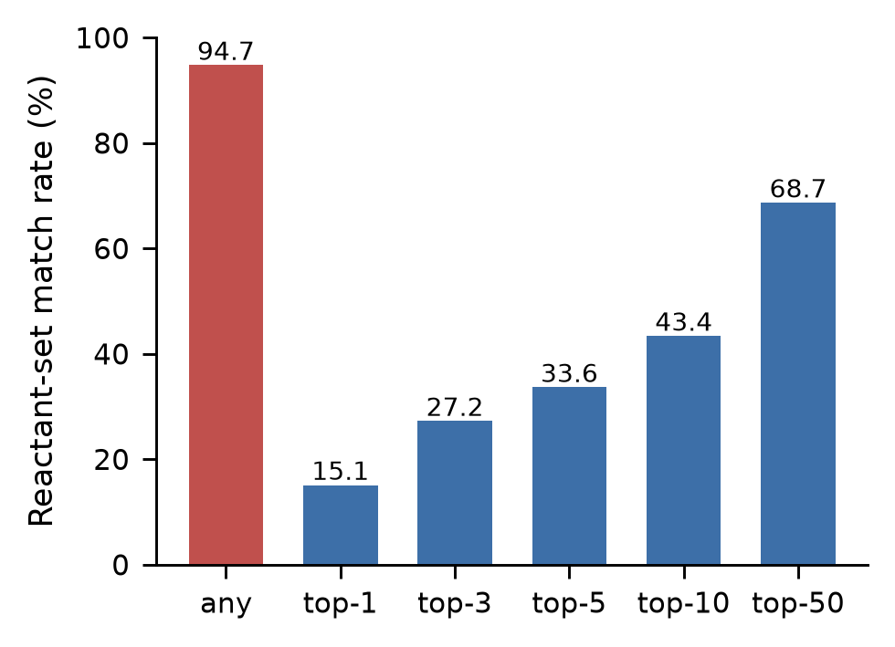
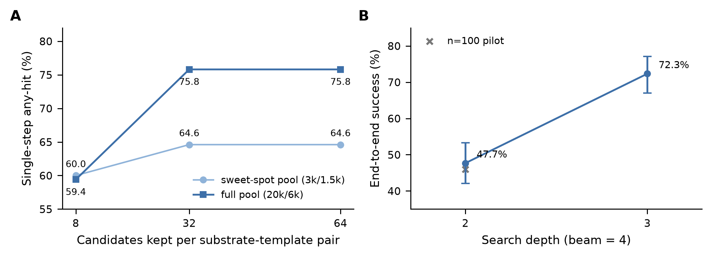
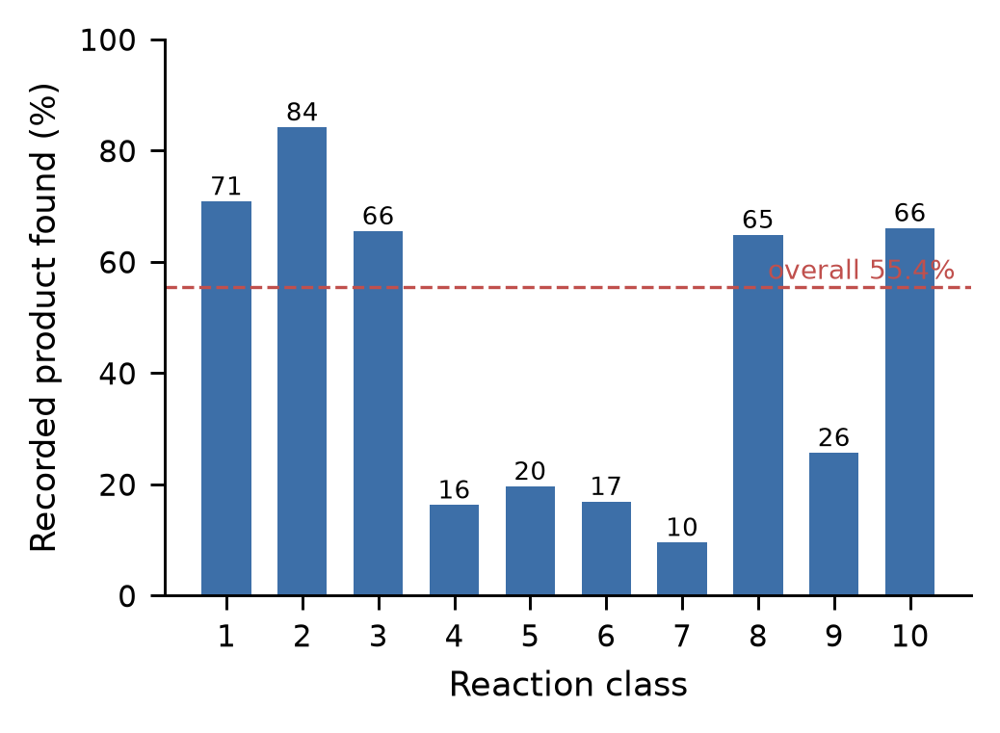
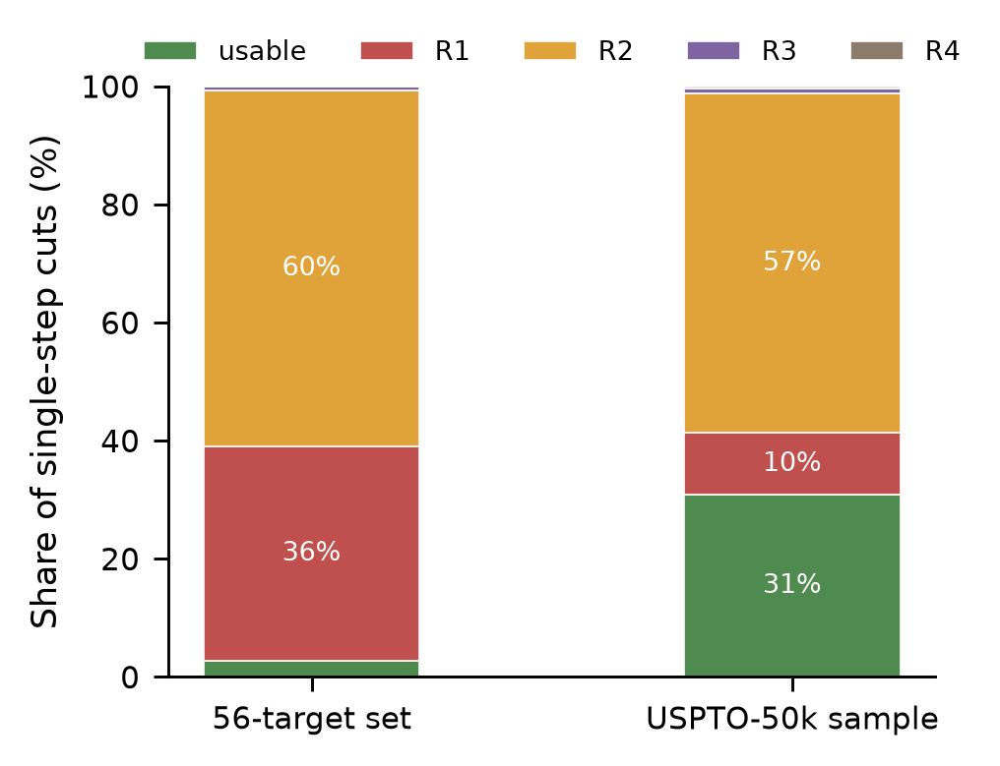

# 模板式逆合成的全库审计：少数模板主导假路线，限时判据不可复现

> 人味版初稿，2026-10-21。底稿是 10 月 19 日的 v0.1；数字沿用冻结版 v1.0.0，未新增实验。
> 与初稿的差别只在文字——其中判据一节改用了产物支持的 68/88，原稿的 62/66 是拼数错误，见 `数字勘误-20261019.md`。

**作者**：（待填）　**单位**：（待填）　**通讯作者**：（待填）

---

## 摘要

模板式逆合成今天仍然是工业界和开源社区的主路。围绕它的论文大多在讲搜索与排序，模板库自己好不好、判定一条路线可不可用的那把尺子准不准，很少有人逐条查过。这篇报告做了这件事：用公开的 USPTO-50k 和 ORD 反应数据，把一套模板库拆开，一条一条看。

看到的东西有五个。假路线不是均匀长出来的：56 个目标的审计集上，3,025 条模板里只有 54 条制造了 83.8% 的无效切断，把这批模板拉黑，可用率从 2.72% 升到 16.74%。USPTO-50k 上占主导的是「前体比目标还大」的切断（R2），57.5%，出自 491 条模板，前五条就占了 52.7%，前一百条 93.8%；这族的化学面孔是芳环 C–H 官能化的逆用。第三个发现不太好看：常用的残基/相似度判据立在限时 MCS 调用上，56 目标集里 88 次调用有 68 次超时（77.3%），50k 抽样 14.6%，判定会跟着机器状态走。第四，黑名单加一条确定性修补，在三种分布上方向一致，把「假可用」从 30.78% 收到 29.22%。第五个是意外：同一个 20k 池，把每个底物–模板对的候选截断从 8 放宽到 32，单步召回从 59.40% 跳到 75.80%（McNemar p=4.1e-25，没有一例回退），全量 50,016 目标上从 70.43% 到 82.32%（剔除泄漏版，Wilson 95% CI 81.98–82.65%）。

逆向覆盖率 94.74%（剔除版，n=5,002），多步端到端 47.67%（depth≤2）和 72.33%（depth≤3），n=300。应用一侧做了一条药典（2025 版）判据链：覆盖 386/491（78.6%）条目，连上 3,277 行，每行都带官方条目链接，装在一个默认关闭的开关后面。

从头到尾我们守一条：只标注，不删除，不暗中排序，每个生成项都带着出处和不确定标记。

**关键词**：逆合成；模板；反应过滤；可复现性；基准评测；数据出处；药典

## Abstract

Template-based retrosynthesis is still the main road, in industry and in open source alike. Most of the literature is about search and ranking. Whether the template library itself is any good, and whether the criterion that calls a route usable is stable, is rarely checked line by line. This report does that check on public data: USPTO-50k and the Open Reaction Database.

Five things came out of it. False routes are not spread evenly: on a 56-target audit set, 54 of 3,025 templates produce 83.8% of the invalid disconnections, and blacklisting them lifts usability from 2.72% to 16.74%. On USPTO-50k the dominant family is the one whose precursors are larger than the target (R2), at 57.5% of all cuts, coming from 491 templates; the top five account for 52.7% and the top hundred for 93.8%, and the chemistry behind them is the reverse of aromatic C–H functionalisation. The third finding is less comfortable: the residue/similarity criterion rests on time-boxed maximum common substructure calls, and in the 56-target set 68 of 88 calls timed out (77.3%), against 14.6% in a 50k sample, so verdicts follow the machine. Fourth, a blacklist plus one deterministic repair behaves the same way on three distributions, tightening the false-usable rate from 30.78% to 29.22%. Fifth, and unexpected: on a fixed 20k pool, widening the per-pair candidate truncation from 8 to 32 raises single-step recall from 59.40% to 75.80% (McNemar p=4.1e-25, zero regressions), and on the full 50,016 targets from 70.43% to 82.32% (leak-free, Wilson 95% CI 81.98–82.65%).

Reverse-direction coverage reaches 94.74% (leak-free, n=5,002), and multi-step success 47.67% at depth <= 2 and 72.33% at depth <= 3 (n=300). On the application side we built a predicate chain from the Chinese Pharmacopoeia (2025): 386 of 491 entries (78.6%), 3,277 linked rows, each row carrying its official entry URL, behind a switch that is off by default. Throughout, we mark instead of deleting, never rank silently, and keep provenance and uncertainty attached to every generated item.

**Keywords**: retrosynthesis; reaction templates; reaction filters; reproducibility; benchmarking; data provenance

---

## 1 引言

模板式逆合成把反应语料压成规则，再拿规则去切目标分子。这条路今天基本是标准配置：rdchiral 负责模板的抽取和应用，Retro* 和 AiZynthFinder 在上面搭搜索与排序，PaRoutes 提供路由级的对照。和这些系统一起长出来的还有一堆工程过滤器——键过滤、反应物数过滤、冻结子结构、学习型可行性模型。它们大多以默认参数的形式躺在代码里，命中就把这个候选扔掉。

这些过滤器存在，本身说明社区早就知道模板会被误用。有意思的是，它们很少成为被研究的对象。于是有三件事没人说得清。

一是毒性到底集不集中。假路线是整库均匀产生的，还是少数模板在制造？如果是后者，查库比扩数据划算得多，而这个判断会改变资源往哪儿投。

二是判据稳不稳。拿「前体跟目标差不多大」当残基路线的信号，是常见做法；这个判断要算最大公共子结构，而算它有超时。一旦超时，判定就落在一次没算完的搜索上。同一个分子，换台机器、换个负载，可能得出不同结论。所有报告「可用率」「路线质量」的工作都会继承这个不确定性，只是很少有人把它说出来。

三是截断的代价。搜索引擎为了控制宽度，会把每个底物—模板对的候选数截断。截得太紧，加模板不但不涨点，反而掉——这是我们跑实验时撞上的，后来专门设计了三点曲线和配对检验去确认它。

我们把这三件事放在一个公开、可复现、泄漏受控的口径上回答，顺手把审计结果做进了产品的默认值。具体做了这些：对全部模板在目标分布上逐条审计，量化集中度；把限时判据的超时结构和判定漂移实测出来，作为负结果报告；找到并修复截断饱和，单步召回从 55.43% 推到 82.32%；把残基判据从「删除」改成「按可得性条件化」；为 3,228 条模板全部挂上 ORD 反应标识；给 R2 家族一个化学读法；最后用一条药典判据链，示范排序依据也可以来自外部标准而不是模型打分。

我们的立场很直白：只标注，不删除；不打分，不静默排序；每个生成项都带出处和不确定标记。这既是对「过滤器早就有」这类质疑的正面回答，也是产品上的硬约束——一个不敢说自己不确定的系统，用户迟早会用错它。

## 2 相关工作

### 2.1 模板式逆合成与工程过滤器

模板抽取与应用的事实标准是 rdchiral（Coley et al., 2019）。Retro*（Chen et al., 2020）把模板相关性用在神经引导的 A* 搜索上；AiZynthFinder（Genheden et al., 2020）是开源规划器，带一整套过滤器。我们对着主分支源码核过一遍：BondFilter 不许断冻结键，QuickKerasFilter 是学习型可行性模型（代码默认 filter_cutoff = 0.05，概率过了阈值才放行），ReactantsCountFilter 要求反应物个数与模板预期一致，FrozenSubstructureFilter 不许切掉匹配的 SMARTS 子结构。四类都是拒绝式，命中即抛 RejectionException，候选直接消失（源码存了一份：reports/_network_evidence_20261018/aizynthfinder_filter_strategies.py，8,214 字节）。

我们和它们的差别不在有没有过滤器，而在把过滤器本身拿来审。我们不新加一个拒绝阈值，而是量现有判据在哪儿失效，然后把结论落在标注上。他们 reject，我们 mark。

### 2.2 基准与评测质量

USPTO-50k（Schneider et al., 2016）是单步逆合成事实上的基准；ORD（Kearnes et al., 2021）给的是带出处的社区反应记录。最近有两项工作把评测协议本身当研究对象：Syntheseus（Maziarz et al., 2025）说基准不一致会掩盖真实进展，并在受控条件下把若干 SOTA 方法的名次重排了；Models Matter（Torren-Peraire et al., 2024）量了单步模型对多步规划结果的影响。立场和我们一致，只是它们审的是基准和模型。

### 2.3 出处作为一等公民

3,228 条模板，每一条都挂了反应记录标识（3,228/3,228，100%）。这件事把「模板质量」从建模问题变成了可治理的数据问题——某条模板可疑，可以点回具体反应去看，而不是停在统计异常上。同样的做法后来用到下游：药典判据链每一行都带官方条目链接（§3.5）。

至于新颖性，我们不敢只凭印象说话。2026 年 10 月 19 日用 OpenAlex 和 Crossref 做了五组检索（附录 C），没找到对模板库做「逐条审计 + 集中度量化 + 留出分布复现 + 截断饱和」这一组合的公开工作。最接近的是上面那两篇评测文章，以及 2026 年几份说「单步基准不足以评价 LLM」的预印本；它们审的是基准或模型，不是模板库的集中度和截断行为。
## 3 方法与协议

协议全文随仓库发（README-protocol.md）。这里复述写死的口径，不是摘要——目的是让人照着能做，不需要猜我们当时怎么定的。

### 3.1 数据与许可

| 角色 | 数据 | 规模 | 许可 |
|---|---|---|---|
| 模板来源 | ORD uspto-grants（parquet） | 1,771,032 条反应，取前 60,000 行 | CC BY-SA 4.0 |
| 抽取记录 | rdchiral 模板抽取 | 56,047 条成功 | 本项目产出 |
| 基准目标 | USPTO-50k（retrosim 镜像） | 50,016 条，0 解析失败 | figshare CC0 / 代码 MIT |
| 终止集合·天然产物 | COCONUT 本地快照 | 269,105 有效分子 | 上游 curated dataset CC0 |
| 终止集合·中药成分 | tcm.db（库主自建，只读） | 31,646 | 库主自有 |
| 终止集合·砌块 | ORD 反推的可购砌块 | 32,146 full key | 继承 CC BY-SA 4.0 |

有一处偏差得先说清：COCONUT 里有，不等于真买得到；砌块表也只是商业可得性的代理。所以终止判定系统性偏乐观。这个偏差对相对比较（过滤前后、截断前后）影响不大，对绝对可用率有影响——全文的数字都按这个口径读。

### 3.2 基准库构建与泄漏控制

第一步是复现校验。用 retro_cluster_eval.py（min-freq=3，per-bucket=3）在不剔除的情况下重聚类，得到的模板集合与生产库完全相等：3,228 条，一条不差。这一步过了，后面的剔除才有意义。

第二步剔除。凡是「产物侧（去掉映射号）命中 USPTO-50k 任一产物」的抽取记录，一律删。删了 3,007 条，剩 56,047 里的一大半；再按同一算法重聚类，得到 3,065 条的基准库。

第三步是量化泄漏本身。50k 的产物出现在原抽取记录里的比例是 4.96%（2,480/50,016），完整反应签名一致的是 1.11%（555/50,016）。也就是说，对 50k 的评测是「模板实例没见过这些反应」条件下的评测。正向结果我们同时报了泄漏版和剔除版，正文一律报剔除版。

### 3.3 指标定义

any-hit 覆盖率：对目标产物套用全部模板，只要存在一个切断，其前体集合（去掉映射号并规范化）与 50k 记录的反应物集合严格相等，就算命中。

top-k（k = 1/3/5/10/50）：同一个产物的所有切断，按「模板频次降序，SMARTS 字典序」排。这个顺序是确定的、可复现的，不含任何化学评分；正确切断的最好名次不超过 k 就算命中。

逐切断可用性：按反应类别分层抽样，每类不超过 300 个，种子 20261014，用与生产环境完全相同的 step_usability 逐条判：R1 残基、R2 前体放大、R3 惰性、R4 荒谬。元素覆盖比和黑名单标记一起记下来。

黑名单是 reports/retro_template_blacklist.json，51 条禁用、3 条豁免、3 条 no-op。三个分布上做留出检验。

正向单步召回：把记录的反应物（1–3 个）喂给引擎跑一轮，记录的产物只要出现在候选集合里就算命中，不看排序；同时记候选规模和分类别回收率。这里只给反应物，不给催化剂和试剂，所以 C–C 偶联那几类天然吃亏——这不是引擎的问题，是输入的问题，后面单独再说。

### 3.4 判据可靠性实验

step_usability 对中等分子会调限时 MCS，超时设 2 秒。我们做两件事：统计超时比例，一处是 56 目标切断集，一处是 50k 分层抽样；再做受控负载的重判，安静跑一遍，压上 8 核负载跑一遍，再安静跑一遍，对 3,320 个切断重复判定，数翻转。负结果照实写，不修饰。

### 3.5 药典判据链（下游应用）

要让输入成分的排序依据经得起外部核对，就得从标准原文出发。《中国药典》2025 年版每个品种的「含量测定」和「鉴别」段落被抽出来，修 OCR 形近字、剔小节名、把多成分的「总量」句重建，再跟成分库对齐，每行都带官方条目链接。排序分两层：Tier-0（含量测定，有定量限度）在前，Tier-1（鉴别）在后；同层里按标准原文的限量值排，不掺任何模型打分。这套东西装在一个默认关闭的开关后面，全文头条结果都是关着的时候跑的。

### 3.6 实现与运行环境

RDKit 2026.3.6、rdchiral 1.1.0、Python 3.12.6；重聚类和出处反查用 duckdb 1.5.6 与 ord_schema 0.8.3。覆盖率跑 5,002 个目标，4 个 worker，44.8 分钟；可用性 1,000 个目标 54.2 分钟；正向 50,016 条约 49.5 分钟。模板库加载：老库 3,025 条 0.2 秒、137 MB；freq≥10 可编译 16,891 条 1.1 秒、595 MB；全量可编译 71,638 条 5.8 秒、2,785 MB。

## 4 结果

### 4.1 审计规模与集中度

3,025 条模板，56 个目标，一条一条过。出来的证据有两个方向。

一个是集中：54 条模板对应 83.8% 的无效切断。假路线不是均匀撒在库里的，是极少数模板在制造。

另一个是修复：把黑名单（51 条禁用、3 条豁免、3 条 no-op）挂上去，这个集合的可用率从 2.72% 升到 16.74%。

黑名单随后拿到另外两个分布上试，方向一致。

| 分布 | 名单命中 | 切断 | 可用 | 结论 |
|---|---|---|---|---|
| 56 目标审计集（早期） | — | — | 2.72% → 16.74% | 集中度与修复的第一份证据 |
| COCONUT 64 目标 | 53 条 | — | 50 条仍零可用 | 3 条「复活」已豁免 |
| USPTO-50k 全量 | 51 条 | 409,422 | **0.40%** | 第三次分布外检验，方向一致 |

*图 1　无效切断的集中度：少数模板主导假路线。*

### 4.2 R2 家族：前体比目标大的切断

50k 上，R2 占全部切断的 57.5%，出自 491 条模板。集中得厉害：前五条占 52.7%，前二十条 77.7%，前一百条 93.8%。

这些模板干的是一件化学上说得通、作为切断却可疑的事——把芳环 C–H 官能化倒过来写（Ar–H ← Ar–F/Cl/Br/I/O/Me），也就是把脱卤、去官能团当成合成步骤。

第一版黑名单是按频次建的（≥5 次），结果整族都没抓到。原因不难理解：按支持度筛，看不见由方向定义的错误。于是我们另建了一份分布条件化的名单，B8，29 条，全部 R2、全部零可用，在 50k 抽样里占全部切断的 45.8%、占全部 R2 的 79.8%。B8 默认关闭；开启时模板从 3,025 降到 2,942，这样头条数字还能跟文献比。

*图 2　黑名单前后可用率（56 目标与 50k）。*

### 4.3 判据可靠性：限时 MCS 与判定漂移

| 实验 | 结果 |
|---|---|
| 超时率（56 目标切断集） | **68/88 = 77.3%** |
| 超时率（50k 分层抽样） | 10,977/74,968 = **14.6%** |
| 受控负载重判（安静/8 核/安静） | 0/3,320 翻转；该集全是 R1、没触发一次 MCS |
| 两次独立审计的复现差 | 3/414；同一模板 idx1613 的切断数 28 → 26 |

零翻转看上去像好消息，其实不是。那 3,320 个切断全都判成 R1，一次 MCS 都没调用——它根本没走到判据的边界上。所以这组数据什么也证明不了，我们把它当失败实验报，而不是当稳定性证据。

能真正说明问题的是前两行：77.3% 和 14.6%。判定大量来自没算完的搜索，这件事本身就够让人不安；再加上两次独立审计在 414 个切断上差了 3 个，同一条模板的切断数在一次运行里是 28、另一次是 26。可复现性的证据应该落在这里，不该落在那次没触发的重判上。

*图 5　MCS 超时比例：56 目标审计与 50k 抽样；注记为第二轮审计与历史复现差。*

### 4.4 数据规模消融

把模板来源从 3.4% 的语料扩到 100%：老库 3,228 条，v2 全量 81,286 条（基准版 79,184）。同 501 个目标上，any-hit 从 78.44% 升到 93.61%；扩到 5,002 个目标是 94.74%（Wilson 95% CI 94.09–95.33%），top-1/3/5/10/50 分别是 15.07/27.21/33.61/43.36/68.65%，平均每个产物 1,766.6 个切断。

| 指标 | 值 | Wilson 95% CI |
|---|---|---|
| 逆向覆盖率（剔除版，n=5,002） | **94.74%** | 94.09–95.33% |
| 逆向覆盖率（freq≥10，n=5,002） | 91.90% | 91.11–92.63% |
| 平均切断数/产物 | 1,766.6 | — |
| 可用率（v2 全量，确定性判据默认） | 23.13% | 23.06–23.20% |
| 可用率（freq≥10） | 27.31% | 27.20–27.42% |

这里有个坑要指出：老库的 29.22% 和 v2 的 23.13% 不能直接比。老库是分层约 2,930 个目标，v2 是每类 100、共 1,000 个。同一句话里的两个百分比，分母都不是一回事——这正是我们坚持「指标必须跟数字一起报」的原因。

*图 3　覆盖率与 top-k 曲线。*

### 4.5 截断饱和：更多模板反而掉点

同一个 20k 候选池，只动每个底物—模板对的候选截断：

| 配置 | 单步召回（500 样本） | 说明 |
|---|---|---|
| cap8 | 59.40% | 基线 |
| cap32 | **75.80%** | +16.4 pt，McNemar p=4.1e-25（0 : 82） |
| cap64 | 75.80% | 32 就饱和了 |

全量 50,016 个目标上是另一组数：cap8 70.43%，cap32 泄漏版 82.56%，剔除版 82.32%（Wilson 95% CI 81.98–82.65%）。相对旧默认的 55.43%，涨了 26.9 个点。配对检验，旧默认到新配置 41.60% 到 75.40%，一边独有 0、另一边 169，p=2.7e-51，没有一例回退。泄漏版和剔除版只差 0.24 个点（McNemar p=0.5），这算是口径诚实性的直接证据。

机制的解释是推断，但跟曲线吻合：引擎对每个（底物，模板）对只留前 cap 个候选，而天然产物类底物的正确答案经常排在这一对的后段；cap 从 8 放到 32，这些答案重新可见，过了 32 不再有新东西，曲线就在 32 处平了。换句话说，此前以为的「模板不够多」，有相当一部分是截断造成的假性缺模板。

*图 7　截断饱和（cap8/32/64）与多步曲线（depth≤2/3）。*

### 4.6 正向：从 55.43% 到 82.32%

| 指标 | 值 | Wilson 95% CI |
|---|---|---|
| 正向·旧默认（600+903 模板） | 55.43% | 54.99–55.87% |
| 正向·全量库 cap8 | 70.43% | 70.03–70.83% |
| 正向·全量库 cap32 泄漏版 | 82.56% | 82.22–82.89% |
| **正向·全量库 cap32 剔除版（本文报此值）** | **82.32%** | **81.98–82.65%** |

候选规模的变化值得单说：旧默认平均 8.8 个（中位 8、p90 15、空集 1.01%），cap32 之后平均 21.4 个、空集 0.03%。分类别召回差得很开，class 2 到 84.2%，class 10 是 66.1%，class 7 只有 9.5%。这跟我们的口径一致：只给反应物、不给试剂和催化剂，C–C 偶联那几类（4/5/6/7）天然吃亏。

失败归因更有意思。22,292 个失败里，只有 2%（503 个）是「一个候选都没有」；单反应物记录召回 15.2%，双反应物 72.1%。短板在记录缺配料和模板覆盖，不在引擎看不见目标。

*图 6　正向召回的分类别分解（基线配置；虚线是总体 55.43%）。*

### 4.7 多步端到端

剔除版库（16,891 条）配 beam=4，n=300：depth≤2 成功 143/300 = 47.67%（CI 42.08–53.31%），depth≤3 是 217/300 = 72.33%（CI 67.01–77.09%）；207 个目标至少有一条「可用」路线。n=100 的试点是 46.0%，跟 n=300 对得上。

### 4.8 应用：药典判据链

药典（2025 版）判据链覆盖了范围内 386/491 个条目（78.6%），连上 3,277 行（58.0%），每行带官方条目链接。复核是对源文本做 400 行盲查：93.5% 有支持，剔掉 5.3% 已知的抽取伪影后是 98.7%；换一个更严格的窗口匹配器独立再查一遍，400 行零分歧。没连上的 21% 集中在矿物、聚合、尾类条目，以及总量句重建失败的品种——这是个能解释的天花板，不是待办的 bug。

两个例子。甘草，12 个成分，生产配置加排序开关跑下来，候选账本里 552 条不同的候选产物、552 条出处路径；药典对这味药定量的两个成分，甘草酸（≥2.0%）和甘草苷（≥0.50%），正好排在候选表前两位，各自带着限量值和出处条目。穿心莲那边演示的是另一种情况：总量句原来是一句话，重建之后还原成四个可连接的成分（穿心莲内酯、新穿心莲内酯、14-去氧穿心莲内酯、脱水穿心莲内酯）。

*图 4　切断判定构成（R1/R2/R3/R4）。*

### 4.9 出处链

3,228 条模板，3,228 条都挂回了 ORD 反应标识，反应级反查 9,177/9,177 一致。这意味着「这条模板为什么可疑」可以一直追到具体反应记录上，而不是停在一句统计结论里。

## 5 讨论

### 5.1 「更多模板反而掉点」的含义

截断饱和这件事，把「数据规模」和「搜索宽度」两个经常被混着说的杠杆分开了。在我们最早的配置里，扩库的收益被截断吃掉了一大半——cap8 下全量库也只有 70.43%——而放宽截断，一点新数据都不要，数字就上到 82.32%。

对做系统的人，建议只有一句：报模板库规模之前，先把截断参数报出来。不报的话，两个系统的召回差异到底来自数据、来自模板、还是来自搜索宽度，根本没法归因。

### 5.2 为什么 R2 家族占主导：一个化学读法

R2 的本质是把「装上官能团」倒过来写成「拆掉官能团」。化学上这不算荒谬，后期 C–H 官能化是真实策略；但当成一个切断看，它默认了那个 C–H 前体是便宜、买得到的起始原料。当引擎吃的是砌块而不是设计好的中间体时，这类编辑步骤会伪装成合成——模型提议拆掉一个它从来没被要求装上的基团。

我们的处置有三个。审计而不是空谈：把家族枚举出来，量化集中度。判据按可得性条件化：前体买得到，逆编辑步骤合法；买不到，才判假。名单做成分布条件化的产物：哪些编辑反应可接受，取决于目标分布（天然产物样还是砌块样），能交付的是条件化名单加审计脚本，而不是一个全局阈值。

### 5.3 审计卫生 vs 数据规模

主线结论可以压成一句话：在社区标准反应数据上，模板式预测的质量瓶颈更多来自语料审计卫生和候选截断，而不是数据量本身。

这跟直觉相反，也解释了一件事：为什么不同系统报的召回数字那么难比。它们的截断、过滤、泄漏处理各不相同，而这些参数很少出现在论文里。

### 5.4 应用含义：可追溯的排序依据

药典判据链示范的是另一种排序：依据来自外部标准（限量值），不是模型打分；每一行都能点回官方条目。它在产品上是个默认关闭的开关，所以不污染主结果；在方法上，它把「可解释」从形容词变成了可审计的数据结构。

## 6 局限

没用上人工盲标，这是最硬的一条。我们没能请到独立的化学专家来标，只能用代理判据加 400 行的金标准复核（93.5%/98.7%）顶上，并且明说这是替代，不是等价。标注套件（200 条切断、单文件 HTML，能导 CSV）一直备着，随时可以发起。

可用性判据本身是启发式的。R1–R4 和有界 MCS 都是，超时也一直存在（量过了），边界上的判定可能跟机器相关。

评测在 ORD 内部做。模板从社区数据挖出来，也在社区数据上评；泄漏我们控了（剔掉 75,718 行，报剔除版），但跨库的外部评测还是未来工作，跟自动逆合成系统的基线对比也没做。

药典链是个下游层，不是 oracle。它依赖第三方的结构化版本；范围内 21% 的条目没连上；总量句得逐个重建。

条件只标注，不模拟。温度、溶剂、试剂的窗口带证据强度标记，我们不敢说动力学、收率、选择性。

范围上有一条自觉的边界：系统是通用反应引擎，具体场景（比如煎煮化学）在这一版里是有意排除的。

最后补一句 TCM 侧的数据出处审计。对 AI 检索来的古方做固定种子抽检（n=300）：28.0% 组成一致（CI 23.2–33.3%），66.3% 只是同名，5.7% 在查过的信道里没找到——没找到不等于不存在。每条记录都带出处分层（0 药典 … 5 AI 现查），从不隐藏或删除。

## 7 结论

模板库不是中性的基础设施。少数模板能主导假路线，判据可能在超时里漂，截断可能悄悄吃掉扩库的收益。这篇给了三件可检验的事——集中度、判据不稳定性、截断饱和——和一套能复现的审计修复框架，把单步召回从 55.43% 推到 82.32%，顺带示范了一种来源可溯的排序依据。

我们更想说的是：把过滤器和评测口径本身当成研究对象，比再加一个排序模型，对这个领域的可信度更有用。

---

## 数据与代码可用性

协议、结果 JSON、图、脚本都随仓库发（复现清单.md、README-protocol.md）。原始数据不分发：ORD、COCONUT、USPTO-50k 一条都不带，只发脚本和由公开数据生成的模板与清单，并注明上游出处与许可。ORD 衍生的模板按 CC BY-SA 4.0 处理；USPTO-50k 是 CC0（figshare 5104873），retrosim 镜像代码 MIT；COCONUT 的 curated dataset 是 CC0、基础设施代码 MIT；SmartReact 模板包 Apache-2.0。评测用的 50k 记录不进入任何中间产物，这一点由 §3.2 的剔除流程保证。

## 作者贡献 / 利益冲突 / 致谢

（待填）

## 参考文献

1. Coley, C. W., Green, W. H., Jensen, K. F. RDChiral: An RDKit wrapper for handling stereochemistry in retrosynthetic template extraction and application. *J. Chem. Inf. Model.* 2019, 59(6): 2529–2537. DOI: 10.1021/acs.jcim.9b00286.
2. Chen, B., Li, C., Dai, H., Song, L. Retro*: Learning retrosynthetic planning with neural guided A* search. *ICML* 2020, PMLR 119: 1608–1616.
3. Genheden, S., Thakkar, A., Chadimová, V., Reymond, J.-L., Engkvist, O., Bjerrum, E. J. AiZynthFinder: a fast, robust and flexible open-source software for retrosynthetic planning. *J. Cheminform.* 2020, 12: 70. DOI: 10.1186/s13321-020-00472-1.
4. Schneider, N., Stiefl, N., Landrum, G. A. What's What: The (Nearly) Definitive Guide to Reaction Role Assignment. *J. Chem. Inf. Model.* 2016, 56(12): 2336–2346. DOI: 10.1021/acs.jcim.6b00564.
5. Kearnes, S. M., Maser, M. R., Wleklinski, M., Kast, A., Doyle, A. G., Dreher, S. D., Hawkins, J. M., Jensen, K. F., Coley, C. W. The Open Reaction Database. *J. Am. Chem. Soc.* 2021, 143(45): 18820–18826. DOI: 10.1021/jacs.1c09820.
6. Sorokina, M., Merseburger, P., Rajan, K., Yirik, M. A., Steinbeck, C. COCONUT online: Collection of Open Natural Products database. *J. Cheminform.* 2021, 13: 2. DOI: 10.1186/s13321-020-00478-9.
7. Genheden, S., Bjerrum, E. J. PaRoutes: towards a framework for benchmarking retrosynthesis route predictions. *Digital Discovery* 2022, 1(4): 527–539. DOI: 10.1039/D2DD00015F.
8. Maziarz, K., Tripp, A., Liu, G., Stanley, M., Xie, S., Gaiński, P., Seidl, P., Segler, M. Re-evaluating retrosynthesis algorithms with Syntheseus. *Faraday Discuss.* 2025, 256: 568–586. DOI: 10.1039/D4FD00093E.
9. Torren-Peraire, P., Hassen, A. K., Genheden, S., Verhoeven, J., Clevert, D.-A., Preuss, M., Tetko, I. V. Models Matter: the impact of single-step retrosynthesis on synthesis planning. *Digital Discovery* 2024, 3(3): 558–572. DOI: 10.1039/D3DD00252G.
10. 国家药典委员会. 中华人民共和国药典（2025 年版）. 北京：中国医药科技出版社，2025.

---

## 附录 A　数字出处对照

| 正文数字 | 值 | 出处文件 |
|---|---|---|
| 模板复现校验 | 3,228 = 3,228 | lib_repro_check.jsonl |
| 基准库（剔除后） | 3,065（删 3,007/56,047） | lib_uspto50k_excl.jsonl |
| 泄漏量化 | 4.96% / 1.11% | README-protocol.md §2 |
| 单步 any-hit（老库） | 79.81% | coverage_summary.json |
| 可用性（老库分层） | 30.78% | usability_summary.json |
| R2 集中度 | 57.5%；top5 52.7% | r2_audit.json |
| 56 目标黑名单前后 | 2.72% → 16.74% | retro_template_audit_summary_r41.json |
| 超时率 | 68/88（77.3%）、14.6% | retro_template_audit_summary_r41.json / usability_summary.json |
| 受控负载重判 | 0/3,320（全 R1、未触发 MCS） | results/instability.json |
| B6 确定性判据 | 30.78% → 29.22% | usability_summary_after_b6.json |
| B8 第二批名单 | 29 条，45.8% | paper_b8_ext.py / blacklist_ext_r2.json |
| v2 覆盖率 | 94.74%（5,002） | coverage_summary__lib_uspto50k_excl_v2_s10.json |
| 截断饱和 | 59.40 → 75.80 → 75.80 | cap32_20k_full50k.json |
| 全量正向 | 82.32%（剔除版） | forward_50k__lf_cap32_20k_full50k.json |
| 多步 | 47.67% / 72.33% | bench_multistep__lfreq10_d{2,3}b4_n300.json |
| 药典链 | 386/491，3,277 行 | chp2025_linked.csv |
| H2 古方抽检 | 28.0% / 66.3% / 5.7% | h2_verdicts_all.json |

## 附录 B　版本说明

本文数字对应结果冻结版 v1.0.0（2026-10-15 至 10-18 的冻结值，唯一出处是统计总表）。当前对外代码是 v0.9.0-beta，2026-10-18 之后加了安全闸：公开版关掉了任意目标逆合成和自由辅助试剂入口，安装器不打包数据库。算法和基准口径两者一致，差的只是外围。投稿前得把版本号统一，别让论文、软著、发布说明三个地方各说各的。

Top500 条件窗口（500 条模板、493 条有产物匹配、451,593 累计 support）是条件数据的产物，还没接进实时引擎的默认路径，本文一个数字都没用到；条件能力在这里只以「标注而非模拟」的立场出现。

## 附录 C　新颖性检索

2026-10-19，OpenAlex 与 Crossref，五组查询：template audit retrosynthesis；toxic templates retrosynthesis false routes；retrosynthesis evaluation reproducibility pitfalls；route validity filter retrosynthesis usability；以及 Retro* 的原始出处核对。

没有找到对模板库做「逐条审计 + 集中度量化 + 留出分布复现 + 截断饱和」这一组合的公开工作。最接近的三类：Syntheseus 与 Models Matter 审的是基准和模型；2026 年几份预印本（例如「When Single Answer Is Not Enough」一类）审的是单步基准对 LLM 的适用性；工程过滤器本身散落在各系统的代码里，没有被当作研究对象。参考文献的卷期页码同一天用 Crossref/PMLR 逐条核过。
