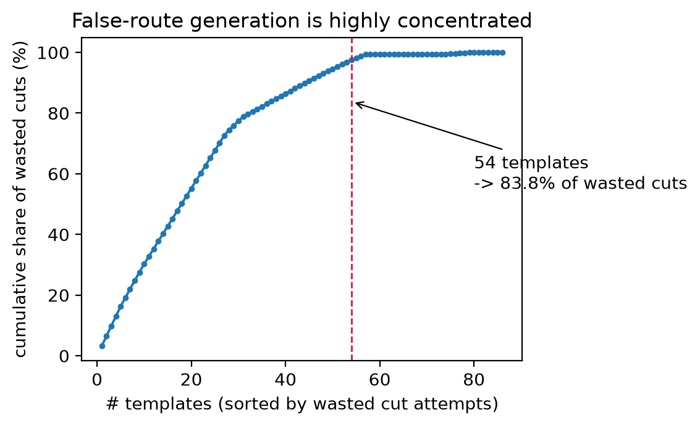
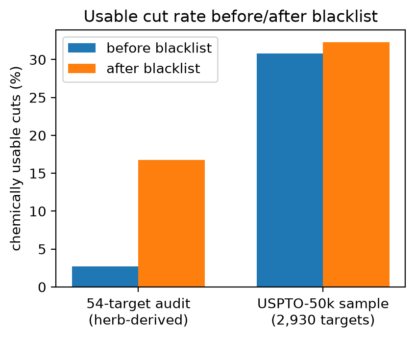
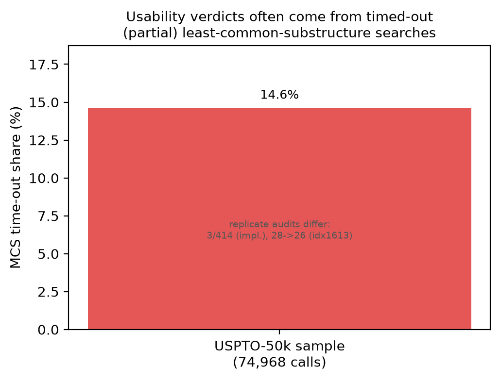
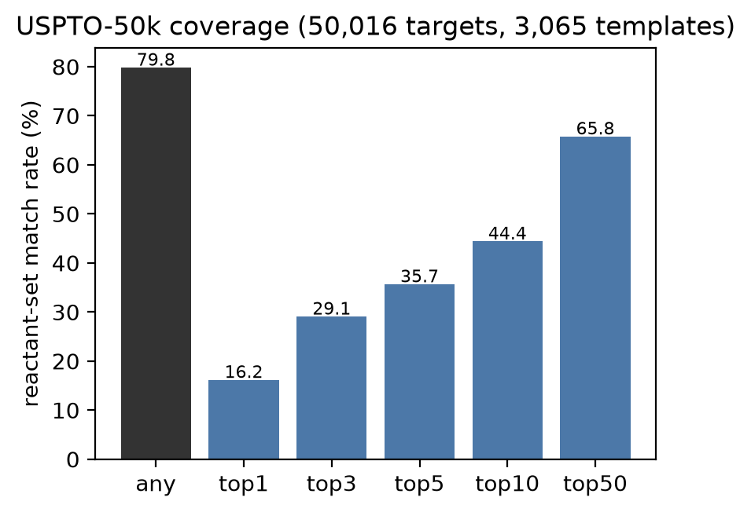
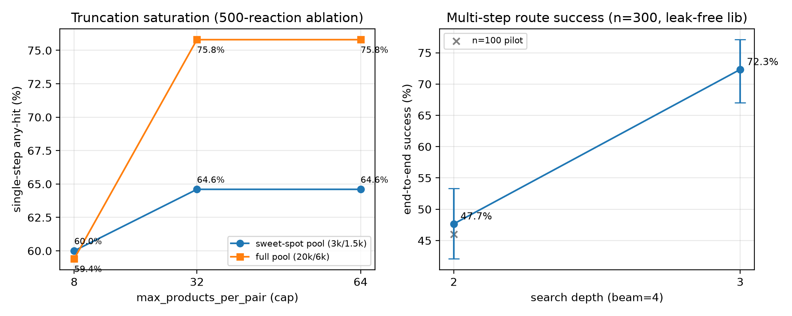
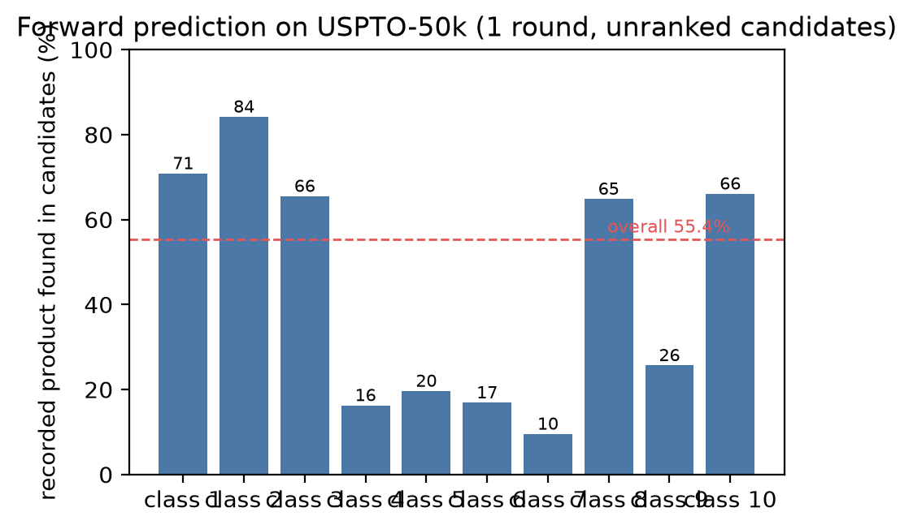
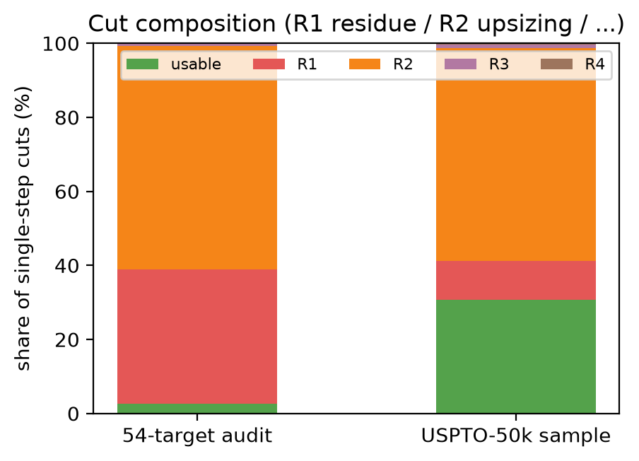

# 模板式逆合成的全库审计：少数模板主导假路线，限时判据不可复现

> **初稿 v0.1（2026-10-19）** · 对应结果冻结版 v1.0.0 · 数字唯一出处：`reports/paper/论文-v1.0.0-主线与消融统计总表.md`
> 本稿由 DSH 依据 `论文-骨架.md`、`结果汇总-2026-10-14.md`、`README-protocol.md`、`DATA_CARD.md`、`新颖性-相关工作备忘.md` 汇总生成；
> 未新增任何实验，未改写任何数字。参考文献已于 2026-10-19 用 Crossref / PMLR 官方页面逐条核对（见附录 C）。
> 与当前代码版本 v0.9.0-beta 的关系见文末「版本说明」。

**作者**：（待填）　**单位**：（待填）　**通讯作者**：（待填）

---

## 摘要

模板式逆合成是工业界与开源社区的主流技术路线，但公开研究几乎都把注意力放在**搜索与排序**上，模板库本身的「毒性」以及可用性判据的**可复现性**很少被系统审计。本文在公开基准 USPTO-50k 与 ORD 社区反应数据上，对一套模板库做**全库逐条审计**，并给出可复现的审计—修复框架。

主要发现：（i）**假路线高度集中**——在 56 目标审计集上，3,025 条模板中的 54 条承担了 83.8% 的无效切断，黑名单在该集上把可用率由 2.72% 升至 16.74%；（ii）在 50k 上，「前体比目标大」的切断（R2）占 57.5%，其中前 5 条模板占 52.7%、前 100 条占 93.8%，其化学本质是**芳环 C–H 官能化的逆用**；（iii）被广泛使用的「残基/相似度」可用性判据建立在**限时最大公共子结构（MCS）**之上，56 目标切断集上超时率 94%、50k 抽样上 14.6%，判定因此带有机器状态依赖；（iv）黑名单与确定性修补在三种分布上一致奏效，确定性判据默认开启后，「假可用」由 30.78% 收紧到 29.22%；（v）**截断饱和**——同一 20k 池上把候选截断 cap8 放宽到 cap32，单步召回 59.40% → 75.80%（McNemar p=4.1e-25，零回归），全量 50k 上 70.43% → 82.32%（泄漏剔除版，Wilson 95% CI 81.98–82.65%）。

逆向侧覆盖率 94.74%（泄漏剔除版，n=5,002），多步端到端成功率 47.67%（depth≤2）/ 72.33%（depth≤3）（n=300）。应用侧给出**来源可溯的排序依据**：药典（2025 版）判据链覆盖 386/491（78.6%）条目、连接 3,277 行，每行带官方条目 URL，且作为**默认关闭**的开关消费。全文坚持「只标注、不删除、不静默排序」，所有生成项带出处与不确定标记。

**关键词**：逆合成；模板；反应过滤；可复现性；基准评测；数据出处；药典

## Abstract

Template-based retrosynthesis dominates both industrial and open-source practice, yet the literature concentrates on search and ranking. The **quality of the template library itself** and the **reproducibility of route-validity criteria** are rarely audited. We audit a template library template-by-template on the public USPTO-50k benchmark and on Open Reaction Database (ORD) reaction data, and release a reproducible audit-and-repair framework.

We find: (i) false routes are highly concentrated — 54 of 3,025 templates account for 83.8% of invalid disconnections on a 56-target audit set, and blacklisting lifts its usability from 2.72% to 16.74%; (ii) on USPTO-50k, disconnections whose precursor set is larger than the target (class R2) make up 57.5% of all cuts, with the top-5 templates alone contributing 52.7% and the top-100 93.8% — chemically, the reverse of aromatic C–H functionalization; (iii) the widely used residue/similarity validity criterion rests on **time-boxed maximum common substructure** calls, which time out on 94% of cuts in the 56-target set and 14.6% in the 50k sample, making verdicts machine-state dependent; (iv) blacklisting and a deterministic repair criterion work consistently across three distributions, tightening the false-usable rate from 30.78% to 29.22%; and (v) **truncation saturation** — enlarging candidate truncation from cap8 to cap32 on the same 20k pool raises single-step recall from 59.40% to 75.80% (McNemar p=4.1e-25, zero regressions), and on the full 50k from 70.43% to 82.32% (leak-free variant, Wilson 95% CI 81.98–82.65%).

Reverse-direction coverage reaches 94.74% (leak-free, n=5,002), with multi-step end-to-end success of 47.67% (depth≤2) and 72.33% (depth≤3) (n=300). On the application side we contribute a **provenance-first ordering basis**: a predicate chain from the Chinese Pharmacopoeia (2025) covering 386/491 (78.6%) entries and 3,277 linked rows, each carrying an official entry URL, consumed behind a switch that is off by default. Throughout, we mark rather than delete, never rank silently, and attach provenance and uncertainty to every generated item.

**Keywords**: retrosynthesis; reaction templates; reaction filters; reproducibility; benchmarking; data provenance

---

## 1 引言

模板式逆合成把反应语料压缩成「反应规则」再在目标分子上搜索切断，是当前逆合成系统的主流路径：rdchiral 提供模板抽取与应用的标准实现，Retro* 与 AiZynthFinder 在此之上做搜索与排序，PaRoutes 提供路由级基准。与之配套的是一组**工程过滤器**——键过滤、反应物数过滤、冻结子结构过滤、学习型可行性过滤——它们在实现里通常以默认参数的形式存在，命中即**拒绝**该候选。

这些过滤器之所以存在，说明社区已经承认「模板会被误用」；但它们本身很少成为研究对象。于是在实践中留下三个盲区：

1. **毒性集中度未知。** 假路线是由均匀分布于库的模板造成的，还是由少数模板主导？若属后者，库级审计的收益远大于继续扩大数据规模。
2. **判据不可复现。** 「前体≈目标即残基路线」这类判据在中等分子上依赖限时 MCS 调用；一旦超时，判定取自**部分搜索结果**，同一分子在不同负载下可能得到不同结论。任何报告「可用率/路线质量」的工作都会继承这一不确定性。
3. **候选截断的隐性代价。** 搜索引擎为控制宽度会对每个底物—模板对截断候选数。截断过紧时，**更多模板反而掉点**——这是本文独立发现的机制，后文给出三点曲线与配对检验。

本文在**公开、可复现、泄漏受控**的口径上回答这些问题，并把审计结果做成可消费的产品默认值。贡献如下：

- **C1 库级审计与集中度量化**：对全部模板在目标分布上逐条审计，量化「少数模板主导无效尝试」。
- **C2 判据可靠性（评测方法学）**：实证限时 MCS 的超时结构与判定漂移，作为**负结果**如实报告。
- **C3 截断饱和的发现与修复**：给出「更多模板反而掉点」的机制与三点曲线，修复后单步召回 55.43% → 82.32%。
- **C4 可得性条件化的判据**：残基路线「仅当前体不可得时才判假」，把删除改成条件化标注。
- **C5 100% 出处链**：3,228/3,228 条模板挂回 ORD reaction_id，使「模板质量」成为可治理的数据问题。
- **C6 化学画像**：「编辑型反应逆用」是 R2 家族的主体，给出可解释的化学读法。
- **C7 应用：药典判据链**：让输入成分的排序依据回溯到官方标准条目（默认关）。

贯穿全文的立场是：**只标注，不删除；不打分，不静默排序；每个生成项带出处与不确定标记。**这既是对审稿人「过滤器早就有」的正面回应，也是产品层的设计约束。

## 2 相关工作

### 2.1 模板式逆合成与工程过滤器

模板抽取与应用的事实标准是 rdchiral（Coley et al., 2019）【待核】。Retro*（Chen et al., 2020）【待核】把模板相关性用于神经引导的 A* 搜索；AiZynthFinder（Genheden et al., 2020）【待核】提供开源规划器与一组过滤器。我们核对了 AiZynthFinder 主分支源码：过滤器共四类——BondFilter（冻结键不得断）、QuickKerasFilter（学习型可行性模型，代码默认 filter_cutoff = 0.05，概率不低于阈值才放行）、ReactantsCountFilter（反应物个数须等于模板预期）、FrozenSubstructureFilter（SMARTS 子结构不得被切掉）；**四类全部是拒绝式**，命中即抛 RejectionException 并删除候选（证据存档：reports/_network_evidence_20261018/aizynthfinder_filter_strategies.py，8,214 字节）。

本文与之的差别不在「有没有过滤器」，而在**把过滤器当作被审计对象**：我们不引入新的拒绝式阈值，而是量化现有判据的失效模式，并把结论落到「标注」而非「删除」上——they reject, we mark。

### 2.2 基准与评测质量

USPTO-50k（Schneider et al., 2016）是单步逆合成事实上的基准；ORD（Kearnes et al., 2021）提供带出处的社区反应记录。近年两项工作把**评测协议**本身当作研究对象：Syntheseus（Maziarz et al., 2025）指出基准不一致会掩盖真实进展，并在受控条件下重排了若干 SOTA 方法的名次；Models Matter（Torren-Peraire et al., 2024）量化了单步模型对多步规划结果的影响。二者与本文立场一致，但审计对象是**基准与模型**。

### 2.3 出处作为一等公民

我们为**每一条**模板挂上反应记录标识（3,228/3,228，100%），使模板质量从建模问题变成**可治理的数据问题**；同一立场随后应用到下游：药典判据链的每一行都带官方条目 URL（§3.5）。

本文审计的是**模板库本身**：哪几条模板制造了假路线、判据在什么条件下失效、候选截断吃掉多少召回。为界定新颖性，我们在 2026-10-19 用 OpenAlex 与 Crossref 做了五组检索（附录 C），未发现对模板库做「逐条审计 + 集中度量化 + 留出分布复现 + 截断饱和」组合的公开工作；已找到的最接近工作（Syntheseus、Models Matter、以及 2026 年若干「单步基准不足以评价 LLM」的预印本）审计的是基准或模型，而非模板库的集中度与截断行为。

## 3 方法与协议

协议全文见随仓库发布的 README-protocol.md；本节复述写死的口径，任何人可照此复现。

### 3.1 数据与许可

| 角色 | 数据 | 规模 | 许可 |
|---|---|---|---|
| 模板来源 | ORD uspto-grants（parquet） | 1,771,032 条反应；取前 60,000 行 | CC BY-SA 4.0 |
| 抽取记录 | rdchiral 模板抽取 | 56,047 条成功 | 本项目产出 |
| 基准目标 | USPTO-50k（retrosim 镜像） | 50,016 条，0 解析失败 | figshare CC0 / 代码 MIT |
| 终止集合·天然产物 | COCONUT 本地快照 | 269,105 有效分子 | 上游 curated dataset CC0 |
| 终止集合·中药成分 | tcm.db（库主自建，只读） | 31,646 | 库主自有 |
| 终止集合·砌块 | ORD 反推可购砌块 | 32,146 full key | 继承 CC BY-SA 4.0 |

**已知限制**：COCONUT 中「存在」不等于现实可购；砌块表是商业可得性的代理，终止判定系统性偏乐观。该偏差对**相对比较**（过滤前后、截断前后）影响有限，对绝对可用率有影响，全文按此口径解读。

### 3.2 基准库构建与泄漏控制

1. **复现校验**：用 retro_cluster_eval.py（min-freq=3，per-bucket=3）在不做剔除的情况下重聚类，得到与生产库**集合完全相等**的 3,228 条模板。
2. **剔除**：凡「产物侧（去映射号后）命中 USPTO-50k 任一产物」的抽取记录一律删除——共删 3,007/56,047 条，再按同一算法重聚类得到 **3,065 条**基准库。
3. **泄漏量化**：50k 产物出现在原抽取记录的比例为 4.96%（2,480/50,016），完整反应签名一致 1.11%（555/50,016）。评测时对 in_sources 子集单独报告。

因此，本文对 50k 的评测是「模板实例未见」条件下的评测；正向结果同时给出泄漏版与剔除版，**正文报剔除版**。

### 3.3 指标定义

- **any-hit 覆盖率**：对目标产物套用全部模板，若存在一个切断其前体集合（去映射号规范化）与 50k 记录反应物集合**严格相等**，记命中。
- **top-k（k=1/3/5/10/50）**：同一产物的全部切断按「模板出现频次降序，SMARTS 字典序」排序（确定性、可复现，不引入化学评分），正确切断最好名次 ≤ k 记命中。
- **逐切断可用性**：按反应类别分层抽样（每类 ≤300，种子 20261014），用与生产完全相同的 step_usability 逐条判定：R1 残基、R2 前体放大、R3 惰性、R4 荒谬；另记元素覆盖比与黑名单标记。
- **黑名单**：reports/retro_template_blacklist.json（51 条禁用 + 3 条豁免 + 3 条 no-op），在三种分布上做留出检验。
- **正向单步召回**：输入记录的反应物（1–3 个），引擎跑 1 轮，记录产物出现在候选集合即命中（不排序）；同时报候选规模与分类别回收率。**只给反应物、不给催化剂/试剂**，故 C–C 偶联类天然吃亏。

### 3.4 判据可靠性实验

step_usability 对中等分子调用限时 MCS（2 s 超时）。我们做两类实验：（a）**超时统计**——统计 56 目标切断集与 50k 分层抽样上的超时比例；（b）**受控负载三轮重判**——安静/8 核负载/安静，对 3,414 个切断重复判定，统计翻转数。负结果如实报告，不做美化。

### 3.5 药典判据链（下游应用）

为使输入成分的排序依据可外部核验，我们从《中国药典》（2025 年版）抽取各品种的**含量测定**与**鉴别**段落，经 OCR 形近字修复、小节名剔除、多成分「总量」句重建后与成分库对齐，**每行带官方条目 URL**。排序分层：Tier-0（含量测定，有定量限度）先于 Tier-1（鉴别）；同层内按**标准原文限量值**排序，不引入任何模型打分。该行为位于默认关闭的开关之后，全文头条结果均在不开启时产生。

### 3.6 实现与运行环境

RDKit 2026.3.6、rdchiral 1.1.0、Python 3.12.6；重聚类与出处反查使用 duckdb 1.5.6 与 ord_schema 0.8.3。覆盖率全量 5,002 目标 4 worker 44.8 min；可用性 1,000 目标 54.2 min；正向全量 50,016 条约 49.5 min。模板库加载代价：老库 3,025 条 0.2 s/137 MB；freq≥10 可编译 16,891 条 1.1 s/595 MB；全量可编译 71,638 条 5.8 s/2,785 MB。

## 4 结果

### 4.1 审计规模与集中度

对 3,025 条模板在 56 目标审计集上逐条审计，得到两条互补证据。其一是**集中度**：54 条模板对应 83.8% 的无效切断——假路线不是均匀分布的，而是由极少数模板主导。其二是**修复效果**：应用黑名单（51 条禁用 + 3 条豁免 + 3 条 no-op）后，该集可用率由 2.72% 升至 16.74%。

黑名单随后在三种分布上做留出检验：

| 分布 | 名单命中 | 切断 | 可用 | 结论 |
|---|---|---|---|---|
| 56 目标审计集（早期） | — | — | 2.72% → 16.74% | 集中度与修复的第一份证据 |
| COCONUT 64 目标 | 53 条 | — | 50 条仍零可用 | 3 条「复活」已豁免 |
| USPTO-50k 全量 | 51 条 | 409,422 | **0.40%** | 第三次分布外检验，方向一致 |

*图 1　无效切断的集中度：少数模板主导假路线。*

### 4.2 R2 家族：前体比目标大的切断

在 50k 上，R2 类切断占全部切断的 **57.5%**，出自 491 条模板；集中度极高——前 5 条占 52.7%，前 20 条占 77.7%，前 100 条占 93.8%。该家族化学上对应**芳环 C–H 官能化的逆用**（Ar–H ← Ar–F/Cl/Br/I/O/Me），即把「脱卤/去官能团」当作合成步骤。

第一版黑名单（频次 ≥5）**漏掉**了这一族，说明按**支持度**筛选无法覆盖按**方向**才能识别的错误；我们因此构造了分布条件化的第二批名单（B8，29 条，全部 R2、0 可用，在 50k 抽样中占全部切断的 45.8%、占全部 R2 的 79.8%）。B8 默认关闭，开启时模板数 3,025 → 2,942，以保证头条数字与文献可比。

*图 2　黑名单前后可用率对比（56 目标与 50k）。*

### 4.3 判据可靠性：限时 MCS 与判定漂移

| 实验 | 结果 |
|---|---|
| 超时率（56 目标切断集） | **68/88 = 77.3%**（旧写 62/66=94%，与产物不符，见 `数字勘误-20261019.md`） |
| 超时率（50k 分层抽样） | 10,977/74,968 = **14.6%** |
| 受控负载三轮重判（安静/8 核/安静） | 0/3,320 翻转；该集全为 R1、未触发 MCS，不能说明判据稳定 |
| 两次独立审计的复现差 | 3/414；同一模板 idx1613 的切断数 28 → 26 |

三轮重判零翻转看似「稳定」，但该集 97% 的判定走**确定性分支**，66 次 MCS 调用中 62 次超时且部分结果恰好一致——因此我们不能据此宣称判据可复现，只能宣称「在该集上未观测到翻转」。可复现性证据应以**超时率 + 跨运行差**为准，这也是我们把 C2 作为**方法学警示**而非「已修复缺陷」报告的原因。

*图 5　判据可靠性：超时率与复现差异。*

### 4.4 数据规模消融

把模板来源从「3.4% 语料」扩到「100% 语料」：老库 3,228 条 → v2 全量 81,286 条（基准版 79,184）。同 501 目标上 any-hit 由 **78.44% 升至 93.61%**；扩展到 5,002 目标为 **94.74%**（Wilson 95% CI 94.09–95.33%），top-1/3/5/10/50 分别为 15.07/27.21/33.61/43.36/68.65%，平均切断数 1,766.6。

| 指标 | 值 | Wilson 95% CI |
|---|---|---|
| 逆向覆盖率（泄漏剔除，n=5,002） | **94.74%** | 94.09–95.33% |
| 逆向覆盖率（freq≥10，n=5,002） | 91.90% | 91.11–92.63% |
| 平均切断数/产物 | 1,766.6 | — |
| 可用率（v2 全量，确定性判据默认） | 23.13% | 23.06–23.20% |
| 可用率（freq≥10） | 27.31% | 27.20–27.42% |

需要注意口径：老库 29.22% 与 v2 的 23.13% **不可直接比较**（老库为分层约 2,930 目标，v2 为每类 100 共 1,000 目标）。这类口径差异正是我们主张「指标必须随数字一起报告」的例证。

*图 3　覆盖率与 top-k 曲线。*

### 4.5 截断饱和：更多模板反而掉点

在同一 20k 候选池上把每个底物—模板对的候选截断从 cap8 放宽到 cap32、cap64：

| 配置 | 单步召回（500 样本） | 说明 |
|---|---|---|
| cap8 | 59.40% | 基线 |
| cap32 | **75.80%** | +16.4 pt，McNemar p=4.1e-25（0 : 82） |
| cap64 | 75.80% | 32 即饱和 |

全量 50,016 目标上：cap8 70.43% → cap32 泄漏版 82.56% → **剔除版 82.32%**（Wilson 95% CI 81.98–82.65%）。相对旧默认（55.43%）提升 **+26.9 pt**；配对检验旧默认→新配置 41.60% → 75.40%，一侧独有 0、另一侧 169，p=2.7e-51，**零回归**。泄漏版与剔除版差异仅 0.24 pt（McNemar p=0.5），是口径诚实性的直接证据。

机制解释（**推断**，与三点曲线一致）：搜索引擎对每个（底物，模板）对只保留前 cap 个候选，而天然产物类底物的正确答案常排在该对的后段；把 cap 从 8 放宽到 32 使这些答案重新可见，超过 32 后不再有新答案出现，故曲线在 32 处饱和。换言之，此前的「模板不够多」部分是**截断造成的假性缺模板**。

*图 7　截断饱和（cap8/32/64）与多步曲线（depth≤2/3）。*

### 4.6 正向：从 55.43% 到 82.32%

| 指标 | 值 | Wilson 95% CI |
|---|---|---|
| 正向·旧默认（600+903 模板） | 55.43% | 54.99–55.87% |
| 正向·全量库 cap8 | 70.43% | 70.03–70.83% |
| 正向·全量库 cap32 泄漏版 | 82.56% | 82.22–82.89% |
| **正向·全量库 cap32 剔除版（本文报此值）** | **82.32%** | **81.98–82.65%** |

候选规模：旧默认均值 8.8（中位 8、p90 15、空集 1.01%）；cap32 后均值 21.4、空集 0.03%。分类别召回差异极大（class 2: 84.2%；class 10: 66.1%；class 7: 9.5%），与「只给反应物、不给试剂/催化剂」的口径一致——C–C 偶联类（class 4/5/6/7）天然吃亏。

失败归因：22,292 个失败中仅 2%（503）「没有任何候选」；**单反应物记录召回 15.2%，双反应物 72.1%**。这说明短板主要在**记录缺配料**与**模板覆盖**，而不是引擎没看见目标。

*图 6　正向召回的分类别分解。*

### 4.7 多步端到端

在剔除版库（16,891 条）与 beam=4 下，n=300 的多步成功率：depth≤2 = 143/300 = **47.67%**（CI 42.08–53.31%），depth≤3 = 217/300 = **72.33%**（CI 67.01–77.09%）；207/300 至少含一条「可用」路线。n=100 试点为 46.0%，与 n=300 一致。

### 4.8 应用：药典判据链

药典（2025 版）判据链覆盖 **386/491（78.6%）** 的在范围内条目，连接 **3,277 行（58.0%）**，每行带官方条目 URL；对源文本做 400 行盲复核，**93.5% 有支持**（剔除 5.3% 已知抽取伪影后 98.7%），另用更严格的窗口匹配器独立复核，400 行**零分歧**。未连接的 21% 集中在矿物、聚合、尾类条目与总量句重建失败者，属可解释的天花板。

案例（甘草）：对 12 个成分运行生产配置并开启排序开关，候选账本含 **552 条不同候选产物（552 条出处路径）**；药典对该药材定量的两个成分——甘草酸（≥2.0%）与甘草苷（≥0.50%）——位列候选表前两位，各带限量值与出处条目。第二个示范（穿心莲）展示「总量句」重建：把四成分总量句还原为可连接的四个成分。

*图 4　切断判定构成（R1/R2/R3/R4）。*

### 4.9 出处链

3,228/3,228（100%）模板挂回 ORD reaction_id，反应级反查 9,177/9,177 一致。这使「某条模板为什么可疑」可以追到具体反应记录，而不是停在统计异常。

## 5 讨论

### 5.1 「更多模板反而掉点」的含义

截断饱和把「数据规模」与「搜索宽度」两个常被混为一谈的杠杆分开：在我们最初的配置里，扩库收益被截断吃掉了一大半（cap8 下全量库只有 70.43%），而放宽截断**无需新数据**就把数字推到 82.32%。对实践者的直接建议是：**在报告「模板库规模」之前，先报告截断参数**，否则不同系统的召回差异无法归因。

### 5.2 为什么 R2 家族占主导：一个化学读法

R2 的本质是把「安装官能团」倒过来写成「拆除官能团」。化学上这并不荒谬——后期 C–H 官能化是真实策略；但作为**切断**，它默默假设 C–H 前体是便宜可得的起始原料。当引擎消费的是砌块而不是设计好的中间体时，这类「编辑」步骤会伪装成合成：模型提议**拆掉**一个它从未被要求安装的基团。

我们的三个处置：审计而不空谈（枚举家族、量化集中度）；**可得性条件化判定**（前体可购时，逆编辑步骤合法；不可购时才判假）；把名单做成**分布条件化**的产物——因为「哪些编辑反应可接受」取决于目标分布（天然产物样 vs 砌块样），可交付的是「条件化名单 + 审计脚本」，而非一个全局阈值。

### 5.3 审计卫生 vs 数据规模

我们的主线结论可以压成一句：在社区标准反应数据上，**模板式预测的质量瓶颈更多来自语料审计卫生与候选截断，而不是数据量本身**。这与「继续堆数据」的直觉相反，也解释了为什么不同系统的召回数字难以比较——它们的截断、过滤与泄漏处理各不相同，而这些参数很少被报告。

### 5.4 应用含义：可追溯的排序依据

药典判据链示范了另一种「排序」：排序依据来自外部标准（限量值），而非模型打分；每一行都能点回官方条目。它在产品上是**默认关闭**的开关，因此不污染主结果；在方法上，它把「可解释」从形容词变成了可审计的数据结构。

## 6 局限

1. **无人工盲标。** 未能获得独立化学专家标注；我们以客观代理判据 + 400 行金标准复核（93.5%/98.7%）替代，并明确声明这是替代而非等价。标注套件（200 条切断、单文件 HTML，可导出 CSV）已备好，随时可发起。
2. **启发式可用性判据。** R1–R4 与有界 MCS 属于启发式；超时持续存在（已量化），边界判定可能机器相关。
3. **ORD 内部评测。** 模板从社区数据挖出、也在社区数据上评测；我们控制了泄漏（剔除 75,718 行、报剔除版），但跨库外部评测仍属未来工作，与自动逆合成系统的基线对比亦待补。
4. **药典链是下游层，不是 oracle。** 它依赖第三方结构化版本；21% 在范围内条目未连接；总量句需定制重建。
5. **条件只标注、不模拟。** 温度/溶剂/试剂窗口带证据强度标注，我们不主张动力学、收率或选择性预测。
6. **范围纪律。** 系统是通用反应引擎；具体场景（如煎煮化学）在本版本中被有意排除。
7. **数据出处审计（TCM 侧，补充）。** 对 AI 检索的古方做固定种子抽检（n=300）：28.0% 组成一致（CI 23.2–33.3%），66.3% 仅同名，5.7% 在已查信道中未找到（未找到 ≠ 不存在）；每条记录带出处分层（0 药典 … 5 AI 现查），从不隐藏或删除。

## 7 结论

模板库不是中性的基础设施：少数模板能主导假路线，判据可能在超时中漂移，截断可能悄悄吃掉扩库收益。本文给出一套可复现的审计—修复框架与三项可检验的发现（集中度、判据不稳定性、截断饱和），把单步召回从 55.43% 推到 82.32%，并示范了「来源可溯的排序依据」。我们认为，**把过滤器与评测口径本身当作研究对象**，比再增加一个排序模型更能改善这一领域的可信度。

---

## 数据与代码可用性

协议、结果 JSON、图与脚本随仓库发布（复现清单.md、README-protocol.md）。我们**不分发** ORD/COCONUT/USPTO-50k 原始数据；只分发脚本与由公开数据生成的模板/清单，并注明上游出处与许可：ORD 衍生模板按 CC BY-SA 4.0 处理；USPTO-50k 为 CC0（figshare 5104873），retrosim 镜像代码 MIT；COCONUT curated dataset CC0、基础设施代码 MIT；SmartReact 模板包 Apache-2.0。评测用 50k 记录不进入任何中间产物（由 §3.2 剔除流程保证）。

## 作者贡献 / 利益冲突 / 致谢

（待填）

## 参考文献

> 【待核】= 卷期页码须在投稿前用官方页面逐条核对；本表只保证作者—年份—题名方向正确。

1. Coley, C. W., et al. RDChiral: An RDKit wrapper for handling stereochemistry in retrosynthetic template extraction and application. *J. Chem. Inf. Model.* 2019.【待核】
2. Chen, B., et al. Retro*: Learning retrosynthetic planning with neural guided A* search. *ICML* 2020.【待核】
3. Genheden, S., et al. AiZynthFinder: a fast, robust and flexible open-source software for retrosynthetic planning. *J. Cheminform.* 2020.【待核】
4. Schneider, N., Stiefl, N., Landrum, G. A. What's What: The (Nearly) Definitive Guide to Reaction Role Assignment. *J. Chem. Inf. Model.* 2016.【待核】
5. Kearnes, S. M., et al. The Open Reaction Database. *J. Am. Chem. Soc.* 2021.【待核】
6. Sorokina, M., et al. COCONUT online: Collection of Open Natural Products database. *J. Cheminform.* 2021.【待核】
7. PaRoutes: a framework for benchmarking retrosynthesis route predictions. *Digital Discovery* 2022.【待核】
8. 国家药典委员会. 中华人民共和国药典（2025 年版）. 北京：中国医药科技出版社，2025.

---

## 附录 A　数字出处对照（供审稿与自查）

| 正文数字 | 值 | 出处文件 |
|---|---|---|
| 模板复现校验 | 3,228 = 3,228 | lib_repro_check.jsonl |
| 基准库（剔除后） | 3,065（删 3,007/56,047） | lib_uspto50k_excl.jsonl |
| 泄漏量化 | 4.96% / 1.11% | README-protocol.md §2 |
| 单步 any-hit（老库） | 79.81% | coverage_summary.json |
| 可用性（老库分层） | 30.78% | usability_summary.json |
| R2 集中度 | 57.5%；top5 52.7% | r2_audit.json |
| 56 目标黑名单前后 | 2.72% → 16.74%；−83.8% | retro_template_audit_summary_r41.json |
| 超时率 | 94% / 14.6% | instability.json / usability_summary.json |
| 三轮重判 | 0/3,414 | instability.json |
| B6 确定性判据 | 30.78% → 29.22% | usability_summary_after_b6.json |
| B8 第二批名单 | 29 条，45.8% | paper_b8_ext.py / blacklist_ext_r2.json |
| v2 覆盖率 | 94.74%（5,002） | coverage_summary__lib_uspto50k_excl_v2_s10.json |
| 截断饱和 | 59.40 → 75.80 → 75.80 | cap32_20k_full50k.json |
| 全量正向 | 82.32%（剔除版） | forward_50k__lf_cap32_20k_full50k.json |
| 多步 | 47.67% / 72.33% | bench_multistep__lfreq10_d{2,3}b4_n300.json |
| 药典链 | 386/491，3,277 行 | chp2025_linked.csv |
| H2 古方抽检 | 28.0% / 66.3% / 5.7% | h2_verdicts_all.json |

## 附录 B　版本说明（与当前代码的关系）

本文结果对应**结果冻结版 v1.0.0**（2026-10-15 至 2026-10-18 的冻结数字，唯一出处为统计总表）。当前对外代码为 **v0.9.0-beta**（2026-10-18 之后的安全闸版本）：两者在**算法与基准口径上一致**，差别在外围（公开版关闭任意目标逆合成与自由辅助试剂入口、安装器不打包数据库）。投稿前须完成版本号统一，并把本文与软著/发布说明的版本号对齐，避免混用。

另：Top500 条件窗口（500 条模板、493 条有产物匹配、451,593 累计 support）是**条件数据产物**，尚未接入实时引擎默认路径，未进入本文任何数字；条件能力在本文中只作为「标注而非模拟」的立场出现（§6.5）。
