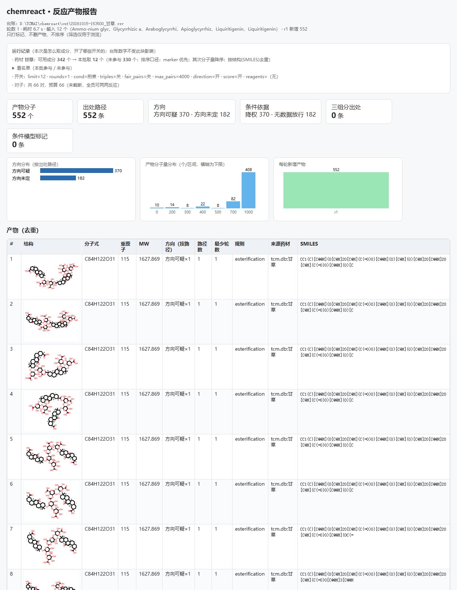

# Christos（炼膏师）化学反应产物预测与药典判据溯源软件 V1.0.0 · 用户手册

> 开发完成日期：2026-10-15 ｜ 本文档与源程序文档、申请表信息的名称与版本号逐字一致。


## 一、概述

Christos（炼膏师）是一套**化学反应产物预测与来源溯源**软件：给它底物（中药材名 / 植物物种学名 / SMILES 列表），它在给定的工艺条件档下枚举可能发生的反应，输出候选产物台账、逆向合成路线与一页式报告，并对每一条结论标注**出处的来源与不确定度**。

本软件面向两类工作：

- 科研场景：为中药 / 天然产物的提取、炮制、煎煮等工艺给出**可能发生的化学变化**清单，并给出每条变化的条件依据与出处，便于实验设计与论文写作；
- 数据场景：把社区标准的反应数据（ORD / USPTO-50k）加工成**可审计的模板库**，并提供覆盖率、可用性、稳定性等基准，用于方法比较与复现。


### 1.1 它是什么、不是什么

- **是**：枚举系统 —— 回答「在这个条件下，可能生成什么」；
- **不是**：产率/动力学模拟系统 —— 不预测收率，也不模拟反应速率；
- **是**：来源可溯 —— 每一条判定与每一个候选都能指回出处（模板支持度 / 药典条目 / ORD 条件窗口）；
- **不是**：打分排序器 —— 软件坚持「只标注、不删除、不静默排序」，排序永远是可解释、可关闭的显式选项（例如 `--herb-order ob`、`--chp-priority`）。


### 1.2 设计原则（贯穿全部输出）

- **只标注、不删除**：不给「不可能」的结论，只给「有依据 / 无依据 / 与介质相反」这类标记；
- **出处可回溯**：模板带支持度与来源，药典判据链每行带官方条目 URL；
- **默认保守**：所有新增开关默认关闭，生产默认 = 论文最优档；
- **失败必报**：批处理不允许「静默跳过」，任何失败都会打印并计数；
- **数据来自数据库**：药材、成分、别名、方剂、药典剂量一律从既有数据库读取，不手写。


### 1.3 度量与已知边界（如实声明）

- U(化学可用性)、覆盖率为**判据**，不是产率；
- 「查不到 ≠ 不存在」：判定只代表**现有依据**下的结论；
- 条件层只做**标注**（激活/降权），不做动力学模拟；
- 评测集来自 ORD 系数据，已做泄漏剔除，但仍是**开放域**问题的一个受控切片。


## 二、运行环境与安装


### 2.1 环境要求

- 操作系统：Windows 10 / 11（x86-64）；
- Python：3.12（随项目 venv；亦兼容 3.14 + RDKit 2026.09 的本地环境）；
- 数据库：SQLite（中药材库 `tcm.db`、天然产物库 `coconut.db`，均为**只读**访问）；
- 依赖：RDKit（化学结构）、numpy；可选 duckdb / matplotlib / ord-schema（仅基准与出图需要）；
- 内存：建议 ≥ 8 GB（基准脚本按可用内存自动限制并发，内存不足会自动降为单进程并打印提示）。


### 2.2 目录结构

```
chemreact-staging/                 # 引擎源码（单一来源）
  core/        引擎：枚举、级联、判据、条件层
  rules/       规则与 SMARTS 模板
  sources/     数据源适配：中药材(HERB)、物种(COCONUT)、方剂、药典、别名、炮制品闸
  conditions/  工艺条件档（煎煮 / 室温浸泡 / 水提 / 醇提 / 酸水解 / 碱水解 / …）
  tools/       命令与基准脚本（100+）
  data/        本软件产出的小型数据（药典成方制剂、别名索引、出处分档…）
  reports/     报告、证据、快照、软著与论文材料
  libs/        第三方库（可重装）
D:\TCMAI\chemreact\               # 部署目录（网页 + 命令行入口）
  chemreact.py 桥接入口（把 staging 的 core/rules/libs/tools/sources 加进 sys.path）
  ui.py        本地网页服务（127.0.0.1:8765）
  ui_page.html 网页界面
  start_ui.bat 一键启动网页版
```


### 2.3 安装与首次运行

```
:: 1) 依赖（示例；离线机器可复制 libs/ 目录）
D:\TCMAI\venv\Scripts\python.exe -m pip install rdkit numpy

:: 2) 自检：确认引擎目录、逆向模板库、中药材库都能读到
D:\TCMAI\venv\Scripts\python.exe chemreact.py info

:: 3) 跑第一条命令
D:\TCMAI\venv\Scripts\python.exe chemreact.py predict --herb 甘草 --limit 12
```


### 2.4 info 命令的真实输出（示例）

```
Christos（炼膏师）桥接（TCMAI）
  引擎目录：D:\ProgramData\DSHNS\chemreact-staging（存在=True）
  逆模板：17502 条（可编译）· 黑名单：83 条（no-op 3；默认关）
  tcm.db（只读）：compounds 31646 行 ✓
```

`info` 是排障第一步：它把「引擎在哪、模板库多少条、药材库能不能只读打开、Python 版本」一次打出来。任何一项异常都在这里先暴露，而不是等到跑批才报错。


## 三、快速开始：命令行四条命令

全部命令都在部署目录下执行。四条命令覆盖 90% 的日常使用：`info`（自检）、`predict`（底物 → 产物）、`routes`（目标分子 → 路线）、`history`（运行台账）。


### 3.1 predict：从底物枚举产物

```
# 中药材（读 tcm.db，只读）
python chemreact.py predict --herb 甘草 --limit 12 --rounds 1 --cond 煎煮

# 多个药材（逗号分隔）；同一个名字写两次 = 该药材 2 份（份数只记录，
# 除非打开 --dose-budget 才会放大成分配额）
python chemreact.py predict --herb 甘草,桂枝,甘草 --dose-budget --limit 12

# 植物物种（双名法拉丁学名 → COCONUT 植物化学库，不限中药）
python chemreact.py predict --species "Glycyrrhiza uralensis" --limit 24

# 方剂（按典籍版本展开成组成药材；同名方剂默认取药典/最权威版本）
python chemreact.py predict --herb 四君子汤 --limit 12

# 直接给结构
python chemreact.py predict --smiles "CC(=O)Oc1ccccc1C(=O)O" --rounds 2
```

关键开关（都默认关，按需打开）：

- `--rounds N`：把产物继续当底物往下跑 N 轮（轮数越多产物越多、也越慢）；
- `--cond`：工艺条件档（煎煮/室温浸泡/水提/醇提/酸水解/碱水解/酶催化/还原/氧化/无氧煎煮）；
- `--limit N|all`：每味药取几个成分；`--max-pairs` 控制对子预算；
- `--chp-priority`：把药典含量测定成分排到前面（只排序、不筛选）；
- `--herb-order ob`：按 TCMSP 的口服生物利用度降序（只排序、不筛选）；
- `--herb-lookup`：中文名先弹「同字段条目（炮制品/同名/药用部位）+ 基元植物」候选窗，由你勾选；
- `--dose-budget`：把「重复输入 = 份数」放大成成分配额；
- `--triples`：启用三组分模板（默认关，很慢）。


### 3.2 routes：从目标分子找路线

```
python chemreact.py routes --target "CC(=O)Oc1ccccc1C(=O)O" --depth 2 --show 20
```

输出为「目标 → 前体 → …」的路线清单，并给出每条切法的**可用性判据**（元素收支、残基判定、是否需要共试剂）。路线报告与产物台账共用同一套留证机制。


### 3.3 history：看运行台账

```
python chemreact.py history -n 20
```

`history` 逐条列出最近运行的时间、类型与参数，并把该次运行的产物文件列出来，便于回溯「这个数字是哪一次跑出来的」。台账本体是 `out\runs.jsonl`（一行一条 JSON）。


### 3.4 一次真实运行的关键输出（节选）

```
   药材 甘草：可用成分 342 个 → 本批取 3 个（只读；marker 优先；其次分子量降序；按结构去重）
   对子预算 4000 ≥ 总对子 66：不截断（每个成分都能两两反应）
★ 一次枚举 ★  2026-10-16 17:03（底物 12 个 · 轮数 1 · 条件「水提」）
  产物分子 1027 个 · 出处路径 1027 条 · 耗时 159.58s
  逐轮（实测）：r1 新增 1027（157.03s）
  被剔的「产物 == 输入分子」：0 条（不计入产物）
  台账 -> out\20261016-170619_四君子汤.csv
  索引 -> out\20261016-170619_四君子汤.tsv
```


## 四、网页版：三步页与结果区

网页版是本机页面（只绑 127.0.0.1），双击 `start_ui.bat` 或执行 `python ui.py --no-browser` 后访问 http://127.0.0.1:8765/ 。


### 4.1 三步流程

- **第 1 步 · 选来源**：一行一味；可填中药材中文名、植物物种双名法学名、方剂名，或直接填 SMILES。行末「查找相似」按需列出同字段条目与基元植物；
- **第 2 步 · 条件与轮数**：选工艺条件档、轮数、每味取几个成分；高级选项里是上面那批开关（默认全部保守）；
- **第 3 步 · 开始预测**：进度与日志实时刷新；完成后出现产物台账、索引、一页报告的下载链接。


*图 4-1 三步页首屏：选来源 / 条件与轮数 / 开始预测*


### 4.2 结果区怎么读

- 摘要逐味列出「可用成分 N 个 → 本批取 M 个」，并标明来源（HERB 药材库 / COCONUT 物种库）；
- **方剂与出处档**表列出该方名的全部版本（含 AI 现查版本），带「出处分档」与「抽检」两列；下拉可只看某一档（默认全部列出，不隐藏、不排序）；
- **对子预算**：被截断时会明确标出「已截断」，并给出每个成分摊到的伙伴数；
- **方向 / 条件依据 / 可用性**：逐条标记，不删产物。



*图 4-2 一页报告：摘要、产物表、分布图与出处*


### 4.3 找路线页签

「找路线」页签输入目标分子（SMILES）与深度，输出路线清单与一页报告。与预测页共用同一套判据与留证。


### 4.4 运行台账与产物文件

每次运行都会在部署目录 `out\` 下留下：产物台账 CSV、索引 TSV、meta JSON 与一页报告 HTML；并追加一行运行记录到 `out\runs.jsonl`。网页结果区里的链接直接指向这些文件。


## 五、输出解读


### 5.1 产物台账（CSV）列释义

- `product_smiles` / `formula` / `mol_weight`：产物结构与分子式；
- `support`：生成它的模板在挖掘库里的支持度（条数）；**它是模板的统计量，不是产率**；
- `n_paths`：有几条出处路径产生它（同一产物可被多条规则/模板命中）；
- `direction_flag`：方向标记（与当前介质相反 / 平衡 / 未定）；
- `cond_evidence`：条件层的依据类型（ORD 条件窗口内 / 无数据放行）；
- `availability`：化学可用性判据（元素收支、残基类别等），用于替代「打分」的中性标记；
- `reactions` / `templates`：产生它的规则与模板编号，便于回溯。


### 5.2 索引（TSV）与去向

索引表按产物去重，列出每个产物的「出现次数、涉及药材、涉及模板数」，用于把候选产物按**出处**分组（例如「只由某一味药单独产生」vs「必须两味药共同参与」）。


### 5.3 一页报告（HTML）

- 开头是摘要：输入、条件、开关状态、对子预算与截断情况；
- 产物表与分布图（分子量分布 / 模板来源分布）；
- 每条结论附带出处（模板 / 药典条目 / 条件窗口）；
- 页脚是**免责与边界**：查不到不等于不存在；activation 是条件判据强度而非发生概率。


### 5.4 运行台账（runs.jsonl）

```
{"ts": "2026-10-16 19:13:41", "kind": "predict",
 "note": "herb=清暑汤 limit=1 rounds=1 cond=水提 chp=False fair=False
          formula_tier=清暑汤:CPMCP(ai7) probe_cha_wu=0/1",
 "files": {"csv": "20261016-191341_清暑汤.csv",
           "tsv": "20261016-191341_清暑汤.tsv", "report": "(未生成)"}}
```

`formula_tier=…` 记录**本次用的是哪个版本的方剂、出处分档是哪一档、该方名下有多少个 AI 现查版本**；`probe_cha_wu=n/m` 记录本条与备选版本里**抽检判为「查无」**的个数（抽检结论见第六节）。


### 5.5 三种「不确定」的表达方式

- **出处分档**（药典 … AI 现查（未核对））：告诉你这条方剂数据的**来源可信度**；
- **抽检结论**（命中 / 部分命中 / 查无）：告诉你这条记录**在公开来源里核对过没有**；
- **条件依据**（ORD 窗口内 / 无数据放行）：告诉你这条反应**有没有条件层的证据**。


## 六、药典判据链与出处分档


### 6.1 药典判据链（Tier-0 / Tier-1）

软件把《中国药典（2025 年版）》的含量测定与鉴别条目整理成「判据链」：当你输入的药材名能在药典里找到时，其**法定指标成分**会被单独标出，并给出该条目在官方知识库里的 URL。

- **Tier-0**：药典含量测定成分（带限量值）—— 最硬的依据；
- **Tier-1**：药材库标注的 marker 成分 —— 次之；
- **其余**：TCMSP 口径的成分（OB/DL 只是「能不能口服吸收、像不像药」，**不是含量高低**）。

默认排序是「marker 优先 → 分子量降序」；`--chp-priority` 打开后改为「药典指标成分优先 → 按限量值降序」。**只排序，不筛选**。


### 6.2 方剂出处分档

- 药典 → ETCM → ITCM → CPMCP → 古籍 → AI 现查（未核对）：
- 判据只用数据里已有的两个字段（`category` 与 `chuchu`），不含任何人工名单；
- 档位只做**标注**：默认选版仍按原有权威度排序，AI 现查版本照旧列出、不隐藏。


### 6.3 抽检结论（H2，100+200 条固定种子样本）

对 AI 现查那批记录做固定种子抽样、逐条在公开来源核对「方名 + 出处 + 组成」：

- **命中**：组成与公开源字面重合 ≥ 60%；
- **部分命中**：同名方在公开源里存在，但组成/版本不同；
- **查无**：本轮公开信道里没有找到能证明该条的实质内容（**不等于不存在**）。

网页「方剂与出处档」表里的「抽检」列即显示该结论（带来源链接）；运行台账里的 `probe_cha_wu` 是本次涉及的「查无」个数。


## 七、常见问题与边界


### 7.1 「查不到」是什么意思

所有「查不到」只代表**现有依据下**的结论：药材库里没有、药典条目没有连上、公开来源里没核到。软件不会因此给出「不存在」或「不可能」的判断。


### 7.2 为什么候选里有「泥沙」

枚举系统的候选是**可能性**，不是结论。垃圾候选的成因有三类：模板支持度低、条件不同（同一反应在不同介质下方向相反）、以及底物本身是混合物。软件用**方向标记 / 条件依据 / 可用性**三类标签帮你筛，而不是删掉它们。


### 7.3 内存与耗时

- 单次枚举的耗时主要由底物个数、对子预算与轮数决定；
- 基准脚本自带内存护栏：可用内存不足时自动降低并发并打印提示；
- `--limit all` 会把该药材全部成分拿来配对，请同时关注对子预算与内存。


### 7.4 药材名怎么写

- 中药材写中文名（如 甘草、白鲜皮），走 HERB 药材库；
- 植物物种写双名法拉丁学名（如 Glycyrrhiza uralensis），走 COCONUT 物种库；
- **炮制品就是炮制品**（如 姜半夏、制何首乌）：库里没有就如实报「库缺」，不会替换成基原；
- 名字一律以**数据库本名/别名列**为准；库里没有的写法不会被硬凑（例如「生地」不会被猜成「地黄」）。


### 7.5 与外部数据的关系

- `tcm.db` / `coconut.db` 全程**只读**打开（`mode=ro`），软件不写入用户数据库；
- 所有新增数据（药典成方制剂、别名索引、出处分档…）落在本软件自己的 `data\` 目录；
- 外部来源均标注出处与许可注记（见附录）。


## 八、附录


### 8.1 论文基准的复现命令（节选）

```
# 0) 50k 目标集标准化（本机实测 37 s，产出与发布哈希逐字节一致）
python tools\paper_50k_prep.py
# 1) 基准库复现校验：不剔除重聚类 == 3,228；剔除 50k 后 == 3,065（本机实测 2 s / 12 s）
python tools\retro_cluster_eval.py --min-freq 3 --per-bucket 3 --skip-eval \
     --out-clustered reports\paper\data\lib_repro_check.jsonl
python tools\retro_cluster_eval.py --min-freq 3 --per-bucket 3 --skip-eval \
     --exclude-products reports\paper\data\uspto50k_canon.jsonl \
     --out-clustered reports\paper\data\lib_uspto50k_excl.jsonl
# 2) 覆盖率 / top-k、3) 可用性构成、3b) 正向单步召回
python tools\paper_bench_50k_coverage.py 6
python tools\paper_bench_50k_usability.py 4
python tools\paper_bench_50k_forward.py 100000 6
```

说明：基准脚本支持用环境变量把**仓库根与输出目录**改到干净目录（`CHEMCREACT_ROOT` / `CHEMCREACT_BENCH_OUT`），便于「干净目录复现演练」。


### 8.2 版本与完整性

- 版本：V1.0.0（开发完成日期 2026-10-15）；
- 发布包：`reports/release/chemreact-v1.0.0-pack.zip`（34 文件 / 16.6 MB）；
- 哈希清单：`reports/release/sha256_manifest.txt`（关键库与结果全覆盖）；
- 运行台账：`out/runs.jsonl`；结果与报告：`out/`。


### 8.3 第三方组件与许可注记

- RDKit（BSD-3）：化学结构解析与反应处理；
- ORD / USPTO-50k（社区标准公开数据）：模板挖掘与基准来源；
- 《中国药典（2025 年版）》：仅作研究引用，软件只提取事实性判据并标注官方出处；
- SymMap / ETCM / ITCM / CPMCP：方剂与药材元数据的公开来源，逐条标注出处。


### 8.4 术语表

- **模板**：从反应数据中抽取的「反应中心 + 环境」模式；支持度 = 该模式出现次数；
- **对子预算**：两两配对的次数上限；被截断时软件会明确提示；
- **方向层**：判断产物在该介质下是「往生成方向」还是「往水解方向」的标记；
- **条件层**：用 ORD 条件窗口判断某类反应在本条件下有无条件证据（只标注）；
- **出处分档 / 抽检**：分别刻画数据的**来源可信度**与**公开可核性**（见第六节）。


### 8.5 变更记录

- V1.0.0（2026-10-15）：首个冻结版本 —— 正向单步召回 82.32%（泄漏剔除版）、逆向覆盖率 94.74%、多步端到端 47.7%(d2)/72.3%(d3)、药典判据链覆盖 386/491；网页三步页 + 命令行四命令 + 运行台账；方剂库（同名按版本）与 COCONUT 物种路线接入。


## 九、三个端到端场景


### 9.1 场景 A：单味药（甘草）

```
python chemreact.py predict --herb 甘草 --limit 24 --rounds 1 --cond 煎煮
```

- 可用成分 342 个（HERB 药材库；按结构去重后）；
- 本批取 24 个（marker 优先 → 分子量降序）；
- 产物台账逐条给出来源规则、模板支持度、方向与条件依据；
- 若打开 `--chp-priority`，药典含量测定成分（甘草苷、甘草酸）会排到最前面，并在报告里带上官方条目 URL。


### 9.2 场景 B：方剂（四君子汤）

```
python chemreact.py predict --herb 四君子汤 --limit 12 --cond 水提
```

- 软件先按**典籍版本**展开方剂：默认取权威度最高的版本（药典 > ETCM > ITCM > CPMCP > 古籍）；
- 输出会打印本次用的版本与出处分档，并列出其他版本（含 AI 现查版本）与它们的抽检结论；
- 组成里对不上的药材（辅料 / 化学药 / 异名）会如实列出并跳过，**不会中止整个方剂**；
- 药典版本带**法定剂量**：以方中最小剂量 = 1 份换算，份数只在打开剂量加权时放大成分配额。


### 9.3 场景 C：植物物种（银杏叶）

```
python chemreact.py predict --species "Ginkgo biloba" --limit 24 --cond 醇提
```

- 物种级来源是 COCONUT 植物化学库（不限中药，植物/真菌/海洋生物皆可）；
- 同名异写会合并（例如同一物种在库里的多种拼写）；
- COCONUT 侧**没有「重要性」依据**，截断时会在提示里明说「这 N 个是任意截取的」；
- 可按 InChIKey 与中药材库交叉标注，能对上的会打上「药典指标 / marker / TCMSP 达标」。


## 十、参数与开关速查


### 10.1 命令行开关（predict）

| 开关 | 默认 | 作用 |
|---|---|---|
| --herb / --species | — | 中药材中文名 / 植物物种双名法学名（可多味，逗号分隔） |
| --smiles / --mol | — | 直接给结构（逗号/分号分隔） |
| --limit | 12 | 每味药取几个成分；all = 不截取（注意对子预算） |
| --rounds | 1 | 轮数：产物继续当底物往下跑 |
| --cond | 煎煮 | 工艺条件档（10 档） |
| --max-pairs | 4000 | 两两配对上限；被截断会明确提示 |
| --fair-pairs | 关 | 公平截断：每个成分摊到大致相同的伙伴数 |
| --chp-priority | 关 | 药典含量测定成分优先（只排序） |
| --herb-order | marker | marker / ob（TCMSP 口服生物利用度降序，只排序） |
| --dose-budget | 关 | 重复输入 = 份数，放大成分配额 |
| --herb-lookup | 关 | 中文名先列同字段条目与基元植物，由用户勾选 |
| --source | auto | auto / herb / coconut：名称的解释路线 |
| --coconut-order | lib | lib（库内序）/ npl（天然产物相似度，只排序） |
| --reagents | 空 | 辅助试剂（SMILES 或名字） |
| --triples | 关 | 启用三组分模板（很慢） |
| --no-direction / --no-score / --no-ik-cache | 关 | 关闭方向层 / 关闭判据 / 关闭 InChIKey 缓存 |
| --out | out/ | 产物输出目录 |
| --no-report | 关 | 不生成一页报告（只出台账/索引） |


### 10.2 网页端开关（第 2 步「更多选项」）

| 控件 | 默认 | 说明 |
|---|---|---|
| 重复输入 = 剂量份数 | 不勾 | 同命令行 --dose-budget |
| 成分排序 | marker | marker / OB 降序 |
| 查找同名字段 | 不勾 | 同 --herb-lookup |
| 药典判据优先 | 不勾 | 同 --chp-priority |
| 公平截断 | 不勾 | 同 --fair-pairs |
| 三组分模板 | 不勾 | 同 --triples |


### 10.3 条件档一览

| 条件档 | 含义 |
|---|---|
| 煎煮 | 水相受热（默认档；含长时间加热语义） |
| 室温浸泡 | 常温溶剂浸泡，激活更保守 |
| 水提 | 水为介质提取 |
| 醇提 | 乙醇/含水醇为介质 |
| 酸水解 | 酸性介质下的水解 |
| 碱水解 | 碱性介质下的水解 |
| 酶催化 | 酶促反应语义 |
| 还原 | 还原性介质 |
| 氧化 | 氧化性介质 |
| 无氧煎煮 | 隔绝氧气的加热体系 |


## 十一、数据文件与出处清单

以下文件都在 `chemreact-staging\data\`（本软件自己的产出），全部由脚本生成、可复算：

| 文件 | 内容 | 生成脚本 |
|---|---|---|
| chp_formulas.json | 药典 2025 成方制剂 1,526 条（含法定剂量） | build_chp_formulas.py |
| chp_processed.json | 药典收载炮制品 20 味（含基原，供禁止替换闸用） | build_chp_processed.py |
| herb_species.json | 中文药名 → 拉丁学名/物种（617 味里 547 条） | build_herb_species.py |
| alias_index.json | 多候选别名索引（31,440 别名 / 5,417 多候选） | build_alias_index.py |
| formula_source_tier.json | 方剂逐条出处分档（12,071 条） | build_formula_source_tier.py |
| case_sources.json | 验收用例分子来源台账（DB 引用 / 库外字面量） | build_cases_from_db.py |
| h2_verdicts_all.json | AI 现查古方抽检判定（n=300，含来源链接） | h2_verdicts2.py + h2_merge.py |

这些文件的共同约定：① 只读输入（用户数据库全程 `mode=ro`）；② 每份都记录生成时间、源文件哈希或计数；③ 任何「认不出」的情况都显式打印，不静默跳过。


## 十二、故障排查

| 现象 | 原因 | 处理 |
|---|---|---|
| info 报「引擎目录 存在=False」 | 部署目录与引擎目录不在同一台机器/盘符 | 确认 D:\ProgramData\DSHNS\chemreact-staging 存在，或在桥接里改路径 |
| 未收录药材：提示后中止 | 输入的药材名不在库里（这是设计：不给你空台账） | 换用库内本名，或用「查找相似」列出候选 |
| 炮制品报「库缺，不替换」 | 药典收载的炮制品（如姜半夏）库里没有 | 换基原前请先确认——软件**不会**替你替换 |
| 对子被截断（已截断提示） | 底物数 × 两两配对数超过 --max-pairs | 提高 --max-pairs，或减小 --limit，或开 --fair-pairs |
| 运行很慢 | 轮数/底物数/三组分模板都会显著放大计算量 | 先用 --limit 小的跑通，再逐步放大；观察「逐轮（实测）」耗时 |
| 网页打不开 | 服务未启动或端口被占用 | 双击 start_ui.bat；确认 127.0.0.1:8765 在监听 |
| 基准脚本报内存护栏降并发 | 机器可用内存偏低（脚本自动降为单进程） | 关掉其他重活；或接受较慢的单进程跑完 |
| 抽检列全是「未抽检」 | 该版本不在抽检样本内（样本是 300 条固定种子） | 属正常；抽检只覆盖样本，不代表其余版本有问题 |


### 12.1 日志与留证在哪里

- 运行台账：`out/runs.jsonl`（一行一次运行，含参数与产物文件名）；
- 产物与报告：`out/*.csv`、`out/*.tsv`、`out/*.meta.json`、`out/*.report.html`；
- 基准与证据：`reports/paper/results/`、`reports/_h2_net/`（H2 原始检索结果）等；
- 版本控制：`chemreact-staging/.git`（标准 git 格式，含每轮快照）。


### 12.2 提交问题时的最小信息

- `history -n 5` 的输出；
- 复现用的完整命令（含所有开关）；
- `info` 的输出；
- 若涉及报错：报错前后 20 行输出（软件不会静默失败，错误一定可见）。


## 十三、安装、升级与卸载


### 13.1 三种安装方式

| 方式 | 适用 | 步骤 |
|---|---|---|
| 随项目使用 | 本机日常 | 直接用 D:\TCMAI\chemreact 入口 + staging 引擎 |
| 发布包解压 | 给别人复现 | 解压 chemreact-v1.0.0-pack.zip，按 8.1 的命令跑基准 |
| 离线复制 | 无网机器 | 连同 libs/ 一起拷贝（第三方库可重装，故不入发布包） |


### 13.2 升级要点

- 引擎源码只在 staging 改动；部署目录只放 3 个文件（chemreact.py / ui.py / ui_page.html），**改 .py 后必须重启网页服务**（HTML 是每请求现读，无需重启）；
- 升级前先用 `tools/git_snapshot.py "说明"` 拍快照，升级后可回退；
- 数据产物（data/*.json）由脚本生成，升级后按需重跑对应 build_*.py。


### 13.3 卸载与数据清理

- 停止网页服务（关闭窗口或结束对应 python 进程）；
- 删除部署目录 `D:\TCMAI\chemreact` 即完成卸载；
- **不会**影响用户自己的数据库（`tcm.db` / `formula_db.json` 等全程只读）。


## 十四、支持与参考

- 用户手册（本文）、发布说明：`reports/release/RELEASE-v1.0.0.md`；
- 论文复现清单：`reports/paper/复现清单.md`；
- 数据卡（数据来源与口径）：`reports/paper/DATA_CARD.md`；
- 基准与统计：`reports/paper/论文-v1.0.0-主线与消融统计总表.md`；
- 源码文档（软著 G1）：`reports/软著/源程序文档_前30页+后30页.txt`。

以上材料与本文档同属 v1.0.0 冻结物；若名称或版本号变更，请同时重跑 `tools/make_g2_manual.py`（手册）与源程序文档生成器，确保三处材料逐字一致。


## 十五、真实输出节选（生成时从产物文件原样读取）

本节内容由手册生成器在**生成时**从最新产物里读取，确保手册与软件真实输出一致。


### 15.1 产物台账（CSV）表头与前三行

```
product_smiles,product_inchikey,formula,mw,heavy_atoms,source_smiles,source_name,source_herb,source_role,rule_name,round,activation,activation_why,is_byproduct,score,reversible,co_products,direction,direction_cn,direction_reason,direction_source,cond_model,element_delta,template_support
COc1cc(/C=C/Cc2c(/C=C/COC(=O)C[C@H](CC(=O)OC[C@@]3(OC[C@@]4(OC[C@@]5(OC[C@@]6(OC[C@@]7(OC[C@@]8(OC[C@@]9(OC[C@@]%10(OC[C@@]%11(OCC%12(O[C@H]%13O[C@H](CO)[C@@H](O)[C@H](O)[C@H]%13O)O[C@H](CO)[C@@H](O)[C@@H]%12O)O[C@H](CO)[C@@H](O)[C@@H]%11O)O[C@H](CO)[C@@H](O)[C@@H]%10O)O[C@H](CO)[C@@H](O)[C@@H]9O)O[C@H](CO)[C@@H](O)[C@@H]8O)O[C@H](CO)[C@@H](O)[C@@H]7O)O[C@H](CO)[C@@H](O)[C@@H]6O)O[C@H](CO)[C@@H](O)[C@@H]5O)O[C@H](CO)[C@@H](O)[C@@H]4O)O[C@H](CO)[C@@H](O)[C@@H]3O)O[C@@H]3O[C@H](CO)[C@@H](O)[C@H](O)[C@H]3O)cc(OC)c(O[C@@H]3O[C@H](CO)[C@@H](O)[C@H](O)[C@H]3O)c2OC)cc(OC)c1O[C@@H]1O[C@H](CO)[C@@H](O)[C@H](O)[C@H]1O,JXRVDIATAJSXAZ-QVQIVIAHSA-N,C111H172O81,2802.516,192,COc1cc(/C=C/Cc2c(/C=C/COC(=O)C[C@H](CC(=O)O)O[C@@H]3O[C@H](CO)[C@@H](O)[C@H](O)[C@H]3O)cc(OC)c(O[C@@H]3O[C@H](CO)[C@@H](O)[C@H](O)[C@H]3O)c2OC)cc(OC)c1O[C@@H]1O[C@H](CO)[C@@H](O)[C@H](O)[C@H]1O,Tangshenoside iv,tcm.db:党参,输入,esterification,1,1.0,ORD 条件窗口内，无降权,False,0.846,True,COc1cc(/C=C/Cc2c(/C=C/COC(=O)C[C@H](CC(=O)OC[C@H]3OC(CO[C@]4(CO[C@]5(CO[C@]6(CO[C@]7(CO[C@]8(CO[C@]9(CO[C@]%10(CO[C@]%11(CO[C@]%12(CO)O[C@H](CO)[C@@H](O)[C@@H]%12O)O[C@H](CO)[C@@H](O)[C@@H]%11O)O[C@H](CO)[C@@H](O)[C@@H]%10O)O[C@H](CO)[C@@H](O)[C@@H]9O)O[C@H](CO)[C@@H](O)[C@@H]8O)O[C@H](CO)[C@@H](O)[C@@H]7O)O[C@H](CO)[C@@H](O)[C@@H]6O)O[C@H](CO)[C@@H](O)[C@@H]5O)O[C@H](CO)[C@@H](O)[C@@H]4O)(O[C@H]4O[C@H](CO)[C@@H](O)[C@H](O)[C@H]4O)[C@@H](O)[C@@H]3O)O[C@@H]3O[C@H](CO)[C@@H](O)[C@H](O)[C@H]3O)cc(OC)c(O[C@@H]3O[C@H](CO)[C@@H](O)[C@H](O)[C@H]3O)c2OC)cc(OC)c1O[C@@H]1O[C@H](CO)[C@@H](O)[C@H](O)[C@H]1O|COc1cc(/C=C/Cc2c(/C=C/COC(=O)C[C@H](CC(=O)OC[C@H]3O[C@@](CO)(OC[C@@]4(OC[C@@]5(OC[C@@]6(OC[C@@]7(OC[C@@]8(OC[C@@]9(OC[C@@]%10(OC[C@@]%11(OCC%12(O[C@H]%13O[C@H](CO)[C@@H](O)[C@H](O)[C@H]%13O)O[C@H](CO)[C@@H](O)[C@@H]%12O)O[C@H](CO)[C@@H](O)[C@@H]%11O)O[C@H](CO)[C@@H](O)[C@@H]%10O)O[C@H](CO)[C@@H](O)[C@@H]9O)O[C@H](CO)[C@@H](O)[C@@H]8O)O[C@H](CO)[C@@H](O)[C@@H]7O)O[C@H](CO)[C@@H](O)[C@@H]6O)O[C@H](CO)[C@@H](O)[C@@H]5O)O[C@H](CO)[C@@H](O)[C@@H]4O)[C@@H](O)[C@@H]3O)O[C@@H]3O[C@H](CO)[C@@H](O)[C@H](O)[C@H]3O)cc(OC)c(O[C@@H]3O[C@H](CO)[C@@H](O)[C@H](O)[C@H]3O)c2OC)cc(OC)c1O[C@@H]1O[C@H](CO)[C@@H](O)[C@H](O)[C@H]1O|COc1cc(/C=C/Cc2c(/C=C/COC(=O)C[C@H](CC(=O)OC[C@H]3O[C@@](CO[C@]4(CO)O[C@H](CO)[C@@H](O)[C@@H]4O)(OC[C@@]4(OC[C@@]5(OC[C@@]6(OC[C@@]7(OC[C@@]8(OC[C@@]9(OC[C@@]%10(OCC%11(O[C@H]%12O[C@H](CO)[C@@H](O)[C@H](O)[C@H]%12O)O[C@H](CO)[C@@H](O)[C@@H]%11O)O[C@H](CO)[C@@H](O)[C@@H]%10O)O[C@H](CO)[C@@H](O)[C@@H]9O)O[C@H](CO)[C@@H](O)[C@@H]8O)O[C@H](CO)[C@@H](O)[C@@H]7O)O[C@H](CO)[C@@H](O)[C@@H]6O)O[C@H](CO)[C@@H](O)[C@@H]5O)O[C@H](CO)[C@@H](O)[C@@H]4O)[C@@H](O)[C@@H]3O)O[C@@H]3O[C@H](CO)[C@@H](O)[C@H](O)[C@H]3O)cc(OC)c(O[C@@H]3O[C@H](CO)[C@@H](O)[C@H](O)[C@H]3O)c2OC)cc(OC)c1O[C@@H]1O[C@H](CO)[C@@H](O)[C@H](O)[C@H]1O|COc1cc(/C=C/Cc2c(/C=C/COC(=O)C[C@H](CC(=O)OC[C@H]3O[C@@](CO[C@]4(CO[C@]5(CO)O[C@H](CO)[C@@H](O)[C@@H]5O)O[C@H](CO)[C@@H](O)[C@@H]4O)(OC[C@@]4(OC[C@@]5(OC[C@@]6(OC[C@@]7(OC[C@@]8(OC[C@@]9(OCC%10(O[C@H]%11O[C@H](CO)[C@@H](O)[C@H](O)[C@H]%11O)O[C@H](CO)[C@@H](O)[C@@H]%10O)O[C@H](CO)[C@@H](O)[C@@H]9O)O[C@H](CO)[C@@H](O)[C@@H]8O)O[C@H](CO)[C@@H](O)[C@@H]7O)O[C@H](CO)[C@@H](O)[C@@H]6O)O[C@H](CO)[C@@H](O)[C@@H]5O)O[C@H](CO)[C@@H](O)[C@@H]4O)[C@@H](O)[C@@H]3O)O[C@@H]3O[C@H](CO)[C@@H](O)[C@H](O)[C@H]3O)cc(OC)c(O[C@@H]3O[C@H](CO)[C@@H](O)[C@H](O)[C@H]3O)c2OC)cc(OC)c1O[C@@H]1O[C@H](CO)[C@@H](O)[C@H](O)[C@H]1O,suspect,方向可疑,水相：缩合类应往水解方向走，此产物是缩合方向,engine_condensation,,0|-2|-1,0
COc1cc(/C=C/Cc2c(/C=C/COC(=O)C[C@H](CC(=O)OC[C@H]3OC(CO[C@]4(CO[C@]5(CO[C@]6(CO[C@]7(CO[C@]8(CO[C@]9(CO[C@]%10(CO[C@]%11(CO[C@]%12(CO)O[C@H](CO)[C@@H](O)[C@@H]%12O)O[C@H](CO)[C@@H](O)[C@@H]%11O)O[C@H](CO)[C@@H](O)[C@@H]%10O)O[C@H](CO)[C@@H](O)[C@@H]9O)O[C@H](CO)[C@@H](O)[C@@H]8O)O[C@H](CO)[C@@H](O)[C@@H]7O)O[C@H](CO)[C@@H](O)[C@@H]6O)O[C@H](CO)[C@@H](O)[C@@H]5O)O[C@H](CO)[C@@H](O)[C@@H]4O)(O[C@H]4O[C@H](CO)[C@@H](O)[C@H](O)[C@H]4O)[C@@H](O)[C@@H]3O)O[C@@H]3O[C@H](CO)[C@@H](O)[C@H](O)[C@H]3O)cc(OC)c(O[C@@H]3O[C@H](CO)[C@@H](O)[C@H](O)[C@H]3O)c2OC)cc(OC)c1O[C@@H]1O[C@H](CO)[C@@H](O)[C@H](O)[C@H]1O,PXHFTKMOBPNLNP-QVQIVIAHSA-N,C111H172O81,2802.516,192,COc1cc(/C=C/Cc2c(/C=C/COC(=O)C[C@H](CC(=O)O)O[C@@H]3O[C@H](CO)[C@@H](O)[C@H](O)[C@H]3O)cc(OC)c(O[C@@H]3O[C@H](CO)[C@@H](O)[C@H](O)[C@H]3O)c2OC)cc(OC)c1O[C@@H]1O[C@H](CO)[C@@H](O)[C@H](O)[C@H]1O,Tangshenoside iv,tcm.db:党参,输入,esterification,1,1.0,ORD 条件窗口内，无降权,False,0.846,True,COc1cc(/C=C/Cc2c(/C=C/COC(=O)C[C@H](CC(=O)OC[C@@]3(OC[C@@]4(OC[C@@]5(OC[C@@]6(OC[C@@]7(OC[C@@]8(OC[C@@]9(OC[C@@]%10(OC[C@@]%11(OCC%12(O[C@H]%13O[C@H](CO)[C@@H](O)[C@H](O)[C@H]%13O)O[C@H](CO)[C@@H](O)[C@@H]%12O)O[C@H](CO)[C@@H](O)[C@@H]%11O)O[C@H](CO)[C@@H](O)[C@@H]%10O)O[C@H](CO)[C@@H](O)[C@@H]9O)O[C@H](CO)[C@@H](O)[C@@H]8O)O[C@H](CO)[C@@H](O)[C@@H]7O)O[C@H](CO)[C@@H](O)[C@@H]6O)O[C@H](CO)[C@@H](O)[C@@H]5O)O[C@H](CO)[C@@H](O)[C@@H]4O)O[C@H](CO)[C@@H](O)[C@@H]3O)O[C@@H]3O[C@H](CO)[C@@H](O)[C@H](O)[C@H]3O)cc(OC)c(O[C@@H]3O[C@H](CO)[C@@H](O)[C@H](O)[C@H]3O)c2OC)cc(OC)c1O[C@@H]1O[C@H](CO)[C@@H](O)[C@H](O)[C@H]1O|COc1cc(/C=C/Cc2c(/C=C/COC(=O)C[C@H](CC(=O)OC[C@H]3O[C@@](CO)(OC[C@@]4(OC[C@@]5(OC[C@@]6(OC[C@@]7(OC[C@@]8(OC[C@@]9(OC[C@@]%10(OC[C@@]%11(OCC%12(O[C@H]%13O[C@H](CO)[C@@H](O)[C@H](O)[C@H]%13O)O[C@H](CO)[C@@H](O)[C@@H]%12O)O[C@H](CO)[C@@H](O)[C@@H]%11O)O[C@H](CO)[C@@H](O)[C@@H]%10O)O[C@H](CO)[C@@H](O)[C@@H]9O)O[C@H](CO)[C@@H](O)[C@@H]8O)O[C@H](CO)[C@@H](O)[C@@H]7O)O[C@H](CO)[C@@H](O)[C@@H]6O)O[C@H](CO)[C@@H](O)[C@@H]5O)O[C@H](CO)[C@@H](O)[C@@H]4O)[C@@H](O)[C@@H]3O)O[C@@H]3O[C@H](CO)[C@@H](O)[C@H](O)[C@H]3O)cc(OC)c(O[C@@H]3O[C@H](CO)[C@@H](O)[C@H](O)[C@H]3O)c2OC)cc(OC)c1O[C@@H]1O[C@H](CO)[C@@H](O)[C@H](O)[C@H]1O|COc1cc(/C=C/Cc2c(/C=C/COC(=O)C[C@H](CC(=O)OC[C@H]3O[C@@](CO[C@]4(CO)O[C@H](CO)[C@@H](O)[C@@H]4O)(OC[C@@]4(OC[C@@]5(OC[C@@]6(OC[C@@]7(OC[C@@]8(OC[C@@]9(OC[C@@]%10(OCC%11(O[C@H]%12O[C@H](CO)[C@@H](O)[C@H](O)[C@H]%12O)O[C@H](CO)[C@@H](O)[C@@H]%11O)O[C@H](CO)[C@@H](O)[C@@H]%10O)O[C@H](CO)[C@@H](O)[C@@H]9O)O[C@H](CO)[C@@H](O)[C@@H]8O)O[C@H](CO)[C@@H](O)[C@@H]7O)O[C@H](CO)[C@@H](O)[C@@H]6O)O[C@H](CO)[C@@H](O)[C@@H]5O)O[C@H](CO)[C@@H](O)[C@@H]4O)[C@@H](O)[C@@H]3O)O[C@@H]3O[C@H](CO)[C@@H](O)[C@H](O)[C@H]3O)cc(OC)c(O[C@@H]3O[C@H](CO)[C@@H](O)[C@H](O)[C@H]3O)c2OC)cc(OC)c1O[C@@H]1O[C@H](CO)[C@@H](O)[C@H](O)[C@H]1O|COc1cc(/C=C/Cc2c(/C=C/COC(=O)C[C@H](CC(=O)OC[C@H]3O[C@@](CO[C@]4(CO[C@]5(CO)O[C@H](CO)[C@@H](O)[C@@H]5O)O[C@H](CO)[C@@H](O)[C@@H]4O)(OC[C@@]4(OC[C@@]5(OC[C@@]6(OC[C@@]7(OC[C@@]8(OC[C@@]9(OCC%10(O[C@H]%11O[C@H](CO)[C@@H](O)[C@H](O)[C@H]%11O)O[C@H](CO)[C@@H](O)[C@@H]%10O)O[C@H](CO)[C@@H](O)[C@@H]9O)O[C@H](CO)[C@@H](O)[C@@H]8O)O[C@H](CO)[C@@H](O)[C@@H]7O)O[C@H](CO)[C@@H](O)[C@@H]6O)O[C@H](CO)[C@@H](O)[C@@H]5O)O[C@H](CO)[C@@H](O)[C@@H]4O)[C@@H](O)[C@@H]3O)O[C@@H]3O[C@H](CO)[C@@H](O)[C@H](O)[C@H]3O)cc(OC)c(O[C@@H]3O[C@H](CO)[C@@H](O)[C@H](O)[C@H]3O)c2OC)cc(OC)c1O[C@@H]1O[C@H](CO)[C@@H](O)[C@H](O)[C@H]1O,suspect,方向可疑,水相：缩合类应往水解方向走，此产物是缩合方向,engine_condensation,,0|-2|-1,0
COc1cc(/C=C/Cc2c(/C=C/COC(=O)C[C@H](CC(=O)OC[C@H]3O[C@@](CO)(OC[C@@]4(OC[C@@]5(OC[C@@]6(OC[C@@]7(OC[C@@]8(OC[C@@]9(OC[C@@]%10(OC[C@@]%11(OCC%12(O[C@H]%13O[C@H](CO)[C@@H](O)[C@H](O)[C@H]%13O)O[C@H](CO)[C@@H](O)[C@@H]%12O)O[C@H](CO)[C@@H](O)[C@@H]%11O)O[C@H](CO)[C@@H](O)[C@@H]%10O)O[C@H](CO)[C@@H](O)[C@@H]9O)O[C@H](CO)[C@@H](O)[C@@H]8O)O[C@H](CO)[C@@H](O)[C@@H]7O)O[C@H](CO)[C@@H](O)[C@@H]6O)O[C@H](CO)[C@@H](O)[C@@H]5O)O[C@H](CO)[C@@H](O)[C@@H]4O)[C@@H](O)[C@@H]3O)O[C@@H]3O[C@H](CO)[C@@H](O)[C@H](O)[C@H]3O)cc(OC)c(O[C@@H]3O[C@H](CO)[C@@H](O)[C@H](O)[C@H]3O)c2OC)cc(OC)c1O[C@@H]1O[C@H](CO)[C@@H](O)[C@H](O)[C@H]1O,KVMDMKAUPFVWSX-QVQIVIAHSA-N,C111H172O81,2802.516,192,COc1cc(/C=C/Cc2c(/C=C/COC(=O)C[C@H](CC(=O)O)O[C@@H]3O[C@H](CO)[C@@H](O)[C@H](O)[C@H]3O)cc(OC)c(O[C@@H]3O[C@H](CO)[C@@H](O)[C@H](O)[C@H]3O)c2OC)cc(OC)c1O[C@@H]1O[C@H](CO)[C@@H](O)[C@H](O)[C@H]1O,Tangshenoside iv,tcm.db:党参,输入,esterification,1,1.0,ORD 条件窗口内，无降权,False,0.846,True,COc1cc(/C=C/Cc2c(/C=C/COC(=O)C[C@H](CC(=O)OC[C@@]3(OC[C@@]4(OC[C@@]5(OC[C@@]6(OC[C@@]7(OC[C@@]8(OC[C@@]9(OC[C@@]%10(OC[C@@]%11(OCC%12(O[C@H]%13O[C@H](CO)[C@@H](O)[C@H](O)[C@H]%13O)O[C@H](CO)[C@@H](O)[C@@H]%12O)O[C@H](CO)[C@@H](O)[C@@H]%11O)O[C@H](CO)[C@@H](O)[C@@H]%10O)O[C@H](CO)[C@@H](O)[C@@H]9O)O[C@H](CO)[C@@H](O)[C@@H]8O)O[C@H](CO)[C@@H](O)[C@@H]7O)O[C@H](CO)[C@@H](O)[C@@H]6O)O[C@H](CO)[C@@H](O)[C@@H]5O)O[C@H](CO)[C@@H](O)[C@@H]4O)O[C@H](CO)[C@@H](O)[C@@H]3O)O[C@@H]3O[C@H](CO)[C@@H](O)[C@H](O)[C@H]3O)cc(OC)c(O[C@@H]3O[C@H](CO)[C@@H](O)[C@H](O)[C@H]3O)c2OC)cc(OC)c1O[C@@H]1O[C@H](CO)[C@@H](O)[C@H](O)[C@H]1O|COc1cc(/C=C/Cc2c(/C=C/COC(=O)C[C@H](CC(=O)OC[C@H]3OC(CO[C@]4(CO[C@]5(CO[C@]6(CO[C@]7(CO[C@]8(CO[C@]9(CO[C@]%10(CO[C@]%11(CO[C@]%12(CO)O[C@H](CO)[C@@H](O)[C@@H]%12O)O[C@H](CO)[C@@H](O)[C@@H]%11O)O[C@H](CO)[C@@H](O)[C@@H]%10O)O[C@H](CO)[C@@H](O)[C@@H]9O)O[C@H](CO)[C@@H](O)[C@@H]8O)O[C@H](CO)[C@@H](O)[C@@H]7O)O[C@H](CO)[C@@H](O)[C@@H]6O)O[C@H](CO)[C@@H](O)[C@@H]5O)O[C@H](CO)[C@@H](O)[C@@H]4O)(O[C@H]4O[C@H](CO)[C@@H](O)[C@H](O)[C@H]4O)[C@@H](O)[C@@H]3O)O[C@@H]3O[C@H](CO)[C@@H](O)[C@H](O)[C@H]3O)cc(OC)c(O[C@@H]3O[C@H](CO)[C@@H](O)[C@H](O)[C@H]3O)c2OC)cc(OC)c1O[C@@H]1O[C@H](CO)[C@@H](O)[C@H](O)[C@H]1O|COc1cc(/C=C/Cc2c(/C=C/COC(=O)C[C@H](CC(=O)OC[C@H]3O[C@@](CO[C@]4(CO)O[C@H](CO)[C@@H](O)[C@@H]4O)(OC[C@@]4(OC[C@@]5(OC[C@@]6(OC[C@@]7(OC[C@@]8(OC[C@@]9(OC[C@@]%10(OCC%11(O[C@H]%12O[C@H](CO)[C@@H](O)[C@H](O)[C@H]%12O)O[C@H](CO)[C@@H](O)[C@@H]%11O)O[C@H](CO)[C@@H](O)[C@@H]%10O)O[C@H](CO)[C@@H](O)[C@@H]9O)O[C@H](CO)[C@@H](O)[C@@H]8O)O[C@H](CO)[C@@H](O)[C@@H]7O)O[C@H](CO)[C@@H](O)[C@@H]6O)O[C@H](CO)[C@@H](O)[C@@H]5O)O[C@H](CO)[C@@H](O)[C@@H]4O)[C@@H](O)[C@@H]3O)O[C@@H]3O[C@H](CO)[C@@H](O)[C@H](O)[C@H]3O)cc(OC)c(O[C@@H]3O[C@H](CO)[C@@H](O)[C@H](O)[C@H]3O)c2OC)cc(OC)c1O[C@@H]1O[C@H](CO)[C@@H](O)[C@H](O)[C@H]1O|COc1cc(/C=C/Cc2c(/C=C/COC(=O)C[C@H](CC(=O)OC[C@H]3O[C@@](CO[C@]4(CO[C@]5(CO)O[C@H](CO)[C@@H](O)[C@@H]5O)O[C@H](CO)[C@@H](O)[C@@H]4O)(OC[C@@]4(OC[C@@]5(OC[C@@]6(OC[C@@]7(OC[C@@]8(OC[C@@]9(OCC%10(O[C@H]%11O[C@H](CO)[C@@H](O)[C@H](O)[C@H]%11O)O[C@H](CO)[C@@H](O)[C@@H]%10O)O[C@H](CO)[C@@H](O)[C@@H]9O)O[C@H](CO)[C@@H](O)[C@@H]8O)O[C@H](CO)[C@@H](O)[C@@H]7O)O[C@H](CO)[C@@H](O)[C@@H]6O)O[C@H](CO)[C@@H](O)[C@@H]5O)O[C@H](CO)[C@@H](O)[C@@H]4O)[C@@H](O)[C@@H]3O)O[C@@H]3O[C@H](CO)[C@@H](O)[C@H](O)[C@H]3O)cc(OC)c(O[C@@H]3O[C@H](CO)[C@@H](O)[C@H](O)[C@H]3O)c2OC)cc(OC)c1O[C@@H]1O[C@H](CO)[C@@H](O)[C@H](O)[C@H]1O,suspect,方向可疑,水相：缩合类应往水解方向走，此产物是缩合方向,engine_condensation,,0|-2|-1,0
```


### 15.2 索引（TSV）表头与前两行

```
product_inchikey	product_smiles	formula	mw	heavy_atoms	n_source_molecules	n_paths	min_round	rules	reversible	is_byproduct	co_products	directions	direction_reason
JXRVDIATAJSXAZ-QVQIVIAHSA-N	COc1cc(/C=C/Cc2c(/C=C/COC(=O)C[C@H](CC(=O)OC[C@@]3(OC[C@@]4(OC[C@@]5(OC[C@@]6(OC[C@@]7(OC[C@@]8(OC[C@@]9(OC[C@@]%10(OC[C@@]%11(OCC%12(O[C@H]%13O[C@H](CO)[C@@H](O)[C@H](O)[C@H]%13O)O[C@H](CO)[C@@H](O)[C@@H]%12O)O[C@H](CO)[C@@H](O)[C@@H]%11O)O[C@H](CO)[C@@H](O)[C@@H]%10O)O[C@H](CO)[C@@H](O)[C@@H]9O)O[C@H](CO)[C@@H](O)[C@@H]8O)O[C@H](CO)[C@@H](O)[C@@H]7O)O[C@H](CO)[C@@H](O)[C@@H]6O)O[C@H](CO)[C@@H](O)[C@@H]5O)O[C@H](CO)[C@@H](O)[C@@H]4O)O[C@H](CO)[C@@H](O)[C@@H]3O)O[C@@H]3O[C@H](CO)[C@@H](O)[C@H](O)[C@H]3O)cc(OC)c(O[C@@H]3O[C@H](CO)[C@@H](O)[C@H](O)[C@H]3O)c2OC)cc(OC)c1O[C@@H]1O[C@H](CO)[C@@H](O)[C@H](O)[C@H]1O	C111H172O81	2802.516	192	1	1	1	esterification	True	False	COc1cc(/C=C/Cc2c(/C=C/COC(=O)C[C@H](CC(=O)OC[C@H]3OC(CO[C@]4(CO[C@]5(CO[C@]6(CO[C@]7(CO[C@]8(CO[C@]9(CO[C@]%10(CO[C@]%11(CO[C@]%12(CO)O[C@H](CO)[C@@H](O)[C@@H]%12O)O[C@H](CO)[C@@H](O)[C@@H]%11O)O[C@H](CO)[C@@H](O)[C@@H]%10O)O[C@H](CO)[C@@H](O)[C@@H]9O)O[C@H](CO)[C@@H](O)[C@@H]8O)O[C@H](CO)[C@@H](O)[C@@H]7O)O[C@H](CO)[C@@H](O)[C@@H]6O)O[C@H](CO)[C@@H](O)[C@@H]5O)O[C@H](CO)[C@@H](O)[C@@H]4O)(O[C@H]4O[C@H](CO)[C@@H](O)[C@H](O)[C@H]4O)[C@@H](O)[C@@H]3O)O[C@@H]3O[C@H](CO)[C@@H](O)[C@H](O)[C@H]3O)cc(OC)c(O[C@@H]3O[C@H](CO)[C@@H](O)[C@H](O)[C@H]3O)c2OC)cc(OC)c1O[C@@H]1O[C@H](CO)[C@@H](O)[C@H](O)[C@H]1O|COc1cc(/C=C/Cc2c(/C=C/COC(=O)C[C@H](CC(=O)OC[C@H]3O[C@@](CO)(OC[C@@]4(OC[C@@]5(OC[C@@]6(OC[C@@]7(OC[C@@]8(OC[C@@]9(OC[C@@]%10(OC[C@@]%11(OCC%12(O[C@H]%13O[C@H](CO)[C@@H](O)[C@H](O)[C@H]%13O)O[C@H](CO)[C@@H](O)[C@@H]%12O)O[C@H](CO)[C@@H](O)[C@@H]%11O)O[C@H](CO)[C@@H](O)[C@@H]%10O)O[C@H](CO)[C@@H](O)[C@@H]9O)O[C@H](CO)[C@@H](O)[C@@H]8O)O[C@H](CO)[C@@H](O)[C@@H]7O)O[C@H](CO)[C@@H](O)[C@@H]6O)O[C@H](CO)[C@@H](O)[C@@H]5O)O[C@H](CO)[C@@H](O)[C@@H]4O)[C@@H](O)[C@@H]3O)O[C@@H]3O[C@H](CO)[C@@H](O)[C@H](O)[C@H]3O)cc(OC)c(O[C@@H]3O[C@H](CO)[C@@H](O)[C@H](O)[C@H]3O)c2OC)cc(OC)c1O[C@@H]1O[C@H](CO)[C@@H](O)[C@H](O)[C@H]1O|COc1cc(/C=C/Cc2c(/C=C/COC(=O)C[C@H](CC(=O)OC[C@H]3O[C@@](CO[C@]4(CO)O[C@H](CO)[C@@H](O)[C@@H]4O)(OC[C@@]4(OC[C@@]5(OC[C@@]6(OC[C@@]7(OC[C@@]8(OC[C@@]9(OC[C@@]%10(OCC%11(O[C@H]%12O[C@H](CO)[C@@H](O)[C@H](O)[C@H]%12O)O[C@H](CO)[C@@H](O)[C@@H]%11O)O[C@H](CO)[C@@H](O)[C@@H]%10O)O[C@H](CO)[C@@H](O)[C@@H]9O)O[C@H](CO)[C@@H](O)[C@@H]8O)O[C@H](CO)[C@@H](O)[C@@H]7O)O[C@H](CO)[C@@H](O)[C@@H]6O)O[C@H](CO)[C@@H](O)[C@@H]5O)O[C@H](CO)[C@@H](O)[C@@H]4O)[C@@H](O)[C@@H]3O)O[C@@H]3O[C@H](CO)[C@@H](O)[C@H](O)[C@H]3O)cc(OC)c(O[C@@H]3O[C@H](CO)[C@@H](O)[C@H](O)[C@H]3O)c2OC)cc(OC)c1O[C@@H]1O[C@H](CO)[C@@H](O)[C@H](O)[C@H]1O|COc1cc(/C=C/Cc2c(/C=C/COC(=O)C[C@H](CC(=O)OC[C@H]3O[C@@](CO[C@]4(CO[C@]5(CO)O[C@H](CO)[C@@H](O)[C@@H]5O)O[C@H](CO)[C@@H](O)[C@@H]4O)(OC[C@@]4(OC[C@@]5(OC[C@@]6(OC[C@@]7(OC[C@@]8(OC[C@@]9(OCC%10(O[C@H]%11O[C@H](CO)[C@@H](O)[C@H](O)[C@H]%11O)O[C@H](CO)[C@@H](O)[C@@H]%10O)O[C@H](CO)[C@@H](O)[C@@H]9O)O[C@H](CO)[C@@H](O)[C@@H]8O)O[C@H](CO)[C@@H](O)[C@@H]7O)O[C@H](CO)[C@@H](O)[C@@H]6O)O[C@H](CO)[C@@H](O)[C@@H]5O)O[C@H](CO)[C@@H](O)[C@@H]4O)[C@@H](O)[C@@H]3O)O[C@@H]3O[C@H](CO)[C@@H](O)[C@H](O)[C@H]3O)cc(OC)c(O[C@@H]3O[C@H](CO)[C@@H](O)[C@H](O)[C@H]3O)c2OC)cc(OC)c1O[C@@H]1O[C@H](CO)[C@@H](O)[C@H](O)[C@H]1O	方向可疑×1	方向可疑：水相：缩合类应往水解方向走，此产物是缩合方向
PXHFTKMOBPNLNP-QVQIVIAHSA-N	COc1cc(/C=C/Cc2c(/C=C/COC(=O)C[C@H](CC(=O)OC[C@H]3OC(CO[C@]4(CO[C@]5(CO[C@]6(CO[C@]7(CO[C@]8(CO[C@]9(CO[C@]%10(CO[C@]%11(CO[C@]%12(CO)O[C@H](CO)[C@@H](O)[C@@H]%12O)O[C@H](CO)[C@@H](O)[C@@H]%11O)O[C@H](CO)[C@@H](O)[C@@H]%10O)O[C@H](CO)[C@@H](O)[C@@H]9O)O[C@H](CO)[C@@H](O)[C@@H]8O)O[C@H](CO)[C@@H](O)[C@@H]7O)O[C@H](CO)[C@@H](O)[C@@H]6O)O[C@H](CO)[C@@H](O)[C@@H]5O)O[C@H](CO)[C@@H](O)[C@@H]4O)(O[C@H]4O[C@H](CO)[C@@H](O)[C@H](O)[C@H]4O)[C@@H](O)[C@@H]3O)O[C@@H]3O[C@H](CO)[C@@H](O)[C@H](O)[C@H]3O)cc(OC)c(O[C@@H]3O[C@H](CO)[C@@H](O)[C@H](O)[C@H]3O)c2OC)cc(OC)c1O[C@@H]1O[C@H](CO)[C@@H](O)[C@H](O)[C@H]1O	C111H172O81	2802.516	192	1	1	1	esterification	True	False	COc1cc(/C=C/Cc2c(/C=C/COC(=O)C[C@H](CC(=O)OC[C@@]3(OC[C@@]4(OC[C@@]5(OC[C@@]6(OC[C@@]7(OC[C@@]8(OC[C@@]9(OC[C@@]%10(OC[C@@]%11(OCC%12(O[C@H]%13O[C@H](CO)[C@@H](O)[C@H](O)[C@H]%13O)O[C@H](CO)[C@@H](O)[C@@H]%12O)O[C@H](CO)[C@@H](O)[C@@H]%11O)O[C@H](CO)[C@@H](O)[C@@H]%10O)O[C@H](CO)[C@@H](O)[C@@H]9O)O[C@H](CO)[C@@H](O)[C@@H]8O)O[C@H](CO)[C@@H](O)[C@@H]7O)O[C@H](CO)[C@@H](O)[C@@H]6O)O[C@H](CO)[C@@H](O)[C@@H]5O)O[C@H](CO)[C@@H](O)[C@@H]4O)O[C@H](CO)[C@@H](O)[C@@H]3O)O[C@@H]3O[C@H](CO)[C@@H](O)[C@H](O)[C@H]3O)cc(OC)c(O[C@@H]3O[C@H](CO)[C@@H](O)[C@H](O)[C@H]3O)c2OC)cc(OC)c1O[C@@H]1O[C@H](CO)[C@@H](O)[C@H](O)[C@H]1O|COc1cc(/C=C/Cc2c(/C=C/COC(=O)C[C@H](CC(=O)OC[C@H]3O[C@@](CO)(OC[C@@]4(OC[C@@]5(OC[C@@]6(OC[C@@]7(OC[C@@]8(OC[C@@]9(OC[C@@]%10(OC[C@@]%11(OCC%12(O[C@H]%13O[C@H](CO)[C@@H](O)[C@H](O)[C@H]%13O)O[C@H](CO)[C@@H](O)[C@@H]%12O)O[C@H](CO)[C@@H](O)[C@@H]%11O)O[C@H](CO)[C@@H](O)[C@@H]%10O)O[C@H](CO)[C@@H](O)[C@@H]9O)O[C@H](CO)[C@@H](O)[C@@H]8O)O[C@H](CO)[C@@H](O)[C@@H]7O)O[C@H](CO)[C@@H](O)[C@@H]6O)O[C@H](CO)[C@@H](O)[C@@H]5O)O[C@H](CO)[C@@H](O)[C@@H]4O)[C@@H](O)[C@@H]3O)O[C@@H]3O[C@H](CO)[C@@H](O)[C@H](O)[C@H]3O)cc(OC)c(O[C@@H]3O[C@H](CO)[C@@H](O)[C@H](O)[C@H]3O)c2OC)cc(OC)c1O[C@@H]1O[C@H](CO)[C@@H](O)[C@H](O)[C@H]1O|COc1cc(/C=C/Cc2c(/C=C/COC(=O)C[C@H](CC(=O)OC[C@H]3O[C@@](CO[C@]4(CO)O[C@H](CO)[C@@H](O)[C@@H]4O)(OC[C@@]4(OC[C@@]5(OC[C@@]6(OC[C@@]7(OC[C@@]8(OC[C@@]9(OC[C@@]%10(OCC%11(O[C@H]%12O[C@H](CO)[C@@H](O)[C@H](O)[C@H]%12O)O[C@H](CO)[C@@H](O)[C@@H]%11O)O[C@H](CO)[C@@H](O)[C@@H]%10O)O[C@H](CO)[C@@H](O)[C@@H]9O)O[C@H](CO)[C@@H](O)[C@@H]8O)O[C@H](CO)[C@@H](O)[C@@H]7O)O[C@H](CO)[C@@H](O)[C@@H]6O)O[C@H](CO)[C@@H](O)[C@@H]5O)O[C@H](CO)[C@@H](O)[C@@H]4O)[C@@H](O)[C@@H]3O)O[C@@H]3O[C@H](CO)[C@@H](O)[C@H](O)[C@H]3O)cc(OC)c(O[C@@H]3O[C@H](CO)[C@@H](O)[C@H](O)[C@H]3O)c2OC)cc(OC)c1O[C@@H]1O[C@H](CO)[C@@H](O)[C@H](O)[C@H]1O|COc1cc(/C=C/Cc2c(/C=C/COC(=O)C[C@H](CC(=O)OC[C@H]3O[C@@](CO[C@]4(CO[C@]5(CO)O[C@H](CO)[C@@H](O)[C@@H]5O)O[C@H](CO)[C@@H](O)[C@@H]4O)(OC[C@@]4(OC[C@@]5(OC[C@@]6(OC[C@@]7(OC[C@@]8(OC[C@@]9(OCC%10(O[C@H]%11O[C@H](CO)[C@@H](O)[C@H](O)[C@H]%11O)O[C@H](CO)[C@@H](O)[C@@H]%10O)O[C@H](CO)[C@@H](O)[C@@H]9O)O[C@H](CO)[C@@H](O)[C@@H]8O)O[C@H](CO)[C@@H](O)[C@@H]7O)O[C@H](CO)[C@@H](O)[C@@H]6O)O[C@H](CO)[C@@H](O)[C@@H]5O)O[C@H](CO)[C@@H](O)[C@@H]4O)[C@@H](O)[C@@H]3O)O[C@@H]3O[C@H](CO)[C@@H](O)[C@H](O)[C@H]3O)cc(OC)c(O[C@@H]3O[C@H](CO)[C@@H](O)[C@H](O)[C@H]3O)c2OC)cc(OC)c1O[C@@H]1O[C@H](CO)[C@@H](O)[C@H](O)[C@H]1O	方向可疑×1	方向可疑：水相：缩合类应往水解方向走，此产物是缩合方向
```


### 15.3 运行台账（runs.jsonl 末行）

```
```


### 15.4 出处分档分布（实测）

```
   药典            1594 条
   ETCM           3297 条
   ITCM           1252 条
   CPMCP           428 条
   古籍             168 条
   AI 现查（未核对） 5332 条
  合计          12071 条
```


### 15.5 AI 现查古方抽检（n=300，固定种子）

| 判定 | 条数 | 占比 | Wilson 95% CI |
|---|---|---|---|
| 命中（组成与公开源字面重合 ≥0.6） | 84 | 28.0% | 23.2–33.3% |
| 部分命中（同名方在、组成/版本不同） | 199 | 66.3% | — |
| 查无（无证据文档） | 17 | 5.7% | — |
| 命中 + 部分命中 | 283 | 94.3% | 91.1–96.4% |


## 十六、把软件接进自己的工作流


### 16.1 批量跑多味药

```
# 一次给多味药（逗号分隔）；重复写 = 该味药多份
python chemreact.py predict --herb 甘草,桂枝,白芍,甘草 --dose-budget --limit 12 --rounds 2

# 只跑某一味的某个方剂版本：先看版本名，再把该版本写进 --herb
python chemreact.py predict --herb 四君子汤 --limit 6 --no-report   # 先看打印的版本信息
```


### 16.2 把台账并进表格软件

- 台账 CSV 是标准逗号分隔、UTF-8，可直接拖进 Excel / pandas；
- 索引 TSV 用 Tab 分隔，便于按产物去重后做透视；
- meta JSON 含本次全部开关与成分取舍，写论文方法学段落时可直接引用。


### 16.3 在 Python 里调用内核

```
import sys; sys.path.insert(0, r"D:\ProgramData\DSHNS\chemreact-staging\core")
import query_base as qb      # 与命令行同一条管线：RunSpec + build_inventory
spec = qb.RunSpec(seeds=["CC(=O)Oc1ccccc1C(=O)O"], cond_name="煎煮", rounds=1)
inv = qb.build_inventory(spec)
# inv 里是产物与出处路径；q 的打印函数另有 print_inv_summary(等)
```


### 16.4 复算与留证

- 每次运行都会留下台账 + meta + 运行记录，可复算「这个数字怎么来的」；
- 基准脚本可用环境变量把**仓库根与输出目录**指向干净目录：`CHEMCREACT_ROOT` / `CHEMCREACT_BENCH_OUT`；
- 改动前后用 `tools/git_snapshot.py` 拍快照（标准 git 格式，可 diff / 可回退）。


## 十七、引擎与判据说明（够用版）


### 17.1 模板是什么

模板 = 从公开反应数据里抽出的「反应中心 + 邻域环境」模式，附带**支持度**（出现次数）。正向枚举用模板套在底物上生成候选；逆向检索用模板反向切断目标分子。

- 支持度是**统计量**，不是产率，也不是「重要性」；
- 低支持度模板不会删，只是进入「低支持度」标记；
- 黑名单（83 条，默认关）用于把「体检判定为不可用」的模板排除，打开后会在报告里注明。


### 17.2 方向层、条件层、可用性三类标记

- **方向层**：判断产物在当前介质下是「往生成方向」还是「往水解方向」，只提醒不删；
- **条件层**：看该类反应在 ORD 条件窗口里有没有数据；「无数据放行」表示这类反应没有条件证据（不是「不能发生」）；
- **可用性**：元素收支、残基类别、是否需要共试剂等中性判据，用于替代「打分」。


### 17.3 三类「数字」分别回答什么

| 数字 | 回答 | 不回答 |
|---|---|---|
| 召回率（82.32%） | 记录产物能否出现在 1 轮候选集合里 | 候选排序对不对 |
| 覆盖率（94.74%） | 目标分子能否被模板切断成记录反应物集合 | 切法好不好用 |
| 可用性构成 | 切断/候选在化学上可用不可用 | 产率高低 |
| 药典覆盖（386/491） | 多少味药材能连到药典判据 | 药典没连上的有没有成分数据 |


### 17.4 为什么坚持「不删、不排序」

枚举系统的价值在于**不漏**：一旦删候选，你就无法知道被删掉的是什么。所以本软件把「不可能/没用」的判断交给人：软件只提供**依据与标记**，排序永远是显式的、可关闭的选项，并在报告里写明排序口径。


## 十八、命令组合速查（20 条）

```
#  1 自检
python chemreact.py info
#  2 单味药，默认档
python chemreact.py predict --herb 甘草
#  3 单味药，取全部成分（注意预算）
python chemreact.py predict --herb 甘草 --limit all --max-pairs 20000
#  4 单味药，两轮（产物继续反应）
python chemreact.py predict --herb 甘草 --rounds 2 --limit 8
#  5 多味药 + 剂量份数
python chemreact.py predict --herb 甘草,桂枝,甘草 --dose-budget
#  6 换条件档
python chemreact.py predict --herb 甘草 --cond 醇提
#  7 药典判据优先
python chemreact.py predict --herb 甘草 --chp-priority
#  8 按口服生物利用度排序（只排序）
python chemreact.py predict --herb 甘草 --herb-order ob
#  9 找相似条目后再跑（网页/命令行二选一）
python chemreact.py predict --herb 甘草 --herb-lookup
# 10 植物物种（物种级来源）
python chemreact.py predict --species "Glycyrrhiza uralensis" --limit 24
# 11 强制走药材库 / 物种库
python chemreact.py predict --herb 甘草 --source herb
python chemreact.py predict --species "Ginkgo biloba" --source coconut
# 12 方剂
python chemreact.py predict --herb 六味地黄丸 --limit 12
# 13 直接给结构
python chemreact.py predict --smiles "CCO" --rounds 1
# 14 辅助试剂
python chemreact.py predict --herb 甘草 --reagents "H2O2"
# 15 三组分模板（慢）
python chemreact.py predict --herb 甘草 --triples
# 16 不生成报告
python chemreact.py predict --herb 甘草 --no-report
# 17 指定输出目录
python chemreact.py predict --herb 甘草 --out D:\temp\chemrun
# 18 逆向路线
python chemreact.py routes --target "CC(=O)Oc1ccccc1C(=O)O" --depth 2 --show 20
# 19 运行台账
python chemreact.py history -n 20
# 20 网页版
python ui.py --no-browser     :: 然后浏览器打开 http://127.0.0.1:8765/
```


## 十九、质量保证与验收


### 19.1 软件内置的验收用例

- **反应级验收**：66 条（61 条规则用例 + 5 条门控用例），覆盖全部 58 条启用规则；
- **真实底物用例**：5 条（底物按名字从库取，期望产物用分子式核对）；
- **用例分子来源**：86 处引用数据库（InChIKey），43 处为库外教科书小分子 ——每一处的来源都记录在 `data/case_sources.json`；
- 运行：`python tools\test_reaction_cases.py`、`python tools\db_cases.py`。


### 19.2 数据出处审计

- `python tools\audit_handwritten_data.py` 扫描「哪里手写了分子数据」；
- 验收用例类的计数已从 287 处降到 90 处（其中真·SMILES 字面量 43 处）；
- 审计脚本会**单列**数据库引用（InChIKey）与正则假阳性，不混进「手写」计数。


### 19.3 复现演练（B10）

- 复现清单：`reports/paper/复现清单.md`；演练记录：`reports/第七十五轮-复现演练.md`；
- 演练要点：在**干净目录**里按清单跑一遍（脚本支持环境变量改仓库根与输出目录），逐项记录耗时、产物与偏差。


### 19.4 不建议的做法

- 不要用「再问一次模型」的方式去核对数据 —— 那是拿同一个不可靠源自证；
- 不要为了让回归通过而放宽断言；
- 不要直接改用户数据库；所有补丁以**文件**形式产出，由用户自己导入。


## 二十、界面操作逐步演示


### 20.1 打开页面

- 双击 `start_ui.bat`（或在部署目录执行 `python ui.py --no-browser`）；
- 浏览器访问 http://127.0.0.1:8765/ ；
- 页面顶部横幅写明：这是**本机页面**（只绑 127.0.0.1），点「开始预测」会真跑引擎，产物与报告自动出现在 `out\`。


*图 20-1 首屏：做什么（预测产物 / 找路线）、第 1 步选来源*


### 20.2 第 1 步：选来源

- 默认给了一行「甘草」作示例，可直接改成你要的药材/物种/方剂，或点「＋ 再加一味」；
- 「查找相似」按钮会列出**同字段条目**（炮制品 / 同名 / 药用部位）以及这些条目对应的**基元植物**（已用物种名字典校验过），勾选后名字会写回输入框；
- 填拉丁学名（如 Glycyrrhiza uralensis）时，列出同属其他物种；
- 方剂名可以直接填（如 四君子汤），系统按典籍版本展开。


### 20.3 第 2 步：条件与轮数

- 条件档、轮数、每味取几个成分；
- 高级选项里是全部开关（剂量份数、成分排序、查找同名字段、药典优先、公平截断、三组分）；
- **所有开关默认保守**：不勾就是论文默认档。


### 20.4 第 3 步：跑与看

- 点「开始预测」后，进度条与日志实时刷新（日志区可滚动）；
- 完成后出现：产物台账 CSV、索引 TSV、一页报告 HTML 的下载链接，以及用时；
- 结果区摘要逐味列出「可用成分 N → 本批取 M」「来源：HERB / COCONUT」；
- 方剂会额外显示「方剂与出处档」表：版本、出处原文、出处分档、抽检结论与来源链接。


*图 20-2 一页报告：摘要、产物表、分布图与出处*


### 20.5 找路线页签

- 输入目标分子 SMILES 与深度（1–3 层），点开始；
- 输出路线清单 + 一页报告；每条切法带可用性判据；
- 与预测页共享同一套留证与台账机制。


### 20.6 运行记录在哪里看

- 网页结果区下方的「运行记录」块（最近若干条）；
- 命令行 `python chemreact.py history -n 20`；
- 直接看 `out\runs.jsonl`。


## 二十一、常见问答


### Q1 为什么同一味药，走药材名和走物种学名，成分数不一样？

这是**两套口径**：药材名走中药材库（带药典 marker 等依据），物种学名走 COCONUT 植物化学库（物种级全量）。两者成分只重合 11%–23%，**软件不合并**（合并会把同一分子算两遍）。想比较就分别跑一次。


### Q2 为什么候选里有明显不可能的东西？

枚举系统的候选是「可能性」的并集：模板是统计模式，条件只做标注，不做动力学筛选。请用**方向标记 / 条件依据 / 可用性**三类标签筛，而不是期望软件删掉它们。


### Q3 OB / DL 高就代表成分重要吗？

不是。OB/DL 回答的是「能不能口服吸收、像不像药」，**不是含量高低**。真正与「重要性」相关的是药典含量测定成分与库标注 marker。


### Q4 为什么方剂同名会有很多版本？

同名方剂在不同典籍里组成不同（实测「六味地黄丸」有 11 个版本、「四君子汤」11 个）。软件**按版本分开**、默认取最权威的，并把其他版本列出来供你改选；合并会造出嵌合体。


### Q5 「抽检 · 查无」是不是说明这条数据是错的？

不是。查无只表示「本轮公开信道里没找到能证明它的实质内容」。抽检样本是 300 条固定种子；没抽到的版本显示「未抽检」，同样不代表有问题。


### Q6 炮制品为什么不能自动换成基原？

药典把炮制品作为**独立药材**收载（各有自己的条目与成分表）。把「姜半夏」换成「半夏」等于换了东西；所以库里没有就如实报「库缺」。


### Q7 为什么有的产物方向被标成「可疑」？

方向层按当前介质判断：例如水相里的缩合类产物会被标「应往水解方向走」。它只是提醒，**不删产物**。


### Q8 数据会不会写坏我自己的数据库？

不会。所有对 `tcm.db` / `coconut.db` 的访问都是**只读**（`mode=ro`）；本软件的产出只落在自己的 `data\`、`reports\` 与部署目录 `out\`。


### Q9 我能只跑一个方剂的某个版本吗？

可以：先跑一次看打印/网页表里的版本名，再在「方剂与出处档」表里确认该版本；命令行下把方剂名换成具体版本名同样有效（软件按名字与出处匹配）。


### Q10 为什么运行时提示「对子被截断」？

底物两两配对的组合数超过了 `--max-pairs`。截断是**有损**的，所以软件一定提示，并给出每个成分摊到的伙伴数；提高预算或开 `--fair-pairs` 可缓解。


## 二十二、一页报告逐节解析

| 区块 | 内容 | 怎么用 |
|---|---|---|
| 页首摘要 | 输入、条件档、开关状态、底物数、轮数 | 写论文方法学段落时照抄 |
| 对子预算块 | 总对子数、是否截断、伙伴数范围 | 判断本次结果是否受预算影响 |
| 产物表 | 产物结构/分子式/来源规则/支持度/方向/条件依据 | 挑候选、回溯出处 |
| 分布图 | 分子量分布、模板来源分布 | 看候选的整体倾向 |
| 条件依据块 | ORD 窗口内 / 无数据放行的条数与占比 | 判断结论的证据强度 |
| 方向块 | 方向可疑 / 方向未定 / 平衡 的条数与例子 | 优先复核可疑项 |
| 页脚声明 | 查不到≠不存在；activation 非概率 | 引用时随附的边界声明 |


### 22.1 报告与台账的关系

- 报告是**给人看**的摘要；台账（CSV/TSV）是**给机器用**的明细；两者同源；
- 报告里的每个数字都能在台账与 meta 里找到对应；
- 报告缺失（如 `--no-report`）不影响台账与运行记录。


## 二十三、三种输入的对照

| 输入形式 | 走哪个库 | 成分口径 | 典型用法 |
|---|---|---|---|
| 中药材中文名（甘草） | HERB 药材库 | marker 优先 / 药典判据可用 | 中药研究、方剂解析 |
| 物种双名法学名（Glycyrrhiza uralensis） | COCONUT 植物化学库 | 物种级全量（无重要性依据） | 植物化学、非中药物种 |
| 方剂名（四君子汤） | 方剂库 + 药典成方制剂 | 展开为组成药材后同上 | 复方研究、经典方 |
| SMILES | 无（直接用结构） | — | 机理验证、单分子实验 |


### 23.1 自动判定顺序（固定，不靠「有没有拉丁字母」猜）

- 药典部位词 → 种名 → 属名 → HERB 药材库；
- 中文名 → HERB；双名法 → COCONUT；
- 想强制指定用 `--source herb|coconut`。


## 二十四、5 分钟上手（从零到第一份报告）


### 24.1 第 1 分钟：确认环境

```
D:\TCMAI\venv\Scripts\python.exe chemreact.py info
# 期望看到：引擎目录 存在=True；逆模板 N 条；tcm.db 只读可开 ✓
```


### 24.2 第 2 分钟：跑一味最熟悉的药

```
D:\TCMAI\venv\Scripts\python.exe chemreact.py predict --herb 甘草 --limit 12
```

观察四件事：①「可用成分 N → 本批取 M」；② 是否提示对子被截断；③ 产物个数与耗时；④ 台账与报告的路径。


### 24.3 第 3 分钟：换条件档再跑一次

```
python chemreact.py predict --herb 甘草 --limit 12 --cond 醇提 --no-report
```

对比两次的产物集合与「方向可疑」条数 —— 这就是条件层在起作用的方式（只改标记与激活，不改「会不会生成」的结论）。


### 24.4 第 4 分钟：跑一个方剂

```
python chemreact.py predict --herb 四君子汤 --limit 6 --cond 水提
```

看打印的版本信息与出处分档；如果该方名有多个版本，软件会把其他版本一并列出。


### 24.5 第 5 分钟：打开网页看报告

```
start_ui.bat        # 或 python ui.py --no-browser
# 浏览器打开 http://127.0.0.1:8765/ ，随便填一味药，点「开始预测」
```

第一次使用建议网页版：所有开关都有中文说明与默认值，结果区把「来源 / 判据 / 出处」摊开给你看。


## 二十五、材料提交与存档须知


### 25.1 软著三件套的一致性规则

- **源程序文档**（G1）、**说明书**（G2，本文）、**申请表信息**（G3）中的「软件全称 + 版本号」必须**逐字一致**；
- 本文档的名称与版本只在生成脚本顶部定义一处，改完全文再生；
- 页眉格式：软件全称 + 版本号 + 页码（与源程序文档同一格式）；
- 页数规则：不足 60 页可全部提交；每页 ≥ 30 行（本文档按 46 行/页排版，满足）。


### 25.2 截图补齐说明

| # | 画面 | 状态 |
|---|---|---|
| 1 | 三步页首屏 | 已有（shot_mockup.png） |
| 2 | 一页报告 | 已有（shot_report.png） |
| 3 | 预测运行中（进度/日志） | 待补：跑一次长任务时截屏（浏览器按 PrintScreen） |
| 4 | 结果区链接 + 运行记录块 | 待补：任一结果页截屏（浏览器按 PrintScreen） |
| 5 | 运行台账 history 输出 | 已有（shot_history.png；由真实 history 输出渲染） |
| 6 | 路线一页报告 | 已有（shot_routes.png；无头浏览器截的本地报告页） |


### 25.3 存档位置

- 软著材料：`reports/软著/`（源程序文档、申请表信息、大纲、本文档）；
- 发布与哈希：`reports/release/`（发布包、发布说明、sha256 清单）；
- 论文材料：`reports/paper/`（复现清单、数据卡、统计总表、图）；
- 版本控制：`chemreact-staging/.git`（标准 git 格式）。


## 二十六、口径与免责声明（全文）

- 本软件输出的是**基于现有依据的可能性枚举**，不是对真实反应结果的断言；
- 「查不到」「未标注」「无数据放行」都不等于「不存在」「错」「不能发生」；
- 覆盖率、召回率、可用性等数字是**受控评测集**上的判据，不等于生产场景的准确率；
- activation（条件依据强度）不是发生概率；方向标记不是热力学结论；
- 药典判据链依赖第三方结构化版本，未连上的条目（约 21%）不代表药典没有收录；
- 方剂组成与剂量的最终解释权在原始典籍与法定标准，本软件只做**转写与标注**；
- 使用本软件产出的任何结论，请随附出处与不确定标记；
- 软件不打分、不排序、不删除候选 —— 所有筛选决定由使用者做出。


### 26.1 引用建议

引用本软件时，请同时引用其数据来源（ORD / USPTO-50k / 中国药典 2025 / SymMap·ETCM·ITCM·CPMCP）并在方法学段落中写明：模板支持度口径、对子预算与截断情况、条件档、以及是否使用了排序开关。


## 附录 A · 关键文件索引

| 路径 | 内容 |
|---|---|
| reports/release/RELEASE-v1.0.0.md | 发布说明（能力与数字） |
| reports/release/sha256_manifest.txt | 哈希清单（关键库与结果） |
| reports/paper/复现清单.md | 论文基准的完整复现命令 |
| reports/paper/DATA_CARD.md | 数据卡（来源、口径、许可） |
| reports/paper/论文-v1.0.0-主线与消融统计总表.md | 统计与消融 |
| reports/第七十五轮-数据出处隐患.md | 数据出处审计（分档 / 抽检 / 用例 DB 化） |
| reports/第七十五轮-AI古方抽检.md | AI 现查古方抽检 n=300 明细 |
| reports/第七十五轮-用例DB化-前后.md | 验收用例数据库化前后对照 |
| data/*.json | 本软件产出的小型数据（见第十一节） |
| out/runs.jsonl | 运行台账 |


## 附录 B · 版本、日期与一致性自检

- 软件全称：Christos（炼膏师）化学反应产物预测与药典判据溯源软件
- 版本号：V1.0.0
- 开发完成日期：2026-10-15
- 源程序量：74,371 行（558 个源文件；不含第三方库与生成产物；2026-10-16 重清点）；
- 编程语言：Python（辅：HTML / JavaScript / Batch）；
- 运行环境：Windows 10/11 + Python 3.12（自带 venv）+ RDKit + SQLite。

一致性自检：本手册页眉与《源程序文档》页眉使用同一行格式；两者的名称与版本号由各自的生成脚本读取同一组常量口径书写。提交前请再核对一次三份材料的名称/版本是否逐字一致。

